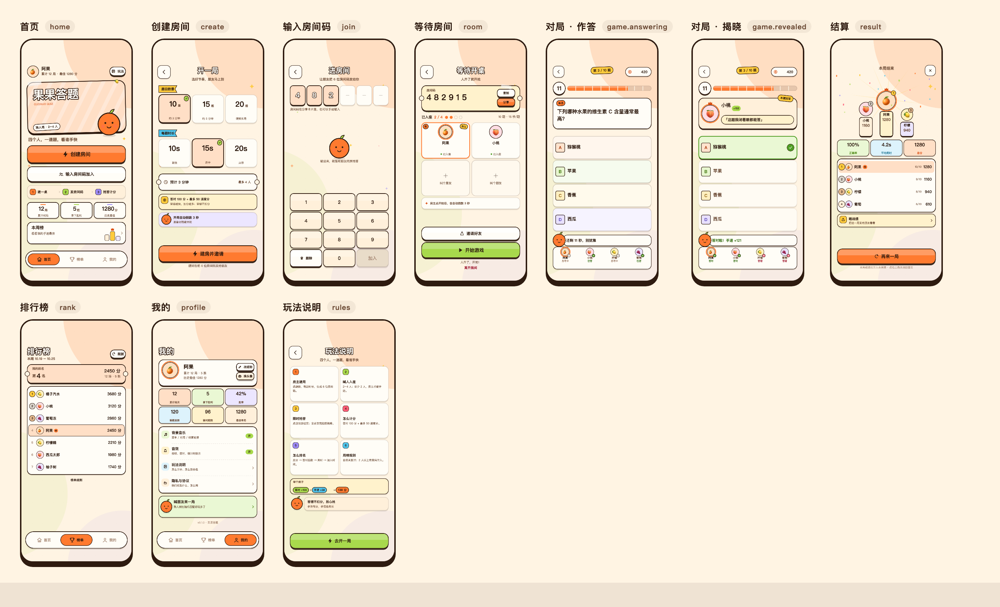

# 果果答题 · UI 基调：果汁街机

> v0.2 · 2026-10-26 · 纯 Canvas 绘制
> 适用端：微信小游戏（`minigame/`）。旧 WXML 小程序版（`miniprogram/`）不再跟进这套视觉。

## 0. 一句话基调

**把答题做成一张贴满水果贴纸的街机台。**

奶油纸底、深可可粗描边、实心投影、歪一点的小徽章；按下去会「咔哒」一下，答对了会有撒花和光线。不是表单，是一台摆在水果摊上的小街机。

### 关键词

**奶油 · 可可 · 贴纸 · 硬投影 · 果冻 · 手账**

### 刻意避开

- 不是电竞黑 / 荧光绿 / 赛博紫。
- 不是玻璃拟态、大面积渐变、复杂插画。
- 不是「白卡片 + 浅色按钮」的表单风。
- 不靠颜色单独传达对错（必须同时有 ✓/✗ 与文字）。

---

## 1. 为什么改

旧版是「白卡片 + 浅橙描边按钮 + 大字标题」，信息清楚但缺少游戏该有的**轮廓、重量和反馈**：

| 旧版 | 新版 |
|---|---|
| 白卡片 + 细边 | 奶油纸底 + 深可可描边 + 实心投影 |
| 扁按钮 | 有厚度、能按下去的贴纸按钮 |
| Emoji 当插画 | 纯 Canvas 画的果果吉祥物 |
| 一屏文字 | 徽章、丝带、胶带、小票、分段计时条 |
| 静态 | 按压、呼吸、光线、撒花、倒计时 |

---

## 2. 五个视觉锚点

1. **奶油纸底**：`#FFF4E3`，叠三块大色斑（橙 / 青柠 / 葡萄，6–18% 透明）+ 稀疏网点，避免整屏死板。
2. **深可可描边**：`#2E1B10`，面板 3–5rpx、按钮 4rpx、徽章 3rpx。描边是层级，不靠阴影模糊。
3. **实心投影**：按钮向下 `10rpx` 的实心可可色；面板用 10% 透明度的偏移阴影。不用大面积 `shadowBlur`。
4. **贴纸徽章**：旋转 −8°~8°、故意探出卡片边缘、带 3rpx 描边和小硬阴影。
5. **果果吉祥物**：橙子小人（`ui.mascot`），有 happy / wow / cool 三种表情，会轻轻呼吸。

---

## 3. Token

### 3.1 颜色

| Token | 值 | 用途 |
|---|---|---|
| `ink` | `#2E1B10` | 描边、主文字、硬投影 |
| `ink2` | `#6B4A35` | 次级文字（对比度 ≥ 4.5:1） |
| `ink3` | `#A98B77` | 占位、装饰文字 |
| `paper` | `#FFF4E3` | 页面底色 |
| `cream` | `#FFF0DA` | 浅色底块 / 幽灵按钮 |
| `card` | `#FFFDF7` | 卡片、按钮面 |
| `orange` | `#FF7A2F` | 品牌主色、主按钮、A 选项 |
| `orangeDeep` | `#DD4F12` | 主色上的深色文字、图标 |
| `orangeSoft` | `#FFDFC6` | 选中态、强调卡 |
| `lime` | `#A8D94C` | 开始游戏、正确答案、B 选项 |
| `butter` | `#FFCB3D` | 题号、胶带、C 选项 |
| `berry` | `#FF5D78` | 错误、紧迫计时 |
| `grape` | `#9C8BF7` | D 选项、邀请、次级强调 |
| `sky` | `#4FC4EC` | 时长、信息 |
| `successSoft` | `#EAF8D4` | 答对底色 |
| `dangerSoft` | `#FFE0E7` | 答错底色 |

> 规则：亮色块上一律用深可可文字，不用白字；白字只出现在「可可描边 + 亮色填充」的展示字上。

### 3.2 尺寸（rpx，750 设计宽）

| 项 | 值 |
|---|---|
| 页面左右边距 | 40 |
| 卡片圆角 | 28–34 |
| 按钮圆角 | 24（键帽）/ 高度一半（胶囊） |
| 描边 | 3（卡片）/ 4（按钮）/ 5（选中） |
| 硬投影位移 | 10（按钮）/ 8（面板） |
| 主按钮高度 | 100–116 |
| 次级按钮高度 | 84–100 |
| 最小点击热区 | 88 × 88 |
| 底部安全区 | `safeArea.bottom` + 20 |

### 3.3 字阶

| 用途 | 字号 | 字重 |
|---|---|---|
| 展示标题（带描边） | 48–78 | 800 |
| 页面标题 | 44–56 | 800 |
| 卡片标题 | 22–30 | 800 |
| 正文 | 20–30 | 400–600 |
| 辅助文字 | 18–21 | 500–700 |
| 徽章 / 标签 | 13–22 | 700–800 |

字体只用系统字体：`"PingFang SC", "Helvetica Neue", "Microsoft YaHei", sans-serif`。

---

## 4. 组件

### 4.1 面板 `ui.panel(x, y, w, h, opts)`

- 默认：`card` 填充 + 3rpx 可可描边 + 8rpx 偏移阴影。
- `shadow: 'hard'`：实心可可色投影，用于选中卡、领奖台、资料卡。
- `shadow: false`：纯色块，用于提示条、内嵌区。
- `ticket`：左右各一个「咬一口」的半圆缺口，用于房间码、预计时长、我的排名。

### 4.2 按钮 `ui.button(app, id, label, x, y, w, h, opts)`

| 变体 | 用途 | 底色 |
|---|---|---|
| `primary` | 主操作 | 橙 |
| `lime` | 开始 / 加入 / 去开一局 | 青柠 |
| `secondary` | 次操作 | 白 |
| `ghost` | 键帽、弱操作 | 奶油 |
| `berry` / `grape` | 特殊强调 | 莓 / 葡萄 |
| `text` / `danger` | 文字链、离开房间 | 透明 |

交互：按下整体下移 6rpx、投影缩到 3rpx，约 90ms；同时轻震动（`wx.vibrateShort`）。

### 4.3 徽章与丝带

- `ui.badge`：胶囊或圆角贴纸，可旋转、可带硬阴影。用于「房主」「我」「+138」「刚刚」。
- `ui.ribbon`：左平右尖的小旗，用于「题目数量」「每题时长」。
- `ui.chip`：浅描边胶囊，用于「10 题 · 15 秒/题」这类元信息。
- `ui.tape`：半透明手账胶带，贴在卡片边缘。

### 4.4 头像与吉祥物

- `ui.avatar`：圆形 + 3rpx 描边；`ring` 时外圈再加 6rpx 橙环，用于「我」「第一名」。
- `ui.mascot`：橙子小人，`mood: 'happy' | 'wow' | 'cool'`；默认每 2.4s 呼吸一次。

### 4.5 对局组件

- **分段计时条** `ui.timerBar`：10 段，橙色 → 最后 5 秒转莓色；右侧数字徽章同步变莓色。
- **选项行**：A/B/C/D 字母方块（各自糖果色 + 黑白描边）+ 浅色底卡；提交橙、答对青柠、答错莓，右侧配 ✓/✗ 圆形图标。
- **玩家计分板**：底部整条面板，四人等分，头像 + 昵称 + 「思考中 / 已答 / 答对 / 答错」。
- **解说气泡**：果果趴在气泡左侧，文案随状态变化（「还剩 11 秒，别犹豫」「差一点，答案是 C」）。
- **揭晓冠军贴纸**：每题揭晓时盖住题卡（不挡选项和计分板），左头像 + 皇冠、昵称、本轮加分，下面一句嘲讽气泡（「轻松拿捏」「在座的各位都是乐色」），右上角「本题冠军」斜贴纸。冠军 = 本轮答对且手速最快的人，没人答对就不出现。文案按「冠军 + 轮次」确定性地取，**同一题所有人看到的是同一句**。

### 4.6 底部导航 `ui.footer`

浮起的白色胶囊条：3 个 tab，当前 tab 变成橙色胶囊 + 可可描边，图标与文字同时变色。

---

## 5. 页面

| # | 页面 | 主任务 | 关键视觉 |
|---|---|---|---|
| 1 | 首页 | 建房 / 加入 | 倾斜招牌、果果、三步开桌、本周榜 |
| 2 | 创建 | 选题数 / 时长 | 三张大选择卡、选中抬起 + ✓ 贴纸、时长小票、计分说明 |
| 3 | 加入 | 输 6 位码 | 6 个码位、拇指区键盘、果果引导 |
| 4 | 等待 | 开始游戏 | 房卡小票、2×2 座位、入座圆点、邀请 + 开始双按钮 |
| 5 | 对局 | 选一个 | HUD、分段计时、题卡、四选项、解说气泡、计分板 |
| 6 | 结算 | 再来一局 | 光线 + 撒花领奖台、三项数据、名次列表、晒战绩 |
| 7 | 排行榜 | 看名次 | 我的排名小票、金/银/铜名次币、我的高亮行 |
| 8 | 我的 | 改资料 | 大头像 + 六宫格数据、菜单（背景音乐 / 音效开关）、邀请卡 |
| 9 | 玩法 | 看懂规则 | 6 张 2×3 卡片 + 计分示例 + 果果提示 |
| 10 | 隐私 | 看完协议 | 双 tab、自适应高度的正文卡 |
| 11 | 加载 | 等待 | 光线、果果、品牌字、呼吸点 |

截图见 [`docs/ui/`](./ui/)。

---

## 6. 动效

| 动效 | 实现 | 时长 |
|---|---|---|
| 按压 | 按钮下移 6rpx、投影缩短 | 90ms |
| 吉祥物呼吸 | `sin(t/420)` 上下 2% | 2.4s 循环 |
| 结算光线 | 12 条射线缓慢旋转 | 9s 一圈 |
| 撒花 | 18 片确定性彩纸，轻微漂移 | 持续 |
| 倒计时 | 大数字 + 射线旋转 + 遮罩 | 3s |
| 紧迫计时 | 数字 / 计时条转莓色 | 最后 5s |
| 揭晓冠军 | 贴纸从 0.58 弹到 1，`easeOutBack` 带一点过冲，同时从下往上落定 | 0.3s |

动效只做「反馈」和「氛围」，不阻塞任何操作；低端机可整体降级（`ui.begin(..., { deco: false })`）。

---

## 7. Canvas 约定

- 设计稿按 **750rpx 宽**，`rpx(v) = v * windowWidth / 750`。
- 初始化时按 `pixelRatio` 放大画布并 `ctx.scale`，逻辑坐标始终是 CSS px。
- 顶部安全区取 `max(safeArea.top, 胶囊按钮 bottom + 4)`；底部取 `windowHeight - safeArea.bottom`。
- **不引入位图**：头像用 emoji，图标用路径，吉祥物用圆 / 贝塞尔曲线。
- 每帧重绘；`app.hits` 在 `ui.begin` 里清空后重建，点击按从后往前命中。
- API 降级：`ctx.ellipse`、`ctx.setLineDash` 等用 `if` 判空；圆角统一走 `arcTo`，不依赖 `roundRect`。
- 性能：大面积阴影只用实心偏移矩形；网点约 300 个 `fillRect`；单屏没有 `shadowBlur`。

---

## 8. 可读性与验收

- 正文与次级文字在奶油底上的对比度 ≥ 4.5:1。
- 正确 / 错误同时具备颜色、图标（✓/✗）和文字（「答对」「差一点」）。
- 所有可点区域 ≥ 88rpx（约 44pt）。
- 三种尺寸都要过：`375×812`、`375×667`、`320×568`；极矮屏自动隐藏「三步开桌 / 本周榜 / 计分示例」等非必要块。
- 一屏一个主任务：首页建房、等待开始、对局选一个、结算再来一局。

---

## 9. 与旧文档的关系

- 旧的 [`UI设计文档.md`](./UI设计文档.md) 描述的是 WXML 小程序版的布局与文案，**文案、页面结构、交互原则仍然有效**。
- 视觉层（色板、圆角、阴影、组件外观）以本文为准；冲突时本文优先。
- 旧文档中「不用大面积渐变、玻璃拟态、复杂插画」仍然成立；本文新增的是**描边、硬投影、贴纸徽章与吉祥物**。
