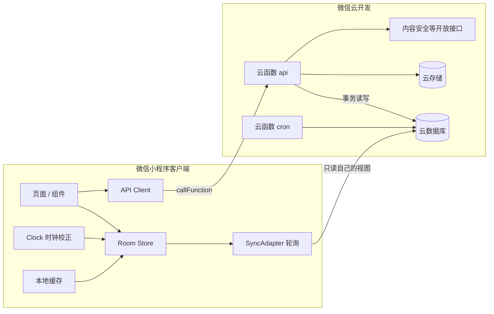
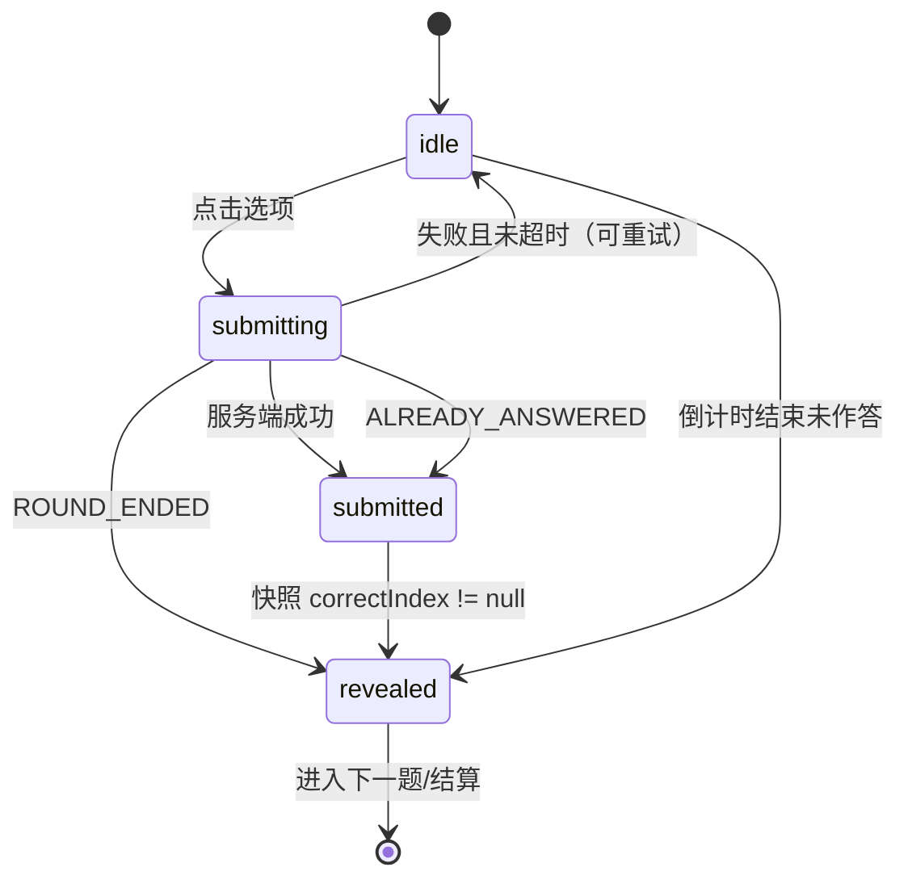
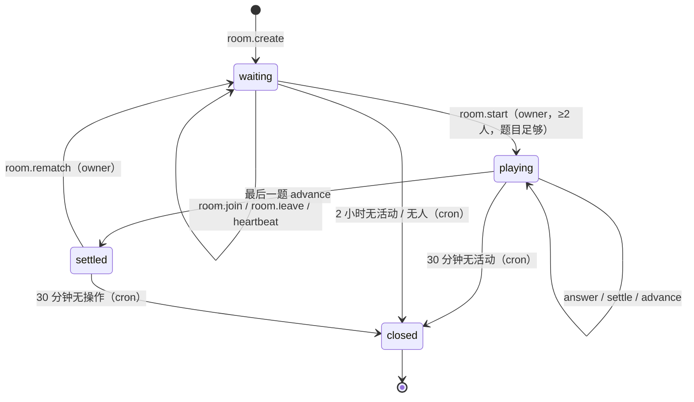
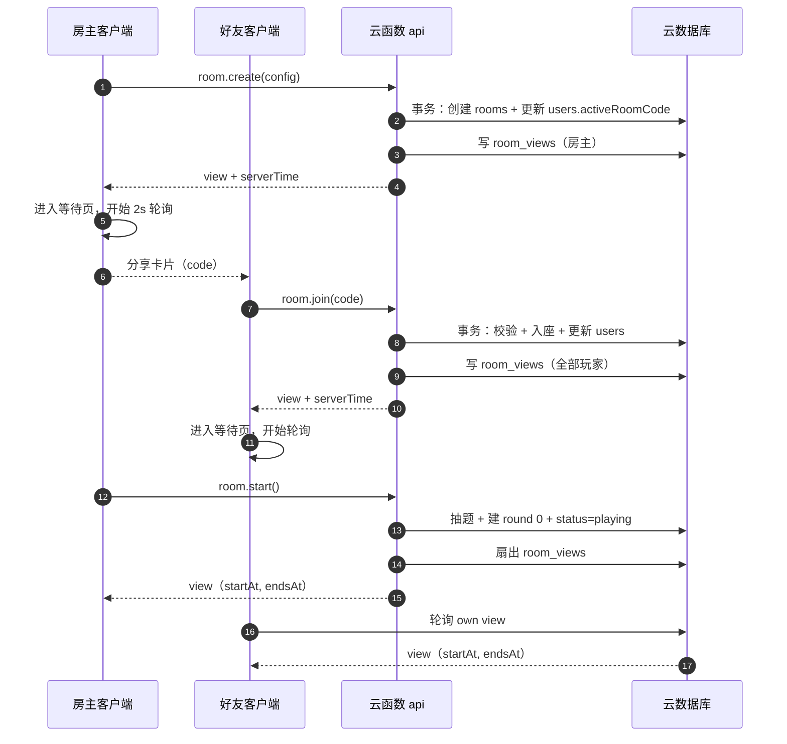
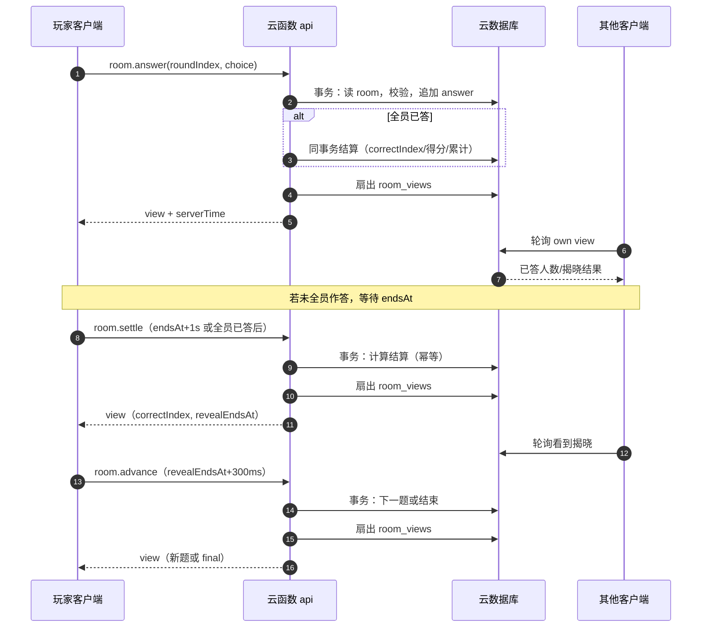
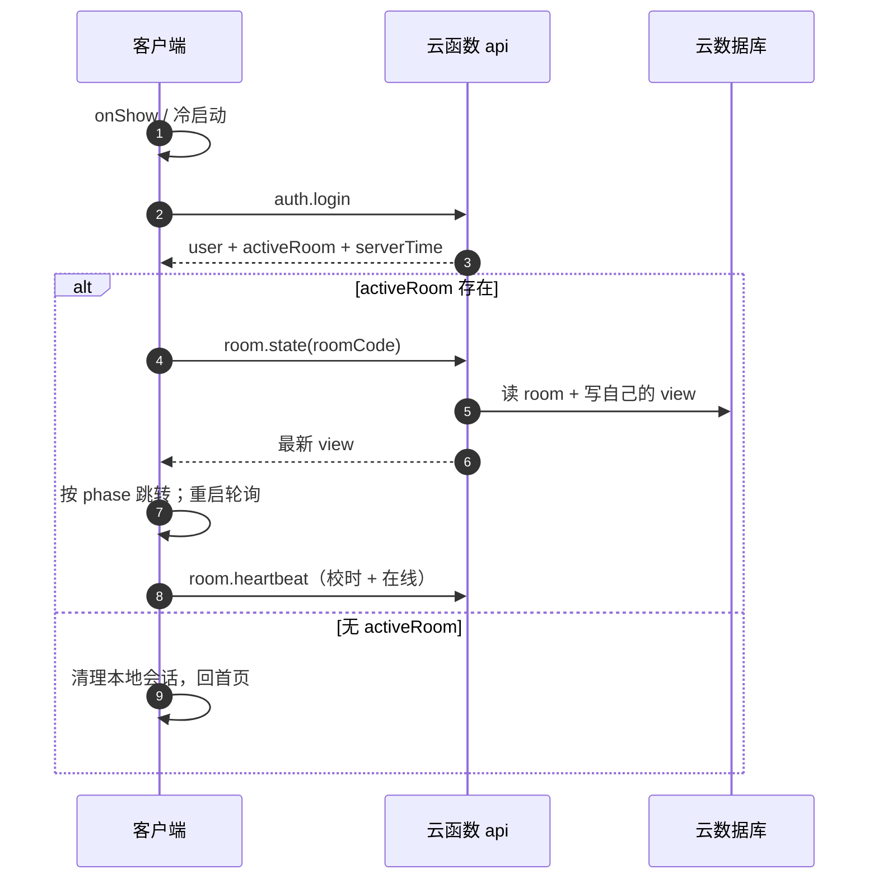
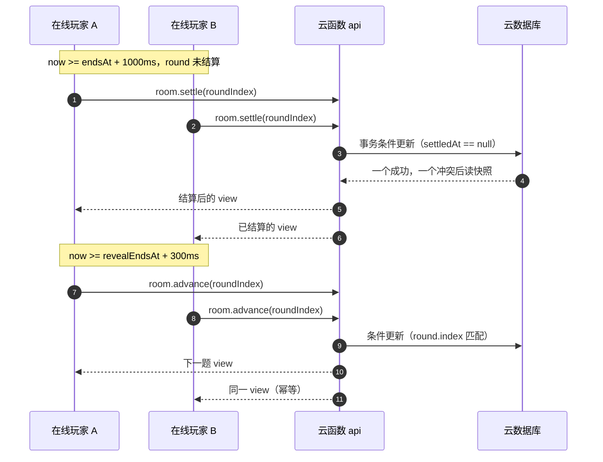

# 果果答题 · 技术实施文档

> 本文回答「怎么实现」：技术选型、架构、工程结构、数据模型、接口契约、状态机、事务与计时、测试与发布。产品范围与验收标准见 [需求文档](./需求文档.md)。

> **2026-10-23 实现变更**：由于账号为微信小游戏，客户端已用 Canvas 重写，源码在 `minigame/`；本文的云函数、数据模型、接口契约继续适用，WXML 页面/组件章节作为小程序版参考。

| 项目 | 内容 |
|---|---|
| 文档版本 | v0.1.0 |
| 文档状态 | 待评审 |
| 更新日期 | 2026-10-22 |
| 适用端 | 微信小程序（原生）+ 微信云开发 |
| 关联文档 | [需求文档](./需求文档.md) · [UI 设计文档](./UI设计文档.md) |
| 文档负责人 | 待定 |

## 修订记录

| 版本 | 日期 | 修改人 | 说明 |
|---|---|---|---|
| v0.1.0 | 2026-10-22 | 技术 | 首版：选型、数据模型、接口、状态机、测试与发布 |

> 说明：本仓库当前只有文档，没有小程序工程。文中的目录树、文件与脚本是**实施规划**，不是已存在的代码。

---

## 0. 阅读指引

### 0.1 本文与需求文档的关系

- 需求文档定义「做什么、什么算验收通过」。
- 本文定义「怎么实现、数据长什么样、接口怎么调、并发怎么保证」。
- 若两份文档冲突：产品行为以需求文档为准，技术实现细节以本文为准；冲突项必须回到评审记录中修正，不允许开发自行选择。

### 0.2 约定

- 时间戳统一为**毫秒级 Unix 时间**（number）；展示时按 Asia/Shanghai 格式化。
- 文中 JSON 示例的时间戳/ID 仅用于展示结构，不代表真实日期或真实用户。
- 字段命名统一 `camelCase`；数据库集合名用下划线复数（`room_views`），代码中的 action 用点号（`room.create`）。
- 所有服务端响应都带 `serverTime`，客户端不得用本地时间作为判分依据。
- 金额/积分均为整数；分数计算只在服务端进行。
- 「视图」= 服务端写给单个玩家的只读房间快照（`room_views` 文档）。
- 「房主」= `rooms.ownerId` 对应的玩家；转让只改 `ownerId`，不改座位。

### 0.3 目标读者

前端开发、云开发开发、测试、运维/发布负责人。读完后应能直接拆任务，不再需要口头补充关键决策。

---

## 1. 技术选型

### 1.1 选型结论

| 层 | 选择 | 理由 |
|---|---|---|
| 客户端形态 | 微信小程序原生 | 答题界面是表单/卡片型，WXML 开发效率高；无 Canvas 渲染负担；包体小 |
| 语言 | JavaScript（首版）；TypeScript（P1 迁移） | 首版避免引入构建链；页面/接口 DTO 以本文契约为准；后续可平滑迁移 TS |
| 样式 | WXSS + CSS 变量 | 设计 token 统一；不引入 Sass/Less 构建链 |
| 组件 | 自研轻量组件 | 页面数量少，避免第三方 UI 库的包体与风格绑定 |
| 状态 | 自研 100 行级 Store | 只有一个房间会话需要跨页共享，MobX/Redux 过重 |
| 后端 | 微信云开发 | 免服务器/备案；云函数直接拿 OPENID；云数据库 + 云存储 + 定时任务齐全 |
| 云函数 | Node.js 18 + JavaScript（CommonJS） | 免打包链，开发者工具直接上传；领域逻辑抽纯函数用 `node:test` 覆盖 |
| 数据库 | 云开发数据库（文档型） | 房间是天然聚合根；事务 + 条件更新满足 4 人并发 |
| 实时同步 | 客户端轮询自己的视图文档 | 免费额度友好、无连接数限制；1 秒级延迟对回合制答题足够 |
| 实时增强 | `watch`（P1，feature flag） | 配额允许时切换，降低延迟；不进入首发关键路径 |
| 测试 | `node:test` + 真机矩阵 + 开发者工具 | 零额外依赖；并发与弱网必须真机验证 |
| 发布 | 微信开发者工具 / miniprogram-ci | 小程序提审 + 云函数上传；可脚本化 |

### 1.2 方案对比

**客户端：原生 vs Taro/uni-app**

| 维度 | 原生 | Taro/uni-app |
|---|---|---|
| 包体 | 最小 | 运行时/编译产物增加 |
| 开发效率 | 表单页面足够快 | 多端才划算 |
| 调试 | 官方工具直接调试 | 多一层编译，问题定位变长 |
| 结论 | **采用** | 不采用（无多端需求） |

**后端：云开发 vs 自建 WebSocket**

| 维度 | 云开发 | 自建 Node + WebSocket + Redis |
|---|---|---|
| 运维 | 无 | 服务器、域名备案、证书、监控 |
| 实时性 | 轮询 1s；watch 可到百毫秒 | 原生 WebSocket，最低延迟 |
| 身份 | 云函数上下文直接取 OPENID | 需自建登录态/token |
| 成本 | 按量，早期低 | 固定服务器成本 + 人力 |
| 结论 | **首发采用** | 规模变大或需要 <300ms 同步时再评估 |

**同步：轮询 vs watch**

| 维度 | 轮询视图文档 | watch 实时推送 |
|---|---|---|
| 延迟 | 1s（对局）/ 2s（等待） | 通常 <500ms |
| 配额 | 只消耗数据库读 | 受实时推送并发连接数限制 |
| 复杂度 | 低，失败可退避 | 需处理连接生命周期、重连、配额 |
| 结论 | **首发采用** | P1 可选增强，接口预留 |

**云函数：JavaScript vs TypeScript**

| 维度 | JavaScript | TypeScript |
|---|---|---|
| 部署 | 直接上传，无构建 | 需 esbuild/tsc 打包 |
| 类型安全 | JSDoc 补足 | 编译期检查 |
| 调试 | 源码即产物 | 需 sourcemap |
| 结论 | **首发采用** | 领域复杂后再迁移 |

### 1.3 版本与依赖

| 项 | 版本/要求 | 说明 |
|---|---|---|
| 微信客户端 | ≥ 8.0 | 主流版本 |
| 小程序基础库 | ≥ 2.21.2 | 头像昵称填写能力、隐私接口 |
| 微信开发者工具 | 稳定版（最新） | 云开发面板、真机调试 |
| Node.js（云函数） | 18 | 云开发运行时；`node:test` 也可在本地 Node 18 跑 |
| `wx-server-sdk` | 最新稳定版 | 云函数内访问数据库、存储、开放接口 |
| 客户端 npm 依赖 | 仅 `miniprogram-api-typings`（dev） | 不引入运行时第三方库 |
| 云开发环境 | dev / prod 两个 | 数据与函数隔离 |

### 1.4 约束与假设

1. 小程序主包 ≤ 2MB、总包 ≤ 20MB（以平台当前限制为准）；首版不引入大图与第三方 UI 库。
2. 云函数存在冷启动（数百毫秒到数秒），首屏不能依赖「首个云函数返回后才渲染」；用骨架屏 + 预热调用。
3. 云开发数据库单文档有大小上限（以控制台为准）；`games` 只存必要逐题结果，不存题干全文。
4. 小程序不支持 WebSocket 服务端推送以外的自定义长连接；首发不引入云托管。
5. 所有客户端输入都可能被篡改；服务端必须重新校验。
6. 题库内容不在本期范围；开发环境提供 10 道占位题，生产题库由运营导入后再开放对局。

---

## 2. 总体架构

### 2.1 架构图



### 2.2 组件职责

| 组件 | 职责 | 不做的事 |
|---|---|---|
| 页面/组件 | 渲染、交互、订阅 Store | 不直接写数据库、不本地判分 |
| Room Store | 保存当前房间快照、版本、阶段；向页面广播 | 不发起业务请求（由页面/服务调用） |
| SyncAdapter | 按阶段轮询视图文档、退避、切后台暂停 | 不解析业务错误（交给上层） |
| Clock | 根据接口 `serverTime` 估算偏移，提供 `serverNow()` | 不决定胜负 |
| API Client | 统一 action 调用、超时、重试、错误映射 | 不做业务校验 |
| 云函数 api | 鉴权、校验、状态机、事务、计分、视图扇出 | 不渲染 UI |
| 云函数 cron | 清理过期房间、补偿榜单、清理事件 | 不处理用户实时请求 |
| 云数据库 | 权威数据：房间、用户、对局、榜单、题目 | 不直接向客户端暴露原始房间文档 |
| 云存储 | 用户头像 | 不存题目/答案 |

### 2.3 读写路径

**写路径（所有状态变更）**

```text
页面交互
  → api.callFunction({ action, data })
  → 云函数 api：校验 OPENID / 参数 / 状态
  → 数据库事务：更新 rooms（+ users/leaderboards/games）
  → 视图扇出：写 room_views/{roomCode}_{playerId}
  → 返回 { ok, data: snapshot, serverTime, version }
  → 客户端 Store 应用快照，页面重渲染
```

**读路径（对局同步）**

```text
SyncAdapter 定时器
  → 客户端直读 room_views/{roomCode}_{playerId}
  → 比较 version，应用较新的快照
  → 页面按 snapshot + serverNow() 渲染倒计时/阶段
```

**读路径（榜单）**

```text
排行榜页面
  → 客户端直读 leaderboards_weekly（公开只读）
  → 计算我的排名（两次 count 查询）
  → 30 秒缓存
```

### 2.4 信任边界

| 数据/操作 | 客户端 | 服务端 |
|---|---|---|
| openid | 不可见 | 从云函数上下文获取，唯一身份来源 |
| 正确答案 | 结算前不可见 | 存在 `rooms`，仅服务端可读 |
| 分数/排名 | 只展示 | 服务端计算并写入 |
| 房间状态 | 只读视图 | 事务内变更，版本号递增 |
| 数据库写 | 无权限 | 云函数管理员权限 |
| 时间 | 只用于显示 | 服务端 `Date.now()` 为唯一判分基准 |
| 房间码 | 可输入/可分享 | 服务端校验存在、状态、人数 |

### 2.5 关键设计决策（ADR）

| 编号 | 决策 | 原因 | 代价/缓解 |
|---|---|---|---|
| ADR-01 | 用小程序而非小游戏 | 表单型 UI 开发快、包体小；接受没有好友关系榜 | 排行榜为站内榜，已在 PRD 说明 |
| ADR-02 | 用云开发而非自建服务 | 免运维、直接拿 OPENID、早期成本低 | 实时性依赖轮询；P1 可切 watch |
| ADR-03 | 轮询每个玩家自己的视图文档 | 无连接配额、权限天然隔离、可按人裁剪字段 | 1s 延迟；读次数随房间数增长 |
| ADR-04 | 服务端权威计时与判分 | 防改时间、防篡改分数 | 客户端需做时钟校正；宽限 800ms |
| ADR-05 | 每个玩家一份 `room_views` 投影 | 不泄露答案/他人选择；读权限只按 openid | 每次状态变更最多 4 次写 |
| ADR-06 | 客户端触发超时结算/下一题 | 云函数定时器最小 1 分钟，太粗 | 依赖至少一个在线客户端；定时任务兜底关闭 |
| ADR-07 | 云函数 JS + 纯领域模块 | 免构建、易部署 | 用 JSDoc + 单测保证质量 |
| ADR-08 | 6 位数字房间码 | 口头/输入成本低 | 空间 90 万；靠失败限流防爆破 |

---

## 3. 工程结构

### 3.1 目录规划

```text
果果答题/
├── project.config.json          # 小程序项目配置（miniprogramRoot: miniprogram/）
├── project.private.config.json  # 本地私有配置（不入库）
├── README.md
├── docs/
│   ├── 需求文档.md
│   └── 实施文档.md
├── miniprogram/
│   ├── app.ts
│   ├── app.json
│   ├── app.wxss
│   ├── sitemap.json
│   ├── pages/
│   │   ├── home/
│   │   ├── create/
│   │   ├── join/
│   │   ├── room/
│   │   ├── game/
│   │   ├── result/
│   │   ├── rank/
│   │   ├── profile/
│   │   ├── rules/
│   │   └── privacy/
│   ├── components/
│   │   ├── nav-bar/
│   │   ├── fruit-avatar/
│   │   ├── player-seat/
│   │   ├── countdown-ring/
│   │   ├── option-card/
│   │   ├── code-input/
│   │   ├── primary-button/
│   │   ├── segmented/
│   │   ├── rank-row/
│   │   ├── podium/
│   │   ├── empty-state/
│   │   ├── loading-overlay/
│   │   └── confirm-modal/
│   ├── core/
│   │   ├── api.ts               # callFunction 封装、错误映射、重试
│   │   ├── store.ts             # 轻量订阅 store
│   │   ├── room-session.ts      # 房间会话与本地缓存
│   │   ├── sync.ts              # SyncAdapter + PollingAdapter
│   │   ├── clock.ts             # 时钟偏移与 serverNow
│   │   ├── router.ts            # 页面跳转与恢复决策
│   │   ├── logger.ts            # 日志与埋点
│   │   └── format.ts            # 时间/分数/文案格式化
│   ├── constants/
│   │   ├── config.ts            # 题数/时长枚举、默认值、上限
│   │   ├── errors.ts            # 错误码与文案
│   │   └── events.ts            # 埋点名
│   ├── types/
│   │   ├── api.d.ts             # action 请求/响应
│   │   └── models.d.ts          # RoomView/Player/Question 等
│   ├── styles/
│   │   ├── tokens.wxss          # CSS 变量
│   │   └── base.wxss            # 重置、工具类
│   └── assets/
│       ├── brand/               # 分享封面、空状态插画
│       └── icons/               # 少量线性图标
├── cloudfunctions/
│   ├── api/
│   │   ├── index.js
│   │   ├── package.json
│   │   ├── config.json          # 超时/环境变量（可选）
│   │   ├── lib/
│   │   │   ├── response.js
│   │   │   ├── errors.js
│   │   │   ├── validate.js
│   │   │   ├── time.js
│   │   │   ├── random.js
│   │   │   └── rate-limit.js
│   │   ├── domain/
│   │   │   ├── scoring.js
│   │   │   ├── ranking.js
│   │   │   ├── week.js
│   │   │   ├── room-state.js
│   │   │   └── view.js
│   │   ├── actions/
│   │   │   ├── auth.js
│   │   │   ├── user.js
│   │   │   ├── room.js
│   │   │   ├── rank.js
│   │   │   └── event.js
│   │   └── repo/
│   │       ├── rooms.js
│   │       ├── views.js
│   │       ├── users.js
│   │       ├── games.js
│   │       ├── questions.js
│   │       └── leaderboard.js
│   └── cron/
│       ├── index.js
│       ├── package.json
│       └── config.json          # 定时触发器
├── scripts/
│   ├── seed-questions.js        # 开发环境占位题（手动执行）
│   ├── deploy-functions.mjs     # 可选：miniprogram-ci 上传
│   └── check-docs.mjs           # 文档编号/围栏自检（临时）
└── tests/
    ├── domain/
    │   ├── scoring.test.js
    │   ├── ranking.test.js
    │   ├── week.test.js
    │   └── room-state.test.js
    └── fixtures/
```

### 3.2 环境配置

| 环境 | 用途 | 云环境 | 入口 |
|---|---|---|---|
| develop | 本地开发、开发者工具 | `guoguo-dev-xxxx` | `envVersion=develop` |
| trial | 体验版、内测 | `guoguo-prod-xxxx`（或独立 trial） | `envVersion=trial` |
| release | 正式版 | `guoguo-prod-xxxx` | `envVersion=release` |

客户端映射：

```ts
// constants/config.ts
const ENV_MAP = {
  develop: 'guoguo-dev-xxxx',
  trial: 'guoguo-prod-xxxx',
  release: 'guoguo-prod-xxxx',
};
export function cloudEnv() {
  const { envVersion } = wx.getAccountInfoSync().miniProgram;
  return ENV_MAP[envVersion] || ENV_MAP.develop;
}
```

规则：

- 体验版默认连生产数据，必须使用**真实可用的正式题库**或只读演示房间；禁止用体验版写入会污染周榜的测试对局。
- 开发环境允许 1 人开局（`DEBUG_ALLOW_SOLO=true`），生产环境强制 ≥2 人。
- 环境 ID 只放在客户端配置与云函数控制台，不写进文档仓库的公开内容。

### 3.3 命名与代码规范

| 类型 | 规范 | 示例 |
|---|---|---|
| 页面目录 | kebab-case | `pages/room/` |
| 组件 | kebab-case，`Component` 构造 | `components/option-card/` |
| 云函数 action | `域.动作` 小驼峰 | `room.create`、`room.answer` |
| 云函数内部文件 | kebab-case | `room-state.js` |
| 数据库集合 | 下划线复数 | `room_views`、`leaderboards_weekly` |
| 字段 | camelCase | `questionCount`、`endsAt` |
| 常量 | UPPER_SNAKE | `MAX_PLAYERS` |
| 错误码 | 数字段 + 常量名 | `3002` / `ROOM_FULL` |

- 客户端启用 `strict`，禁止 `any` 进入公共 DTO；页面私有数据可用 `any` 但需注释。
- 云函数领域模块不 import `wx-server-sdk`，保持可单测。
- 所有数据库写入必须设置 `updatedAt`；所有状态变更必须递增 `version`。
- 注释只解释「为什么」，不复述代码。

### 3.4 本地开发与调试

1. 微信开发者工具导入仓库根目录，`miniprogramRoot` 指向 `miniprogram/`，`cloudfunctionRoot` 指向 `cloudfunctions/`。
2. 开通云开发环境，创建集合与索引（见 5.13），部署 `api`/`cron`。
3. 执行 `scripts/seed-questions.js`（云函数或本地脚本）写入 10 道开发题。
4. 开发者工具「云函数本地调试」可断点调试 `api`；数据库用「模拟器」查看。
5. 真机调试：预览二维码 + 4 个微信号；体验版用于完整回归。
6. 调试开关：`DEBUG_ALLOW_SOLO`、`DEBUG_SHOW_ANSWER`（仅开发环境，生产构建剔除）。

## 4. 客户端设计

### 4.1 启动与路由

#### 启动顺序

```text
App.onLaunch(options)
  1. wx.cloud.init({ env, traceUser: true })
  2. 读取本地会话 roomSession
  3. 解析 options.query（分享 code / from）
  4. 调用 auth.login（同时预热云函数）
  5. 写入 user + clock.sync(serverTime)
  6. 决策：
     - 有 pendingJoinCode → 进入加入流程
     - 有 activeRoom → 按状态进入 waiting/playing/result
     - 有本地会话但无 activeRoom → 调 room.state 校验；失败则清理
     - 都没有 → 首页
  7. 预加载排行榜首页数据（可选，空闲时）
```

- 登录失败：展示全屏错误页，保留「重试」；本地有缓存用户时可浏览首页，但房间操作禁用。
- 云环境未初始化：开发环境直接抛出配置错误；生产环境展示「服务暂不可用」。
- 启动阶段不弹隐私授权、不弹更新提示；更新提示使用 `wx.getUpdateManager` 在首页空闲时检查（P1）。

#### 页面栈与跳转

| 从 | 到 | 方法 | 说明 |
|---|---|---|---|
| 首页 | 创建页 | `navigateTo` | 可返回 |
| 首页 | 加入页 | `navigateTo` | 可返回 |
| 创建页 | 等待页 | `redirectTo` | 创建后不允许回到创建页重复建 |
| 加入页 | 等待页 | `redirectTo` | 加入后替换，返回直达首页 |
| 等待页 | 对局页 | `redirectTo` | 开局后不允许返回等待页 |
| 对局页 | 结算页 | `redirectTo` | 结算后不允许回到对局 |
| 结算页 | 等待页 | `redirectTo` | 再来一局 |
| 结算页 | 首页 | `reLaunch` | 清空页面栈 |
| 任意 | 首页 | `reLaunch` | 房间关闭/被移出时 |

- 对局页、结算页使用 `navigationStyle: custom`：对局页返回按钮点击弹「退出本局？」确认，确认后调用 `room.leave` 并 `reLaunch` 首页；结算页左上角关闭直接回首页，避免返回到已结束的对局。
- 等待页返回首页：保留房间（不调用 leave），首页显示「继续游戏」；用户明确点「离开房间」才释放座位。
- 所有页面在 `onLoad` 校验必要参数（`code`），缺失时回首页。

#### 分享参数解析

```ts
// app.ts
let pendingJoinCode: string | null = null;

onLaunch(options) {
  pendingJoinCode = normalizeCode(options.query?.code);
  // ...
}

onShow(options) {
  const code = normalizeCode(options.query?.code);
  if (code && code !== currentRoomCode) {
    if (store.phase === 'playing' || store.phase === 'countdown') {
      wx.showToast({ title: '先打完当前这局', icon: 'none' });
    } else {
      pendingJoinCode = code;
      routeToJoin(code);
    }
  }
}
```

- 只信任 `code` 与 `from`；忽略 `nickName`、`score` 等参数。
- 冷启动时，`onLaunch` 与 `onShow` 可能都带参数，做去重。
- `normalizeCode`：提取连续 6 位数字并校验首位非 0。

### 4.2 页面与组件

#### 页面职责

| 页面 | 主要数据 | 主要动作 | 轮询 |
|---|---|---|---|
| home | user、activeRoom、本地缓存 | 创建/加入/恢复 | 否（onShow 刷新） |
| create | 本地配置 | room.create | 否 |
| join | code、加入状态 | room.join | 否 |
| room | RoomView | 分享、开始、离开、心跳 | 2s |
| game | RoomView + Clock | 提交、结算、推进 | 1s |
| result | RoomView.final | 再来一局、分享、返回 | 2s（等待再来一局/房间关闭） |
| rank | leaderboards、我的排名 | 切 Tab、下拉刷新 | 否（30s 缓存） |
| profile | user、本地设置 | 改资料、设置、清除缓存 | 否 |

#### 组件清单

| 组件 | Props | Events | 说明 |
|---|---|---|---|
| `nav-bar` | `title`, `back`, `theme`, `fixed` | `back` | 处理状态栏/胶囊；仅对局页用自定义 |
| `fruit-avatar` | `avatar`, `size`, `dim`, `ring` | `tap` | emoji/云存储头像，失败回退 |
| `player-seat` | `player`, `isOwner`, `isSelf`, `online`, `phase` | `tap`, `longpress` | 等待页座位/对局页状态 |
| `countdown-ring` | `remainingMs`, `durationMs`, `danger` | — | CSS conic-gradient + 数字 |
| `option-card` | `index`, `text`, `state` | `choose` | idle/selected/correct/wrong/disabled |
| `code-input` | `value`, `disabled` | `change`, `complete` | 6 格输入，支持粘贴 |
| `primary-button` | `text`, `loading`, `disabled`, `variant` | `tap` | 统一按钮 |
| `segmented` | `options`, `value` | `change` | 题数/时长选择 |
| `rank-row` | `rank`, `player`, `highlight` | `tap` | 榜单行 |
| `podium` | `top3` | — | 结算领奖台 |
| `empty-state` | `title`, `desc`, `actionText` | `action` | 空状态 |
| `loading-overlay` | `visible`, `text` | — | 全屏 loading |
| `confirm-modal` | `visible`, `title`, `content`, `confirmText` | `confirm`, `cancel` | 二次确认 |

组件原则：

- 组件只做展示与轻交互，不直接调用云函数；业务动作由页面处理。
- 组件不读全局 Store；通过 props 注入，避免隐式依赖。
- 所有可点击元素加 `hover-class`，按压反馈 120ms。

### 4.3 状态管理与数据投影

#### Store 形态

```ts
type Phase = 'waiting' | 'countdown' | 'answering' | 'revealed' | 'finished' | 'closed';

interface RoomState {
  roomCode: string | null;
  playerId: string | null;
  viewId: string | null;
  view: RoomView | null;
  version: number;
  phase: Phase;
  network: 'online' | 'unstable' | 'offline';
  lastSyncedAt: number;
}
```

Store API：

```ts
store.getState(): RoomState
store.subscribe(listener): () => void
store.applyView(view: RoomView): void
store.patch(partial: Partial<RoomState>): void
store.reset(): void
```

实现要点：

- 约 100 行：`state` + `listeners: Set<Function>` + `notify()`。
- 页面在 `onLoad` 订阅，在 `onUnload` 取消；避免页面隐藏后仍 setData。
- `applyView` 内部做版本比较与阶段推导，页面只消费结果。
- 不持久化整份 view 到本地（体积与过期问题）；只持久化 `roomCode/playerId/viewId/lastPhase`。

#### 快照类型（客户端视角）

```ts
interface RoomView {
  roomCode: string;
  playerId: string;          // 当前接收者的 playerId
  version: number;
  status: 'waiting' | 'playing' | 'settled' | 'closed';
  ownerId: string;
  config: { questionCount: number; durationSec: number; revealSec: number };
  players: PlayerView[];
  round: RoundView | null;
  final: FinalView | null;
  updatedAt: number;
}

interface PlayerView {
  playerId: string;
  nickName: string;
  avatar: Avatar;
  seat: number;
  score: number;
  correctCount: number;
  left: boolean;
  lastSeenAt: number;        // 用于计算在线
}

interface RoundView {
  index: number;             // 0-based
  total: number;
  stem: string;
  options: [string, string, string, string];
  startedAt: number;
  endsAt: number;
  revealEndsAt: number | null;
  correctIndex: number | null;   // 结算前为 null
  explain: string | null;
  myChoice: number | null;
  myCorrect: boolean | null;
  myGain: number | null;
  answeredCount: number;
  activeCount: number;
  perPlayer: Array<{
    playerId: string;
    answered: boolean;
    correct: boolean | null;
    gain: number | null;
  }>;
}

interface FinalView {
  rankings: Array<{
    rank: number;
    playerId: string;
    nickName: string;
    avatar: Avatar;
    score: number;
    correctCount: number;
    correctTimeMs: number;
    left: boolean;
  }>;
  winnerId: string;
  finishedAt: number;
}
```

> 完整字段定义与示例见 5.5；客户端类型必须与本文一致，不允许自行加字段。

#### 阶段推导

```ts
function derivePhase(view: RoomView, now: number): Phase {
  if (view.status === 'waiting') return 'waiting';
  if (view.status === 'settled') return 'finished';
  if (view.status === 'closed') return 'closed';
  const r = view.round;
  if (!r) return 'waiting';
  if (now < r.startedAt) return 'countdown';
  if (now < r.endsAt) return 'answering';
  return 'revealed';
}
```

- `now = clock.serverNow()`。
- 阶段由「服务端时间 + 快照」派生，不单独存服务端阶段字段，避免客户端状态机分叉。
- 页面根据阶段切换 UI；同一阶段内只做数值更新。

#### 版本合并

```ts
function applyView(view: RoomView) {
  const cur = state.view;
  if (cur && view.roomCode === cur.roomCode && view.version < cur.version) return;
  if (cur && view.roomCode === cur.roomCode && view.version === cur.version
      && view.updatedAt <= cur.updatedAt) return;
  state.view = view;
  state.version = view.version;
  state.phase = derivePhase(view, clock.serverNow());
  notify();
}
```

- 版本相同但 `updatedAt` 更新（心跳扇出）也允许覆盖，保证在线状态刷新。
- 房间码变化时先 `reset()` 再应用，避免旧房间数据串台。

### 4.4 轮询同步

#### 适配器接口

```ts
interface SyncAdapter {
  start(viewId: string, phase: Phase): void;
  stop(): void;
  refresh(): Promise<RoomView | null>; // 立即拉一次
  onView(cb: (view: RoomView) => void): void;
  onError(cb: (err: SyncError) => void): void;
}
```

首发实现 `PollingAdapter`；P1 可加 `WatchAdapter`（`db.collection('room_views').doc(viewId).watch()`），两者对 Store 暴露相同接口。

#### 轮询间隔

| 阶段 | 间隔 | 说明 |
|---|---|---|
| waiting | 2000ms | 成员变化不频繁 |
| countdown | 500ms | 开局瞬间，尽快追平 |
| answering | 1000ms | 平衡延迟与读次数 |
| revealed | 800ms | 等待下一题/结算 |
| finished | 2000ms | 结算页等待房主再来一局或房间关闭；游戏页在跳转后停止 |
| closed | 停止 | 页面跳转 |
| 小程序后台 | 停止 | `onAppHide` |
| 网络异常 | 退避 1/2/4/8/10s | 恢复后回到阶段间隔 |

- 使用 `setTimeout` 链，不用 `setInterval`，避免请求堆叠。
- 单次请求 6 秒超时；超时按失败处理。
- 页面切换时由 Store/会话统一管理轮询，不按页面重复启动。

#### 轮询伪代码

```ts
class PollingAdapter implements SyncAdapter {
  private timer: number | null = null;
  private stopped = true;
  private inFlight = false;
  private failures = 0;

  async tick() {
    if (this.stopped || this.inFlight) return;
    this.inFlight = true;
    try {
      const res = await db.collection('room_views').doc(this.viewId).get();
      this.failures = 0;
      this.emitView(res.data as RoomView);
      this.emitNetwork('online');
    } catch (err) {
      if (isDocNotFound(err)) return this.emitGone();
      this.failures++;
      this.emitNetwork(this.failures >= 3 ? 'unstable' : 'online');
      if (this.failures >= 3) this.emitError(err);
    } finally {
      this.inFlight = false;
      this.schedule();
    }
  }

  schedule() {
    if (this.stopped) return;
    const base = INTERVAL[this.phase] ?? 1000;
    const delay = this.failures === 0
      ? base
      : Math.min(10000, 1000 * 2 ** (this.failures - 1));
    this.timer = setTimeout(() => this.tick(), delay);
  }
}
```

#### 生命周期

- `auth.login` 或进入房间成功后拿到 `viewId` → `sync.start(viewId, phase)`。
- `onAppShow` → `sync.refresh()` + 恢复轮询；同时调用一次 `room.heartbeat` 校时。
- `onAppHide` → `sync.stop()`；停止倒计时 UI 定时器。
- 离开房间/结算后返回首页 → `sync.stop()` + `store.reset()` + 清本地会话。
- 对局页 `onUnload` 不停止轮询（可能跳结算页）；由会话层统一管理。

#### 退避与恢复

- 3 次连续失败：顶部离线条；页面保留最后一次快照，倒计时继续按本地时钟走。
- 30 秒仍失败：展示「重连」按钮；点击立即 `refresh()`；仍失败可返回首页（房间保留）。
- 网络恢复（`wx.onNetworkStatusChange`）立即 `refresh()` 并重置退避。
- 收到 `room_views` 文档不存在：调用 `room.state` 确认；若房间已关闭则清理并跳首页。

#### 读成本估算

- 4 人对局 8 分钟，1s 轮询：4 × 480 ≈ 1920 次读/局。
- 1000 局/日 ≈ 192 万次读/日。
- 优化：后台停止、游戏页跳转后停止、结算页 2s、等待 2s、视图文档 < 4KB；P1 切 watch 可显著降低读次数。

### 4.5 时钟同步与倒计时

#### 偏移估算

```ts
// 每次接口响应
const t0 = Date.now();
const res = await callFunction(...); // 含 envelope.serverTime
const t1 = Date.now();
const sample = res.serverTime - (t0 + t1) / 2;
clock.addSample(sample);
```

- 保留最近 5 个样本，取中位数作为 `offset`，降低网络抖动影响。
- 单次样本与当前 offset 相差 > 5000ms 时（用户改系统时间/时区），清空样本重新采样。
- `serverNow() = Date.now() + offset`；`offset` 初始为 0，登录响应后立即校正。
- 心跳每 15 秒返回 `serverTime`，持续校正；页面显示不因偏移跳变而闪烁（变化 < 200ms 不重绘）。

#### 倒计时渲染

- 每 200ms 计算一次 `remaining = endsAt - serverNow()`，但只在整数秒变化或环形进度变化 ≥ 1% 时 `setData`。
- 显示：`Math.max(0, Math.ceil(remaining / 1000))` 秒。
- 环形进度：`progress = clamp(remaining / durationMs, 0, 1)`，用 CSS 变量 `--p` 更新。
- 最后 5 秒：数字变红、脉冲；`remaining <= 5000` 时每秒振动一次（受设置控制）。
- `remaining <= 0`：立即禁用选项、停止振动、显示「时间到，等待揭晓」。

#### 关键触发

| 时间点 | 动作 | 幂等保护 |
|---|---|---|
| `endsAt + 1000ms` 且本轮未结算 | 调用 `room.settle` | 服务端检查 `settledAt` 与 `now` |
| `revealEndsAt + 300ms` 且仍在揭晓 | 调用 `room.advance` | 服务端检查 `roundIndex` 与 `revealEndsAt` |
| 全员已答（快照 `answeredCount === activeCount`） | 立即调用 `room.settle` | 同上 |
| 回前台且已过时间点 | 立即补触发 | 同上 |

- 触发前检查当前快照版本，避免用旧回合参数请求新回合。
- 请求失败不阻塞 UI；下一次轮询或回前台会再次触发。
- 只有在线玩家触发；房主不在线不影响。

#### 时钟异常

- 用户手动改时间：offset 重新采样后，倒计时可能跳变；以服务端状态为准，不补答。
- 时区变化：不影响毫秒时间；展示时间（开始时间）按 Asia/Shanghai 格式化。
- 客户端时间倒退：`serverNow()` 可能倒退，倒计时计算使用 `Math.max(0, ...)`；提交仍以服务端为准。

### 4.6 答题交互状态机



规则：

1. 点击选项：
   - 立即置为 `submitting`，选项显示选中态，其他选项禁用。
   - 生成 `{ roomCode, roundIndex, choice }`，6 秒超时，最多自动重试 1 次（相同参数）。
   - 成功后 `submitted`；`ALREADY_ANSWERED` 视为成功；`ROUND_ENDED` 拉取快照进入揭晓。
2. 失败且仍在本轮时间窗内：回到 `idle` 并保留轻提示「没提交上，再点一次」。
3. 已提交后不允许再次点击；服务端幂等，客户端也做防抖。
4. 揭晓阶段所有选项禁用，点击无响应。
5. 页面切后台不改变状态；回前台按快照校正（可能直接 `revealed`）。

### 4.7 分享、隐私与异常

#### 分享

每个页面实现 `onShareAppMessage`：

```ts
onShareAppMessage() {
  const { roomCode, view } = store.getState();
  if (roomCode && view?.status === 'waiting') {
    return {
      title: `${view.players.find(p => p.playerId === view.ownerId)?.nickName} 喊你来答题，房间 ${roomCode}`,
      path: `/pages/join/index?code=${roomCode}&from=share`,
      imageUrl: '/assets/brand/share-cover.png',
    };
  }
  return {
    title: '四个人，一道题，看谁手快',
    path: '/pages/home/index?from=share',
    imageUrl: '/assets/brand/share-cover.png',
  };
}
```

- 分享标题中的昵称来自服务端快照，不拼接用户输入之外的敏感信息。
- 分享按钮使用 `<button open-type="share">`；点击埋点 `share_click`。
- `onShareTimeline`（P1）返回 `{ title, query }`，进入统一落首页。
- 封面图 ≤ 200KB，5:4 比例，避免文字过多。

#### 隐私授权

- `app.json` 开启 `__usePrivacyCheck__: true`（以官方当前配置项为准）。
- `app.ts` 注册 `wx.onNeedPrivacyAuthorization`，展示自定义隐私弹窗（协议链接 + 同意/拒绝）。
- 同意按钮使用 `open-type="agreePrivacyAuthorization"`，通过 `resolve({ buttonId, event: 'agree' })` 返回；拒绝则 `disagree`，功能降级为默认资料。
- 在调用头像/昵称能力前调用 `wx.requirePrivacyAuthorize`；失败时提示并退回默认资料。
- 低版本基础库不支持隐私接口时，跳过弹窗，直接使用默认资料。

#### 异常与日志

| 异常 | 处理 |
|---|---|
| `wx.onError` | 生成 `traceId`，限流上报 `client_error`，控制台打印 |
| `wx.onUnhandledRejection` | 同上，附加页面路径 |
| API 返回已知错误码 | 映射文案 + 可选操作；不弹原始错误 |
| API 返回未知错误 | 提示「服务开小差了」+ 上报；保留当前页面 |
| 页面参数缺失 | `reLaunch` 首页 |
| 连续轮询失败 | 离线条 + 重连按钮，不清空快照 |
| 本地缓存损坏 | 捕获解析异常，清空会话，回首页 |

- `traceId` 由客户端生成（时间戳 + 随机 6 位），随请求传入 `requestId`，服务端日志透传。
- 日志不打印完整 openid、昵称、头像 URL。

### 4.8 设计系统实现

#### Design token

```css
/* styles/tokens.wxss — 完整视觉规范见 UI 设计文档 2.9 */
page {
  --color-bg: #FFF8F0;
  --color-surface: #FFFFFF;
  --color-surface-2: #FFFDF9;
  --color-primary: #FF7A45;
  --color-primary-ink: #B7410E;
  --color-primary-soft: #FFF0E6;
  --color-primary-border: #FFD3BF;
  --color-primary-dark: #E85D2A;
  --color-on-primary: #2D1A10;
  --color-text: #2D2A26;
  --color-text-2: #6F6259;
  --color-text-3: #9A8C80;
  --color-border: #F0E4D8;
  --color-divider: #F5EAE1;
  --color-disabled-bg: #F6D9CC;
  --color-disabled-text: #8A6A5C;

  --color-success: #2FBF71;
  --color-success-soft: #EAF9F0;
  --color-success-ink: #1C7C46;
  --color-danger: #F2545B;
  --color-danger-soft: #FFF0F1;
  --color-danger-ink: #C02C36;
  --color-warning: #F5A623;
  --color-warning-soft: #FFF6E5;
  --color-warning-ink: #9A6200;
  --color-info: #4E8CFF;
  --color-info-soft: #EAF1FF;
  --color-info-ink: #2F5FD0;

  --option-a: #4E8CFF;
  --option-a-soft: #EAF1FF;
  --option-a-ink: #2F5FD0;
  --option-b: #2FBF71;
  --option-b-soft: #E8F8EF;
  --option-b-ink: #1C7C46;
  --option-c: #F5A623;
  --option-c-soft: #FFF6E5;
  --option-c-ink: #9A6200;
  --option-d: #8B5CF6;
  --option-d-soft: #F1ECFF;
  --option-d-ink: #5B3DBD;

  --space-1: 8rpx;
  --space-2: 16rpx;
  --space-3: 24rpx;
  --space-4: 32rpx;
  --space-5: 40rpx;
  --space-6: 48rpx;
  --space-8: 64rpx;

  --radius-xs: 12rpx;
  --radius-sm: 16rpx;
  --radius-md: 20rpx;
  --radius-lg: 24rpx;
  --radius-xl: 32rpx;
  --radius-2xl: 40rpx;
  --radius-pill: 999rpx;

  --shadow-card: 0 8rpx 24rpx rgba(122, 63, 32, 0.08);
  --shadow-float: 0 16rpx 40rpx rgba(122, 63, 32, 0.14);
  --shadow-btn: 0 12rpx 28rpx rgba(255, 122, 69, 0.28);

  --duration-fast: 120ms;
  --duration-base: 200ms;
  --duration-slow: 320ms;
  --ease-out: cubic-bezier(0.2, 0.8, 0.2, 1);
}
```

- 组件样式只引用变量，不写死颜色；新增颜色先加 token。
- 主按钮使用 `--color-on-primary` 深可可文字，不使用白字；详见 UI 文档 3.3。
- 深色模式（P2）通过 `@media (prefers-color-scheme: dark)` 覆盖变量。

#### 布局与安全区

- 页面根容器 `min-height: 100vh; padding-bottom: env(safe-area-inset-bottom);`。
- 自定义导航高度 = `statusBarHeight + 44px`；胶囊位置用 `wx.getMenuButtonBoundingClientRect()` 对齐。
- 底部固定按钮：`position: fixed; bottom: calc(env(safe-area-inset-bottom) + 24rpx);`，内容区预留等高 padding。
- 仅竖屏：`app.json` 的 `window.pageOrientation` 不配置横屏；页面不写横屏布局。

#### 倒计时环形

- 使用 `conic-gradient(var(--color-primary) calc(var(--p) * 1turn), rgba(0,0,0,.06) 0)`。
- `--p` 由 JS 每 250ms 更新；数字与环共用同一 `remainingMs`，避免不同步。
- 低端机/不支持 conic-gradient 时降级为横向进度条 + 数字，逻辑不变。
- 最后 5 秒切换 `--color-danger` 并加 `animation: pulse 1s infinite`；尊重系统「减少动态效果」时可关闭脉冲（P1）。

#### 头像与图标

- `fruit-avatar` 统一渲染：`type=emoji` 时显示 emoji + 背景色；`type=cloud` 时 `<image>` 加载，失败回退到默认 emoji。
- 头像圆形裁剪 `border-radius: 50%`；描边 4rpx 白色，保证深色背景可见。
- 图标首版用 emoji（🏆 ⏱️ 🔗 📤），统一 `font-size` 与基线；P1 替换为线性 PNG/iconfont。
- 所有图片资源提供 2x/3x 或使用 SVG 转 PNG，避免模糊。

#### 无障碍

- 选项整卡可点，热区 ≥ 88rpx；字母徽标不作为唯一信息。
- 正确/错误同时使用颜色 + ✓/✗ + 文案「正确/你的选择」。
- 对比度 ≥ 4.5:1；主色文字不使用纯橙在小字号上。
- 支持系统字体放大：文字容器不使用固定高度；按钮最小高度 88rpx。

### 4.9 性能与资源

| 项 | 策略 |
|---|---|
| 首屏 | 骨架屏先渲染；`auth.login` 与首页静态资源并行；云函数预热 |
| setData | 只更新变化字段（`view.players[0].score` 等）；倒计时单独字段；避免整对象重设 |
| 轮询 | 后台/游戏页停止；结算页 2s；等待 2s；失败退避；P1 watch |
| 包体 | 无第三方 UI 库；emoji 头像；封面图 ≤ 200KB；图标 ≤ 20KB |
| 图片 | 头像上传前压缩到 ≤ 200KB；展示用 `mode="aspectFill"`；懒加载榜单头像（P1） |
| 内存 | 只保留一份 RoomView；退出房间清空；不缓存历史对局全文 |
| 启动 | 不在 `onLaunch` 做同步阻塞；非关键请求延后到首页 `onReady` |
| 分包 | 首版不分包；若主包接近 1.8MB，将 rank/profile/rules 放入分包（P1） |
| 监控 | 记录首屏耗时、登录耗时、轮询失败率、提交耗时 |

## 5. 服务端设计

### 5.1 云函数入口与路由

#### 函数划分

| 函数 | 触发 | 职责 | 建议配置 |
|---|---|---|---|
| `api` | 小程序 `callFunction` | 登录、资料、房间、答题、结算、事件上报 | 超时 10s，内存 256MB |
| `cron` | 定时触发器 | 清理房间、补偿榜单、清理事件 | 超时 60s，内存 256MB |

- 首发不拆多个业务函数：单入口减少冷启动与部署成本，action 路由保持清晰。
- `cron` 与 `api` 不共享可变内存；共享 `domain/` 纯逻辑通过复制或同仓引用（部署时各自打包）。

#### `api/index.js` 结构

```js
const cloud = require('wx-server-sdk');
const { ok, fail } = require('./lib/response');
const { AppError, ERR } = require('./lib/errors');

cloud.init({ env: cloud.DYNAMIC_CURRENT_ENV });
const db = cloud.database();

const routes = {
  'auth.login': require('./actions/auth').login,
  'user.updateProfile': require('./actions/user').updateProfile,
  'user.updateSettings': require('./actions/user').updateSettings, // P1
  'room.create': require('./actions/room').create,
  'room.join': require('./actions/room').join,
  'room.state': require('./actions/room').state,
  'room.heartbeat': require('./actions/room').heartbeat,
  'room.leave': require('./actions/room').leave,
  'room.start': require('./actions/room').start,
  'room.answer': require('./actions/room').answer,
  'room.settle': require('./actions/room').settle,
  'room.advance': require('./actions/room').advance,
  'room.rematch': require('./actions/room').rematch,
  'room.kick': require('./actions/room').kick, // P1
  'rank.meta': require('./actions/rank').meta,
  'rank.weekly': require('./actions/rank').weekly,
  'event.report': require('./actions/event').report,
};

exports.main = async (event = {}, context) => {
  const startedAt = Date.now();
  try {
    const action = String(event.action || '');
    const handler = routes[action];
    if (!handler) throw new AppError(ERR.UNKNOWN_ACTION);

    const { OPENID } = cloud.getWXContext();
    if (!OPENID) throw new AppError(ERR.UNAUTHORIZED);

    const ctx = {
      openid: OPENID,
      db,
      cloud,
      now: Date.now(),
      requestId: String(event.requestId || ''),
      clientVersion: String(event.clientVersion || ''),
    };
    const data = await handler(event.data || {}, ctx);
    return ok(data, ctx.now);
  } catch (err) {
    const normalized = normalizeError(err);
    console.error('[api]', event.action, normalized.code, normalized.message, {
      requestId: event.requestId,
      durationMs: Date.now() - startedAt,
      stack: normalized.stack,
    });
    return fail(normalized, Date.now());
  }
};
```

#### 统一响应

```ts
interface ApiResponse<T> {
  ok: boolean;
  data?: T;
  error?: { code: number; name: string; message: string; retryable: boolean };
  serverTime: number; // 毫秒时间戳
  version?: number;   // 房间操作时返回
}
```

- 成功：`{ ok: true, data, serverTime }`。
- 失败：`{ ok: false, error, serverTime }`；HTTP 状态始终为 200（`callFunction` 语义）。
- 错误对象必须包含稳定的 `code`、`name`、用户可读 `message`、`retryable`。
- 未知异常统一转 `5000 SYSTEM_ERROR`，不把堆栈返回给客户端。

#### 超时与重试

- 客户端 6 秒超时；云函数超时 10 秒，留出余量。
- 幂等 action 客户端最多重试 1 次：`room.state`、`room.heartbeat`、`room.answer`（同参数）、`room.settle`、`room.advance`、`room.rematch`。
- `auth.login` 允许重试 2 次（1s/2s 退避），仍失败进入错误页。
- 非幂等 action 不自动重试：`room.create`、`room.join`、`room.leave`、`user.updateProfile`、`user.updateSettings`（P1）。
- 超时后客户端先拉 `room.state` 确认真实状态，再决定是否重试，避免「已成功但响应丢失」造成重复操作。

### 5.2 鉴权、校验与限流

#### 身份

- 唯一身份来源：`cloud.getWXContext().OPENID`。
- 不接受客户端传入的 openid、playerId、房主标记、分数。
- 用户不存在时：`auth.login` 自动创建；其他 action 返回 `USER_NOT_FOUND`，客户端先登录。

#### 参数校验

| 参数 | 规则 |
|---|---|
| `roomCode` | 字符串，`/^[1-9]\d{5}$/` |
| `config.questionCount` | 10 / 15 / 20 |
| `config.durationSec` | 10 / 15 / 20 |
| `config.category` | 首发仅 `general` |
| `roundIndex` | 整数，≥ 0，且等于服务端当前回合 |
| `choice` | 整数 0–3 |
| `nickName` | 去首尾空格后 2–12 个 Unicode 字符，非纯空白 |
| `avatar` | emoji：8 个白名单之一 + 背景色；cloud：`cloud://` 开头且属于当前环境 |
| `events[]` | 数组，≤ 20 条；每条 name 在白名单 |

- 校验失败抛 `INVALID_PARAM`，附带字段名（开发环境）或通用文案（生产）。
- 不把用户输入直接拼进数据库查询；所有查询使用固定字段与参数化值。

#### 权限

| 检查 | 规则 |
|---|---|
| 是否房间成员 | `players[].openid === ctx.openid` 且 `left !== true` |
| 是否房主 | `room.ownerId === ctx.openid` |
| 是否可操作回合 | 当前 `round.index === roundIndex` 且 `round.settledAt == null`（或已结算的幂等分支） |
| 是否可加入 | 房间 `waiting`、人数 < 4、未被踢、用户无其他 `playing` 房间 |

- 所有写操作在事务内重新读取并校验，不信任事务外的检查结果。
- 房主权限只用于 `start`、`rematch`、`kick`；答题/离开对所有人一致。

#### 限流

| 动作 | 窗口 | 上限 | 超限错误 |
|---|---|---|---|
| `room.create` | 60s | 3 次 | `RATE_LIMITED` |
| `room.join` 失败 | 60s | 10 次 | `RATE_LIMITED` |
| `user.updateProfile` | 60s | 5 次 | `RATE_LIMITED` |
| `user.updateSettings`（P1） | 60s | 5 次 | `RATE_LIMITED` |
| `event.report` | 60s | 10 次 | `RATE_LIMITED` |

实现：

- 在 `users` 文档中保存 `rate: { create: { windowStart, count }, joinFail: {...}, profile: {...}, event: {...} }`。
- 云函数读取后判断；写入放在同一事务或紧随其后的更新（限流精度允许轻微超发）。
- 时间窗口按服务端 `now` 计算；窗口过期重置。
- 加入失败计数只在返回 `ROOM_NOT_FOUND / ROOM_FULL / ROOM_CLOSED / KICKED` 时累加，网络错误不计。

### 5.3 房间状态机

#### 房间状态



#### 回合阶段（字段派生，不单独存状态）

| 阶段 | 条件 | 客户端表现 |
|---|---|---|
| 开局倒数 | `now < round.startedAt` | 3-2-1，题目不可作答 |
| 作答中 | `round.startedAt <= now < round.endsAt` 且 `settledAt == null` | 选项可点，倒计时 |
| 揭晓中 | `round.settledAt != null` 且 `now < round.revealEndsAt` | 正确项、得分、3 秒 |
| 回合结束 | `now >= round.revealEndsAt` | 等待 advance |
| 对局结束 | `room.status === settled` | 结算页 |

#### 动作守卫表

| action | 允许状态 | 前置条件 | 事务效果 | 幂等策略 |
|---|---|---|---|---|
| `room.create` | 无 / 旧房已关闭 | 配置合法；无进行中对局 | 建房、房主入座、写用户 activeRoomCode | 已有 waiting 房则返回该房 |
| `room.join` | waiting | 未满、未开局、未踢、非其他 playing | 分配 playerId/座位、写视图 | 已是成员则返回当前快照 |
| `room.start` | waiting | 房主、≥2 人、题目足够 | 抽题、建 round 0、`startAt=now+3000` | 已 playing 则返回快照 |
| `room.answer` | playing | 成员、回合匹配、未结算、未答、`now <= endsAt+800`、choice 合法 | 记录答案；若全员已答则同事务结算 | 同 choice 重复提交返回成功 |
| `room.settle` | playing | 回合未结算、`now >= endsAt` 或全员已答 | 计算正确项/得分/累计、`revealEndsAt=now+3000` | 已结算则返回快照 |
| `room.advance` | playing | 回合已结算、`now >= revealEndsAt+300`、index 匹配 | 下一题或结束对局 | 已推进则返回当前快照 |
| `room.rematch` | settled | 房主 | 重置分数/回合、状态回 waiting | 已 waiting 则返回快照 |
| `room.leave` | waiting/playing | 成员 | 标记 left、转让/关闭 | 已离开则返回成功 |
| `room.heartbeat` | waiting/playing | 成员 | 更新 lastSeenAt；节流扇出视图 | 天然幂等 |
| `room.kick`（P1） | waiting | 房主、目标非房主 | 标记 kicked、释放座位 | 已踢则返回成功 |
| `room.state` | 任意未关闭 | 成员 | 只读，返回当前玩家视图 | 天然幂等 |

### 5.4 核心流程时序

#### 创建 → 加入 → 开始



#### 答题 → 结算 → 下一题



#### 断线恢复



#### 超时结算与下一题（无房主参与）



### 5.5 数据模型

#### 集合总览

| 集合 | 主键 | 客户端读 | 客户端写 | 用途 |
|---|---|---|---|---|
| `users` | openid | 仅自己 | 禁止 | 用户资料、累计统计、限流、当前房间 |
| `rooms` | 6 位房间码 | 禁止 | 禁止 | 权威房间状态、答案、回合 |
| `room_views` | `roomCode_playerId` | 仅自己 | 禁止 | 每个玩家的只读快照 |
| `games` | 自动 ID | 禁止 | 禁止 | 对局历史与榜单补偿 |
| `questions` | 题目 ID | 禁止 | 禁止 | 题库（含答案） |
| `leaderboards_weekly` | `weekKey_uid` | 所有人 | 禁止 | 周榜公开数据 |
| `event_batches` | 自动 ID | 禁止 | 禁止 | 埋点批次 |

> 所有集合的客户端写权限均为关闭；写操作只通过云函数（管理员权限）完成。

#### users

```jsonc
{
  "_id": "oX7...openid",          // openid，28 位左右
  "uid": "9f2c1a7b3d4e5f60",      // md5(openid) 前 16 位，用于榜单文档 ID
  "nickName": "果友3721",
  "avatar": { "type": "emoji", "value": "🍎", "bg": "#FFE3D5" },
  "createdAt": 1761120000000,
  "lastLoginAt": 1761120000000,
  "lastSeenAt": 1761120000000,
  "stats": {
    "games": 12,
    "wins": 3,
    "bestScore": 1280,
    "bestScoreAt": 1761110000000,
    "totalCorrect": 86,
    "totalAnswered": 120,
    "totalPlayMs": 3600000
  },
  "settings": { "sound": true, "vibration": true, "rankOptOut": false },
  "activeRoomCode": "123456",     // 无则为 null；关闭/离开时清空
  "rate": {
    "create":   { "windowStart": 1761120000000, "count": 1 },
    "joinFail": { "windowStart": 1761120000000, "count": 0 },
    "profile":  { "windowStart": 1761120000000, "count": 0 },
    "event":    { "windowStart": 1761120000000, "count": 0 }
  }
}
```

| 字段 | 类型 | 说明 |
|---|---|---|
| `_id` | string | openid |
| `uid` | string | `md5(openid).slice(0,16)`，榜单文档 ID 的一部分 |
| `nickName` | string | 2–12 字符 |
| `avatar` | object | `type=emoji/value/bg` 或 `type=cloud/value=fileID` |
| `stats.*` | number | 只累计有效对局；离开的玩家不累计 |
| `settings.*` | boolean | 本地设置同步到云端，换设备可恢复 |
| `activeRoomCode` | string\|null | 当前进行中房间；登录时校验有效性 |
| `rate.*` | object | 限流窗口与计数 |
| `lastSeenAt` | number | 最近一次心跳/操作时间 |

#### rooms

```jsonc
{
  "_id": "123456",
  "ownerId": "oX7...owner",
  "status": "playing",                 // waiting | playing | settled | closed
  "closeReason": null,                 // expired | empty | abandoned | manual
  "config": {
    "questionCount": 10,
    "durationSec": 15,
    "revealSec": 3,
    "countdownSec": 3,
    "category": "general"
  },
  "players": [
    {
      "playerId": "a1b2c3d4",
      "openid": "oX7...owner",
      "nickName": "果友3721",
      "avatar": { "type": "emoji", "value": "🍎", "bg": "#FFE3D5" },
      "seat": 1,
      "joinedAt": 1761120000000,
      "left": false,
      "score": 420,
      "correctCount": 3,
      "correctTimeMs": 18000,
      "answeredCount": 3,
      "lastSeenAt": 1761120030000
    }
  ],
  "kickedIds": [],
  "questionIds": ["q_001", "q_007"], // 示例只列 2 题，实际等于 questionCount
  "questionPool": [
    {
      "_id": "q_001",
      "stem": "下列哪种水果的维生素 C 含量通常最高？",
      "options": ["猕猴桃", "苹果", "香蕉", "西瓜"],
      "answerIndex": 0,
      "explain": null
    }
    // 其余题目省略；整局快照仅服务端可见
  ],
  "history": [], // 已结算回合快照，进入下一题/结束时追加
  "round": {
    "index": 2,
    "total": 10,
    "questionId": "q_007",
    "question": {
      "stem": "下列哪种水果的维生素 C 含量通常最高？",
      "options": ["猕猴桃", "苹果", "香蕉", "西瓜"],
      "explain": null
    },
    "answerIndex": 0,
    "startedAt": 1761120100000,
    "endsAt": 1761120115000,
    "settledAt": 1761120116000,
    "revealEndsAt": 1761120119000,
    "answers": [
      {
        "playerId": "a1b2c3d4",
        "choice": 0,
        "submittedAt": 1761120104200,
        "correct": true,
        "gain": 136
      }
    ]
  },
  "gameId": null,
  "final": null,
  "version": 37,
  "rematchCount": 0,
  "createdAt": 1761120000000,
  "updatedAt": 1761120116000,
  "lastActivityAt": 1761120116000,
  "lastPresenceSyncAt": 1761120110000,
  "closedAt": null
}
```

| 字段 | 类型 | 说明 |
|---|---|---|
| `_id` | string | 6 位房间码 |
| `ownerId` | string | 房主 openid |
| `status` | string | 房间状态，见 5.3 |
| `closeReason` | string\|null | 关闭原因 |
| `config` | object | 开局后不可修改 |
| `players[]` | array | 最多 4 人；对局中离开的玩家保留并标记 `left` |
| `players[].playerId` | string | 8 位短 ID，房间内唯一 |
| `players[].seat` | number | 1–4，显示用 |
| `players[].openid` | string | 服务端内部字段，不进入视图 |
| `players[].score` | number | 总分，结算时更新 |
| `players[].correctCount` | number | 答对数 |
| `players[].correctTimeMs` | number | 正确题用时之和，排名用 |
| `players[].answeredCount` | number | 已答题目数，用于展示 |
| `kickedIds` | string[] | 被踢 openid（P1），加入时拒绝 |
| `questionIds` | string[] | 本局题目 ID 顺序 |
| `questionPool` | object[] | 整局题目快照（含答案），仅服务端可见；开局写入，重开清空 |
| `history` | object[] | 已结算回合快照；推进/结束时追加，仅服务端可见；重开清空 |
| `round` | object\|null | 当前回合；题目快照含答案，绝不进入视图 |
| `round.answerIndex` | number | 正确项，结算前只存在 rooms |
| `round.answers[]` | array | 已提交答案，按提交时间 |
| `round.settledAt` | number\|null | 非空表示已结算，幂等关键字段 |
| `round.revealEndsAt` | number\|null | 揭晓结束时间 |
| `gameId` | string\|null | 结束后写入 games 的 ID |
| `final` | object\|null | 最终排名快照 |
| `version` | number | 每次状态变更 +1；视图同步用 |
| `rematchCount` | number | 再来一局次数 |
| `lastActivityAt` | number | 清理任务依据 |
| `lastPresenceSyncAt` | number | 心跳扇出节流 |
| `closedAt` | number\|null | 关闭时间 |

#### room_views

```jsonc
{
  "_id": "123456_a1b2c3d4",
  "roomCode": "123456",
  "playerId": "a1b2c3d4",
  "openid": "oX7...owner",            // 仅用于安全规则，不展示
  "version": 37,
  "status": "playing",                // 揭晓阶段的示例：status 仍是 playing
  "ownerId": "oX7...owner",
  "config": { "questionCount": 10, "durationSec": 15, "revealSec": 3 },
  "players": [
    {
      "playerId": "a1b2c3d4",
      "nickName": "果友3721",
      "avatar": { "type": "emoji", "value": "🍎", "bg": "#FFE3D5" },
      "seat": 1,
      "score": 420,
      "correctCount": 3,
      "left": false,
      "lastSeenAt": 1761120030000
    }
  ],
  "history": [], // 已结算回合快照，进入下一题/结束时追加
  "round": {
    "index": 2,
    "total": 10,
    "stem": "下列哪种水果的维生素 C 含量通常最高？",
    "options": ["猕猴桃", "苹果", "香蕉", "西瓜"],
    "startedAt": 1761120100000,
    "endsAt": 1761120115000,
    "revealEndsAt": 1761120119000,
    "correctIndex": 0,
    "explain": null,
    "myChoice": 0,
    "myCorrect": true,
    "myGain": 136,
    "answeredCount": 3,
    "activeCount": 4,
    "perPlayer": [
      {
        "playerId": "a1b2c3d4",
        "answered": true,
        "correct": true,
        "gain": 136
      }
    ]
  },
  "final": null,
  "updatedAt": 1761120116000
}
```

**投影规则（必须严格遵守）**

| 阶段 | `correctIndex` | `myChoice` | `perPlayer.correct/gain` | `final` |
|---|---|---|---|---|
| 未开局（waiting） | — | — | — | null |
| 作答中（未结算） | null | 自己的选择或 null | null | null |
| 已结算（揭晓中） | answerIndex | 自己的选择 | 已计算 | null |
| 对局结束 | answerIndex | 自己的选择 | 已计算 | 排名快照 |
| 其他人选择 | 永不出现 | — | 永不出现 | — |

- `perPlayer` 覆盖所有未离开玩家；已离开玩家只在 `players` 中保留 `left=true`，不进入 `perPlayer`。
- `round.correctIndex` 与 `perPlayer.correct/gain` 在 `settledAt` 为空时必须为 null。
- `answerIndex` 永远不进入视图；视图只投影 `correctIndex`（结算后）。
- `openid` 仅用于安全规则，客户端不得展示、上报或写入日志。

补充：

- `players` 不包含 `openid`、`kicked`、`rate` 等内部字段。
- `round` 不包含 `questionId`（可选，用于埋点；不包含答案与解析之外的敏感信息）。
- 视图文档目标 < 4KB；不存题干历史、不存其他回合。
- `room_views` 在房间关闭后由 cron 删除；客户端读到「文档不存在」即视为房间结束。

#### games

```jsonc
{
  "_id": "g_1761120120000_ab12",
  "roomCode": "123456",
  "questionIds": ["q_001", "q_007"],
  "players": [
    {
      "playerId": "a1b2c3d4",
      "openid": "oX7...owner",
      "nickName": "果友3721",
      "avatar": { "type": "emoji", "value": "🍎", "bg": "#FFE3D5" },
      "score": 1280,
      "correctCount": 9,
      "correctTimeMs": 54000,
      "rank": 1,
      "left": false
    }
  ],
  "rounds": [
    {
      "index": 0,
      "questionId": "q_001",
      "correctIndex": 2,
      "startedAt": 1761120003000,
      "endsAt": 1761120018000,
      "settledAt": 1761120018300,
      "answers": [
        {
          "playerId": "a1b2c3d4",
          "choice": 2,
          "submittedAt": 1761120010200,
          "correct": true,
          "gain": 126
        }
      ]
    }
  ],
  "startedAt": 1761120003000,
  "endedAt": 1761120120000,
  "valid": true,
  "abandoned": false,
  "statsApplied": true,
  "createdAt": 1761120120000
}
```

| 字段 | 说明 |
|---|---|
| `valid` | 有效对局：结算时 ≥2 名未离开玩家，且正常完成最后一题 |
| `abandoned` | cron 关闭的中断对局；不计入榜单 |
| `statsApplied` | 用户统计与榜单是否已写入；用于幂等补偿 |
| `rounds[].answers` | 只存 playerId/choice/submittedAt/correct/gain，不存题干 |

#### questions

```jsonc
{
  "_id": "q_001",
  "category": "general",
  "stem": "下列哪种水果的维生素 C 含量通常最高？",
  "options": ["猕猴桃", "苹果", "香蕉", "西瓜"],
  "answerIndex": 0,
  "explain": "猕猴桃的维生素 C 含量通常在水果中名列前茅。",
  "difficulty": 1,
  "tags": ["水果", "营养"],
  "enabled": true,
  "source": "internal",
  "version": 1,
  "createdAt": 1761120000000
}
```

校验：

- `options.length === 4`，每项 trim 后 1–30 字，互不重复。
- `answerIndex` 为 0–3 的整数。
- `stem` trim 后 1–80 字，不含 HTML 标签与外链。
- 只有 `enabled=true` 且 `category` 匹配的题可被抽取。

#### leaderboards_weekly

```jsonc
{
  "_id": "20261019_9f2c1a7b3d4e5f60",
  "weekKey": "20261019",             // 周一的 YYYYMMDD（Asia/Shanghai）
  "uid": "9f2c1a7b3d4e5f60",
  "nickName": "果友3721",
  "avatar": { "type": "emoji", "value": "🍎", "bg": "#FFE3D5" },
  "score": 2580,
  "games": 3,
  "wins": 1,
  "bestScore": 1280,
  "firstRankAt": 1761120120000,
  "rankScore": 258000101280,          // score*1e8 + wins*1e5 + bestScore
  "visible": true,
  "updatedAt": 1761120120000
}
```

| 字段 | 说明 |
|---|---|
| `_id` | `${weekKey}_${uid}`，长度 8+1+16=25 |
| `weekKey` | 周一日期，Asia/Shanghai |
| `uid` | 用户哈希 ID，不含 openid |
| `nickName`/`avatar` | 最近一次有效对局时的快照 |
| `score` | 本周有效对局总分之和 |
| `games` | 本周有效对局数 |
| `wins` | 本周第 1 名次数 |
| `bestScore` | 本周最佳单局分 |
| `firstRankAt` | 本周首次上榜时间，用于同分排序 |
| `rankScore` | 排序键，必须满足 `score ≤ 9e7`、`wins ≤ 999`、`bestScore ≤ 99999` |
| `visible` | P1 关闭上榜用；MVP 恒为 true |

> `rankScore` 是有界排序键，不是分数本身。写入前做边界断言；若用户周内胜场超过 999（异常），记录告警并降级为人工处理。

#### event_batches

```jsonc
{
  "_id": "evt_1761120120000_x1",
  "openidHash": "3a7f...",           // sha256(openid).slice(0,16)，不可逆
  "serverTs": 1761120120000,
  "clientVersion": "0.1.0",
  "scene": 1001,
  "events": [
    {
      "name": "answer_submit",
      "params": { "roundIndex": 0, "correct": true, "elapsedMs": 4200 },
      "clientTs": 1761120120000,
      "page": "pages/game/index",
      "traceId": "t_1761120120000_ab12"
    }
  ]
}
```

- 一批最多 20 条；超过拆分。
- 服务端补充 `openidHash`、`serverTs`、`scene`。
- 90 天清理。

#### 文档大小与增长

| 集合 | 单文档预估 | 增长控制 |
|---|---|---|
| `users` | < 2KB | 不存历史对局 |
| `rooms` | < 20KB（20 题时含当前回合） | 只存当前回合；历史进 games |
| `room_views` | < 4KB | 只存当前回合与必要玩家字段 |
| `games` | < 60KB | 不存题干；只存答案与结果 |
| `questions` | < 2KB | 按题一条 |
| `leaderboards_weekly` | < 2KB | 每周每人一条，保留 8 周 |
| `event_batches` | < 20KB | 一批一条，90 天清理 |

### 5.6 事务、并发与幂等

#### 为什么必须用事务

4 个玩家可能在同一秒提交答案；任意客户端都可能触发结算或下一题；网络重试会重复调用。若用「读 → 改 → 写」的普通更新，会出现：

- 两名玩家同时答完，各自以为「还差一个」，导致不结算；
- 两名玩家同时触发结算，分数加两次；
- 两个客户端同时推进，跳过一题；
- 加入房间时第 4、5 人同时通过人数校验，出现 5 个玩家。

因此所有房间状态变更必须在**数据库事务**内完成，并以房间文档的 `version` 与业务字段作为条件。

#### 事务封装

```js
// repo/rooms.js
async function runRoomTx(roomCode, mutator, { retries = 3 } = {}) {
  for (let attempt = 0; attempt < retries; attempt++) {
    const tx = await db.startTransaction();
    try {
      const snap = await tx.collection('rooms').doc(roomCode).get();
      if (!snap.data) throw new AppError(ERR.ROOM_NOT_FOUND);

      const room = snap.data;
      const result = await mutator(tx, room); // 修改 room 对象或直接写
      const { _id, ...payload } = room;       // 去掉 _id，避免 set 冲突
      await tx.collection('rooms').doc(roomCode).set({
        data: { ...payload, updatedAt: Date.now() },
      });
      await tx.commit();
      return result;
    } catch (err) {
      await tx.rollback().catch(() => {});
      if (isRetryableConflict(err) && attempt < retries - 1) {
        await sleep(20 * (attempt + 1));
        continue;
      }
      throw err;
    }
  }
}
```

- `isRetryableConflict`：云开发事务冲突/版本冲突错误。具体错误码以当前 SDK 为准，统一封装。
- 事务内只做必要读写；不要在事务内调外部接口（内容安全、云存储）。
- 若当前事务 API 不支持 `set`，改为 `update` 并显式列出全部可变字段（`status/players/round/questionPool/questionIds/final/gameId/kickedIds/version/lastActivityAt/...`），避免漏字段。
- 事务提交后再做视图扇出、埋点、日志；这些失败不回滚房间状态。

#### 跨集合一致性

`room.create / join / leave / start / rematch` 需要同时更新 `rooms` 与 `users.activeRoomCode`。

- **首选**：在同一事务内操作两个集合的文档（云开发事务支持多文档；开发第一周用集成用例验证当前版本行为）。
- **兜底**（若运行时不支持跨集合事务）：
  1. 先提交 `rooms` 事务；
  2. 再以幂等方式更新 `users.activeRoomCode`（失败重试 2 次）；
  3. 登录时用 `rooms` 文档校验 `activeRoomCode`：房间不存在/已关闭则清空；
  4. 允许短暂的「房间已建但首页没有继续入口」，用户仍可通过房间码/本地缓存进入。
- 无论哪种方式，`rooms` 是权威；`users.activeRoomCode` 只是索引缓存。

#### 答题 + 结算的原子流程

```js
async function answer(data, ctx) {
  return runRoomTx(data.roomCode, async (tx, room) => {
    assertRoomPlaying(room);
    const player = findActivePlayer(room, ctx.openid);
    assertRoundIndex(room, data.roundIndex);
    assertChoice(data.choice);
    assertNotSettled(room);

    const now = Date.now();
    if (now > room.round.endsAt + GRACE_MS) throw new AppError(ERR.ROUND_ENDED);

    const existing = room.round.answers.find((a) => a.playerId === player.playerId);
    if (existing) {
      if (existing.choice === data.choice) return room; // 幂等
      throw new AppError(ERR.ALREADY_ANSWERED);
    }

    const correct = data.choice === room.round.answerIndex;
    const gain = scoreAnswer({
      correct,
      submittedAt: now,
      endsAt: room.round.endsAt,
      durationMs: room.round.endsAt - room.round.startedAt,
    });

    room.round.answers.push({
      playerId: player.playerId,
      choice: data.choice,
      submittedAt: now,
      correct,
      gain,
    });
    player.answeredCount += 1;
    room.lastActivityAt = now;

    if (allActiveAnswered(room)) {
      settleRound(room, now); // 同一事务内结算
    }

    room.version += 1;
    return room;
  });
}
```

`settleRound(room, now)`：

```js
function settleRound(room, now) {
  if (room.round.settledAt) return; // 幂等
  const byPlayer = new Map(room.round.answers.map((a) => [a.playerId, a]));

  for (const p of room.players) {
    // 已离开玩家若在离开前提交过答案，仍应获得本题分数（本局成绩保留）
    const ans = byPlayer.get(p.playerId);
    if (!ans) continue;
    p.score += ans.gain;
    if (ans.correct) {
      p.correctCount += 1;
      p.correctTimeMs += Math.max(0, ans.submittedAt - room.round.startedAt);
    }
  }

  room.round.settledAt = now;
  room.round.revealEndsAt = now + room.config.revealSec * 1000;
  room.lastActivityAt = now;
}
```

- `settleRound` 只更新玩家累计；答案本身在提交时已记录。
- 结算只发生一次：`settledAt` 非空直接返回。
- 提前结算（全员已答）与超时结算共用该函数。

#### 推进与结束

```js
async function advance(data, ctx) {
  let pendingGame = null;

  const room = await runRoomTx(data.roomCode, async (tx, room) => {
    if (room.status === 'settled') {
      findActivePlayer(room, ctx.openid); // 仍要求是房间成员
      return room;
    }
    assertRoomPlaying(room);
    findActivePlayer(room, ctx.openid);
    if (room.round.index > data.roundIndex) return room; // 已被别人推进
    assertRoundIndex(room, data.roundIndex);
    if (!room.round.settledAt) throw new AppError(ERR.ROUND_NOT_SETTLED);

    const now = Date.now();
    if (now < room.round.revealEndsAt + ADVANCE_BUFFER_MS) {
      throw new AppError(ERR.ADVANCE_TOO_EARLY, {
        waitMs: room.round.revealEndsAt + ADVANCE_BUFFER_MS - now,
      });
    }

    if (room.round.index + 1 >= room.round.total) {
      pendingGame = finishGame(room, now); // 只改 room，返回待写入的 game
    } else {
      startNextRound(room, now);
    }
    room.version += 1;
    room.lastActivityAt = now;
    return room;
  });

  if (pendingGame) {
    await db.collection('games').add({ data: pendingGame });
    await applyGameStats(pendingGame._id); // 失败由 cron 补偿，不影响结算展示
  }
  await syncViews(room);
  return room;
}
```

- `room.status === 'settled'` 时直接返回快照，保证最后一个 `advance` 可被多个客户端重复调用。
- 写 `games` 与 `applyGameStats` 在房间事务提交后执行；失败不回滚结算，客户端仍能看到 `final`。

```js
function startNextRound(room, now) {
  const index = room.round.index + 1;
  const q = room.questionPool[index]; // 开局时已把整局题目快照写入 questionPool
  room.round = {
    index,
    total: room.config.questionCount,
    questionId: q._id,
    question: { stem: q.stem, options: q.options, explain: q.explain || null },
    answerIndex: q.answerIndex,
    startedAt: now + 1000,
    endsAt: now + 1000 + room.config.durationSec * 1000,
    settledAt: null,
    revealEndsAt: null,
    answers: [],
  };
}
```

> 实现提示：`questionIds` 只存 ID；下一题的题干/选项/答案需要读取题库。为避免每次推进都查库，可在开局时把整局题目快照放进房间的 `questionPool` 字段（服务端可见，不进入视图），推进时直接取。若担心房间文档变大，20 题 × 1KB ≈ 20KB，可接受。本文以「开局快照整局题池」为准，`questionPool` 为 rooms 内部字段，视图永不投影。

#### 结束对局

`finishGame(room, now)` 需要：

1. 计算排名（包含离开玩家）。
2. 计算有效性：结算时未离开玩家 ≥ 2。
3. 写 `room.status = 'settled'`、`room.final`、`room.gameId`、`room.closedAt = null`。
4. 生成 `games` 文档，`statsApplied=false`。
5. 事务提交后调用 `applyGameStats(gameId)`；失败由 cron 重试。

```js
function finishGame(room, now) {
  const rankings = rankPlayers(room.players);
  const active = room.players.filter((p) => !p.left);
  const valid = active.length >= 2;
  const gameId = `g_${now}_${randomHex(2)}`;

  room.status = 'settled';
  room.gameId = gameId;
  room.final = {
    rankings,
    winnerId: rankings[0].playerId,
    finishedAt: now,
  };

  // 返回值由 action 暂存在事务外，提交后再写入 games；
  // 不写入 rooms 文档，避免房间文档带上一整份对局历史。
  return buildGameDoc(room, rankings, valid, now, gameId);
}
```

- `finishGame` 只修改房间并返回待写入的 game 文档；`advance` action 在事务提交后 `games.add(doc)`，再调用 `applyGameStats`。
- 若 game 写入失败，房间已 `settled` 但 `gameId` 指向不存在的记录：客户端仍可看 `room.final`，cron 以 `roomId` 对账补写（P1）；首发要求 game 写入失败时返回可重试错误，并在下次 `advance` 幂等重试。

#### 幂等矩阵

| 场景 | 重复请求的行为 |
|---|---|
| 创建 | 有 `waiting` 房且是房主 → 返回该房；有 `playing` → `ALREADY_IN_ROOM` |
| 加入 | 已是成员 → 返回当前快照；已满/已开局 → 对应错误 |
| 开始 | 已 `playing` → 返回当前快照（不重复抽题） |
| 提交 | 相同 choice → 成功；不同 choice → `ALREADY_ANSWERED` |
| 结算 | `settledAt` 非空 → 返回当前快照 |
| 推进 | 当前 `index` 已大于请求 → 返回当前快照；相等且已结算 → 正常推进 |
| 再来一局 | 已回到 `waiting` → 返回当前快照 |
| 离开 | 已 `left` → 成功 |
| 心跳 | 更新 `lastSeenAt`，重复调用无副作用 |

#### 视图扇出

```js
async function syncViews(room) {
  const targets = room.players.filter((p) => !p.left);
  const results = await Promise.allSettled(
    targets.map((p) => {
      const { _id, ...view } = projectView(room, p); // _id 由 doc(id) 决定
      return db.collection('room_views')
        .doc(`${room._id}_${p.playerId}`)
        .set({ data: view });
    })
  );
  const failed = results.filter((r) => r.status === 'rejected');
  if (failed.length) {
    console.warn('[views] fanout failed', room._id, failed.length);
    return false;
  }
  return true;
}
```

- 扇出在事务提交后执行；失败不回滚业务状态。
- 失败后由下一次状态变更或心跳（每 10 秒节流）重试。
- 视图版本与房间版本一致；客户端按版本取舍。
- 房间关闭时删除全部视图：`where({ roomCode }).remove()`。

#### 冲突与重试策略

| 场景 | 策略 |
|---|---|
| 事务冲突 | 重试 3 次，20/40/60ms 退避；仍失败返回 `CONFLICT_RETRY`（retryable=true） |
| 视图写入失败 | 不重试业务；记录日志；下次扇出修复 |
| 榜单写入失败 | `applyGameStats` 重试 2 次；仍失败保留 `statsApplied=false`，cron 补偿 |
| 客户端重复提交 | 服务端幂等 + 客户端提交锁 |
| 客户端超时但服务端成功 | 客户端先 `room.state` 对账，再决定是否重试 |

### 5.7 计时、超时与补偿

#### 时间字段

| 字段 | 写入时机 | 含义 |
|---|---|---|
| `round.startedAt` | 开局/下一题 | 本题可作答的起点（可能在未来） |
| `round.endsAt` | 开局/下一题 | 作答截止 |
| `round.settledAt` | 结算 | 实际结算时间 |
| `round.revealEndsAt` | 结算 | 揭晓结束，可推进下一题 |
| `room.lastActivityAt` | 任意动作/心跳 | 清理任务依据 |
| `room.lastPresenceSyncAt` | 心跳扇出 | 在线状态刷新节流 |

#### 时间参数

| 常量 | 值 | 说明 |
|---|---|---|
| `COUNTDOWN_MS` | 3000 | 首题开局倒数 |
| `NEXT_ROUND_BUFFER_MS` | 1000 | 下一题开始前缓冲 |
| `REVEAL_MS` | 3000 | 揭晓时长（来自配置，固定 3s） |
| `GRACE_MS` | 800 | 提交宽限，速度分归零 |
| `TIMEOUT_SETTLE_MS` | 1000 | 客户端在 `endsAt` 后多久触发结算 |
| `ADVANCE_BUFFER_MS` | 300 | 客户端在 `revealEndsAt` 后多久触发推进 |
| `HEARTBEAT_MS` | 15000 | 客户端心跳 |
| `OFFLINE_MS` | 45000 | 超过则视为离线 |
| `PRESENCE_FANOUT_MS` | 10000 | 心跳扇出节流 |

#### 首题与下一题

```text
首题：
  startAt = now + 3000
  round.startedAt = startAt
  round.endsAt = startAt + durationSec * 1000

下一题：
  startAt = now + 1000
  round.startedAt = startAt
  round.endsAt = startAt + durationSec * 1000
```

- 首题 3 秒让所有客户端完成轮询追平；下一题 1 秒足够覆盖 1s 轮询。
- 客户端在 `now < startedAt` 时展示倒数，不展示可点击选项。

#### 结算触发

服务端接受 `room.settle` 的条件：

- `room.status === 'playing'`；
- `round.settledAt == null`；
- `now >= round.endsAt` **或** 所有未离开玩家已作答；
- `roundIndex` 匹配。

否则：

- 未到时间且未全员作答 → `SETTLE_TOO_EARLY`；
- 已结算 → 幂等返回快照；
- 回合不匹配 → `ROUND_MISMATCH`。

客户端触发时机：

- 全员已答（快照 `answeredCount >= activeCount`）→ 立即；
- 否则 `endsAt + 1000ms`；
- 回前台发现已超过 → 立即；
- 重试最多 3 次，间隔 1s/2s/3s。

#### 推进触发

服务端接受 `room.advance` 的条件：

- `room.status === 'playing'`；
- `round.settledAt != null`；
- `now >= round.revealEndsAt + 300`；
- `roundIndex` 匹配；
- 当前玩家未离开（任意在线玩家可推进）。

否则：

- 未到时间 → `ADVANCE_TOO_EARLY`；
- 未结算 → `ROUND_NOT_SETTLED`；
- 已推进 → 幂等返回当前快照。

#### 无客户端触发时

- 若所有玩家离线，`settle/advance` 无人调用，房间停在当前状态。
- cron 每 10 分钟扫描：`playing` 且 `lastActivityAt < now - 30min` → 关闭房间，写 `games.abandoned=true`（不计榜单），删除视图，清空用户 `activeRoomCode`。
- 若玩家只是短暂离开，30 分钟内回来仍可恢复并继续。

#### 补偿任务

| 任务 | 频率 | 逻辑 |
|---|---|---|
| 关闭过期房间 | 10 分钟 | waiting 2h / playing 30min / settled 30min |
| 补偿榜单 | 10 分钟 | `games.statsApplied=false` 且 `endedAt > now-24h` → `applyGameStats` |
| 清理视图 | 随关闭 | 删除该房间全部 `room_views` |
| 清理事件 | 每天 | `serverTs < now-90d` 删除 |
| 清理旧榜单 | 每天 | `weekKey` 早于 8 周前删除 |

### 5.8 关键算法

#### 计分

```js
const BASE_SCORE = 100;
const MAX_SPEED_BONUS = 50;

function scoreAnswer({ correct, submittedAt, endsAt, durationMs }) {
  if (!correct) return 0;
  const remaining = Math.max(0, Math.min(durationMs, endsAt - submittedAt));
  const speed = Math.round((MAX_SPEED_BONUS * remaining) / durationMs);
  return BASE_SCORE + Math.max(0, Math.min(MAX_SPEED_BONUS, speed));
}
```

- `submittedAt > endsAt`（宽限内）→ `remaining=0` → 100 分。
- 每题 100–150 分；答错/未答 0 分。
- 不在客户端实现同一公式；客户端只展示服务端结果。

#### 排名

```js
function comparePlayers(a, b) {
  if (b.score !== a.score) return b.score - a.score;
  if (b.correctCount !== a.correctCount) return b.correctCount - a.correctCount;
  if (a.correctTimeMs !== b.correctTimeMs) return a.correctTimeMs - b.correctTimeMs;
  if (a.joinedAt !== b.joinedAt) return a.joinedAt - b.joinedAt;
  return a.playerId < b.playerId ? -1 : 1;
}

function rankPlayers(players) {
  const sorted = [...players].sort(comparePlayers);
  return sorted.map((p, i) => ({
    rank: i + 1,
    playerId: p.playerId,
    nickName: p.nickName,
    avatar: p.avatar,
    score: p.score,
    correctCount: p.correctCount,
    correctTimeMs: p.correctTimeMs,
    left: !!p.left,
  }));
}
```

- 包含已离开玩家；已离开玩家仍可能占据名次。
- 名次唯一，不设并列。

#### 有效对局

```js
function isValidGame(room, rankings) {
  const activeAtFinish = room.players.filter((p) => !p.left).length;
  return activeAtFinish >= 2 && rankings.length >= 2;
}
```

- `abandoned` 的对局直接 `valid=false`。
- 中途离开的玩家不计入用户统计与周榜，但出现在本局排名。

#### 周 Key

```js
function weekKeyOf(ts) {
  const SHANGHAI_OFFSET = 8 * 3600 * 1000;
  const d = new Date(ts + SHANGHAI_OFFSET);
  const day = d.getUTCDay();            // 0=周日
  const daysSinceMonday = (day + 6) % 7;
  const mondayUtc = Date.UTC(
    d.getUTCFullYear(),
    d.getUTCMonth(),
    d.getUTCDate() - daysSinceMonday
  );
  const m = new Date(mondayUtc);
  const y = m.getUTCFullYear();
  const mm = String(m.getUTCMonth() + 1).padStart(2, '0');
  const dd = String(m.getUTCDate()).padStart(2, '0');
  return `${y}${mm}${dd}`;
}
```

- 例：2026-10-22（周四）→ 周一 2026-10-19 → `20261019`。
- 周范围展示：周一 00:00 到周日 23:59:59（Asia/Shanghai），由 `weekKey` 反推。
- 不在客户端计算周 Key；服务端返回，客户端只展示。

#### 房间码

```js
async function generateRoomCode() {
  for (let i = 0; i < 5; i++) {
    const code = String(crypto.randomInt(100000, 1000000));
    try {
      // initialRoom：除 _id 外的完整初始化数据（ownerId/status/players/config/...）
      await db.collection('rooms').add({ data: { _id: code, ...initialRoom } });
      return code;
    } catch (err) {
      if (!isDuplicateId(err)) throw err;
    }
  }
  throw new AppError(ERR.ROOM_CODE_EXHAUSTED);
}
```

- 6 位、首位非 0；冲突重试 5 次。
- 房间码即 `_id`，天然唯一。
- 创建前做用户级限流，避免恶意占码。

#### playerId

```js
function newPlayerId(existing) {
  for (let i = 0; i < 5; i++) {
    const id = crypto.randomBytes(4).toString('hex'); // 8 位
    if (!existing.has(id)) return id;
  }
  throw new AppError(ERR.SYSTEM_ERROR);
}
```

- 8 位十六进制；房间内唯一。
- 用于视图文档 ID 与玩家标识，避免暴露 openid。

#### 抽题

```js
async function drawQuestions({ count, category }) {
  const res = await db.collection('questions')
    .where({ enabled: true, category })
    .limit(500)
    .get();
  const valid = res.data.filter(isValidQuestion);
  if (valid.length < count) throw new AppError(ERR.QUESTION_NOT_ENOUGH);

  const pool = [...valid];
  for (let i = pool.length - 1; i > 0; i--) {
    const j = crypto.randomInt(0, i + 1);
    [pool[i], pool[j]] = [pool[j], pool[i]];
  }
  return pool.slice(0, count);
}
```

- 同一局不重复；先校验再洗牌。
- 题库超过 500 时改用聚合 `sample`（若当前环境支持），否则分页随机；首版题库规模小，直接取 500 足够。
- 抽题后把完整题目快照写入房间 `questionPool`（内部字段），视图只投影当前题。

#### UID

```js
function uidOf(openid) {
  return crypto.createHash('md5').update(openid).digest('hex').slice(0, 16);
}
```

- 用于 `users.uid` 与榜单文档 ID；不可逆，降低 openid 泄露面。
- 登录时返回 `uid`，客户端用于查询自己的榜单条目。

#### 榜单排序键

```js
function rankScoreOf({ score, wins, bestScore }) {
  if (score > 9e7 || wins > 999 || bestScore > 99999) {
    console.warn('[leaderboard] rankScore bounds exceeded', { score, wins, bestScore });
  }
  return score * 1e8 + wins * 1e5 + bestScore;
}
```

- 排序：`rankScore` 降序 → `firstRankAt` 升序。
- 我的排名：`count(rankScore > mine) + count(rankScore == mine && firstRankAt < mine) + 1`。

### 5.9 排行榜

#### 写入时机

对局结束（`finishGame`）后，`applyGameStats(gameId)` 完成统计与榜单写入：

1. 读取 `games` 文档；
2. 若 `statsApplied === true`，直接返回；
3. 若 `valid=false` 或 `abandoned=true`，标记 `statsApplied=true` 但不写用户统计与榜单；
4. 对每个**未离开**的玩家：
   - 更新 `users.stats`（场次、胜场、最佳分、正确数、总题数、总时长）；
   - 若未关闭上榜，upsert 本周 `leaderboards_weekly`；
5. 置 `games.statsApplied = true`。

```js
async function applyGameStats(gameId) {
  return runGameStatsTx(gameId, async (tx, game) => {
    if (game.statsApplied) return;

    if (!game.valid || game.abandoned) {
      await tx.collection('games').doc(gameId).update({
        data: { statsApplied: true, statsAppliedAt: Date.now(), statsSkipReason: 'invalid' },
      });
      return;
    }

    const weekKey = weekKeyOf(game.endedAt);
    for (const p of game.players) {
      if (p.left) continue;
      const userRef = tx.collection('users').doc(p.openid);
      const userSnap = await userRef.get();
      if (!userSnap.data) continue;

      const user = userSnap.data;
      const isWin = p.rank === 1;
      const stats = {
        ...user.stats,
        games: user.stats.games + 1,
        wins: user.stats.wins + (isWin ? 1 : 0),
        bestScore: Math.max(user.stats.bestScore, p.score),
        bestScoreAt:
          p.score > user.stats.bestScore ? game.endedAt : user.stats.bestScoreAt,
        totalCorrect: user.stats.totalCorrect + p.correctCount,
        totalAnswered: user.stats.totalAnswered + game.questionIds.length,
        totalPlayMs: user.stats.totalPlayMs + (game.endedAt - game.startedAt),
      };
      await userRef.update({ data: { stats, lastSeenAt: Date.now() } });

      if (user.settings && user.settings.rankOptOut) continue;
      await upsertWeekly(tx, { user, player: p, game, weekKey, isWin });
    }

    await tx.collection('games').doc(gameId).update({
      data: { statsApplied: true, statsAppliedAt: Date.now() },
    });
  });
}
```

`upsertWeekly`：

```js
async function upsertWeekly(tx, { user, player, game, weekKey, isWin }) {
  const id = `${weekKey}_${user.uid}`;
  const ref = tx.collection('leaderboards_weekly').doc(id);

  let cur = null;
  try {
    cur = (await ref.get()).data;
  } catch (err) {
    if (!isNotFound(err)) throw err; // 不存在是正常分支
  }

  if (!cur) {
    const score = player.score;
    const wins = isWin ? 1 : 0;
    const bestScore = player.score;
    await ref.set({
      data: {
        weekKey,
        uid: user.uid,
        nickName: user.nickName,
        avatar: user.avatar,
        score,
        games: 1,
        wins,
        bestScore,
        firstRankAt: game.endedAt,
        rankScore: rankScoreOf({ score, wins, bestScore }),
        visible: true,
        updatedAt: game.endedAt,
      },
    });
    return;
  }

  const score = cur.score + player.score;
  const wins = cur.wins + (isWin ? 1 : 0);
  const bestScore = Math.max(cur.bestScore, player.score);
  await ref.update({
    data: {
      nickName: user.nickName,
      avatar: user.avatar,
      score,
      games: cur.games + 1,
      wins,
      bestScore,
      rankScore: rankScoreOf({ score, wins, bestScore }),
      updatedAt: game.endedAt,
    },
  });
}
```

- `firstRankAt` 只在首次创建时写入，之后不变（同分排序依据）。
- 昵称/头像按最近一次有效对局更新。
- 关闭上榜：跳过榜单写入，但用户统计照常累计。
- P1 开启/关闭上榜：更新 `users.settings.rankOptOut`，并把本周已有条目的 `visible` 同步为 `false/true`；关闭后新对局跳过写入，重新开启不补历史场次。
- 事务范围：game + 最多 4 个 user + 最多 4 个 leaderboard = 9 个文档。若云开发单事务文档数受限，按玩家拆分，`game.appliedPlayerIds` 记录进度；cron 继续补偿。

#### 查询口径

**周榜 Top 50**

```js
const top = await db.collection('leaderboards_weekly')
  .where({ weekKey, visible: true })
  .orderBy('rankScore', 'desc')
  .orderBy('firstRankAt', 'asc')
  .limit(50)
  .get();
```

**我的条目**

```js
const myId = `${weekKey}_${user.uid}`;
const mine = await db.collection('leaderboards_weekly').doc(myId).get();
```

**我的名次**

```js
const greater = await db.collection('leaderboards_weekly')
  .where({ weekKey, visible: true, rankScore: _.gt(mine.rankScore) })
  .count();

const sameButEarlier = await db.collection('leaderboards_weekly')
  .where({
    weekKey,
    visible: true,
    rankScore: _.eq(mine.rankScore),
    firstRankAt: _.lt(mine.firstRankAt),
  })
  .count();

const myRank = greater.total + sameButEarlier.total + 1;
```

- 两次 count 都走 `(weekKey, visible, rankScore, firstRankAt)` 复合索引。
- Top 50 不返回 `uid`、`rankScore`、`visible` 等内部字段；客户端只拿昵称、头像、分数、场次、胜场。
- 我的条目不存在 → 未上榜；展示「本周还没成绩」。
- 关闭上榜（P1）→ 不写入，查询自然不出现；我的卡片展示「已关闭上榜」。

#### 客户端读取流程

`leaderboards_weekly` 是公开只读集合，客户端可以直接查询，减少一次云函数往返：

1. 进入排行榜页 → `rank.weekly` 获取 Top 50、我的排名与周期文案（内部复用 `rank.meta` 的周期计算）。
2. 并行查询 Top 50、我的条目、两次 count。
3. 结果缓存 30 秒；下拉刷新强制重查。
4. 本地缓存按 `weekKey` 分键，跨周自动失效。

`rank.meta` 的 `data` 返回：

```json
{
  "weekKey": "20261019",
  "weekStartAt": 1792368000000,
  "weekEndAt": 1792972799000
}
```

- `serverTime` 在统一响应信封中，不在 `data` 内重复。
- 示例时间戳仅用于展示结构，不代表真实日期。
- 不在客户端计算周 Key，避免时区/边界错误。
- 周切换后第一次进入榜单会拿到新 `weekKey`，旧缓存不展示。

#### 周切换与清理

- 周一 00:00:00（Asia/Shanghai）后，`weekKeyOf(now)` 自动变化；无需重置任务。
- 旧周数据保留 8 周（56 天），cron 每天清理更早的文档。
- 结算跨越周界时，以 `game.endedAt` 所在周为准，不按开局时间。
- 客户端展示的周期文案必须来自 `rank.weekly`（服务端 `weekText`），不使用本地日期拼接。

#### 总榜（P1）

- 单独集合 `leaderboards_total`，字段：`uid`、`nickName`、`avatar`、`bestScore`、`bestScoreAt`、`games`、`updatedAt`。
- 仅当单局分超过个人历史最佳时更新；公开只读。
- 查询：`orderBy('bestScore','desc').orderBy('bestScoreAt','asc').limit(50)`。
- 与周榜共用 `rank.weekly` 的周期计算，增加 `tab=total` 参数。
- 首版不创建该集合，避免空数据与额外索引。

#### 防刷与异常

- 只有 `valid=true` 且 `statsApplied` 的对局才写入。
- 同一 gameId 重试不会重复累计（`statsApplied` + 事务）。
- 周内分数异常增长（如单日 > 200 局）记录告警，P1 人工标记 `flagged` 并从榜单隐藏。
- `rankScore` 越界时告警并按边界值截断，避免排序错乱。

### 5.10 定时任务

#### 触发器配置

`cloudfunctions/cron/config.json`：

```json
{
  "triggers": [
    {
      "name": "cleanup",
      "type": "timer",
      "config": "0 */10 * * * * *"
    },
    {
      "name": "daily",
      "type": "timer",
      "config": "0 20 3 * * * *"
    }
  ]
}
```

- `cleanup`：每 10 分钟。
- `daily`：每天 03:20（时区以云开发控制台为准，部署时确认）。
- 触发器使用 7 段 cron（秒 分 时 日 月 周 年）。

#### cleanup：关闭过期房间

```js
const now = Date.now();
const batches = [
  { status: 'waiting', before: now - 2 * 3600 * 1000 },
  { status: 'playing', before: now - 30 * 60 * 1000 },
  { status: 'settled', before: now - 30 * 60 * 1000 },
];

for (const b of batches) {
  const res = await db.collection('rooms')
    .where({ status: b.status, lastActivityAt: _.lt(b.before) })
    .limit(100)
    .get();

  for (const room of res.data) {
    await closeRoom(room, b.status === 'playing' ? 'abandoned' : 'expired');
  }
}
```

`closeRoom` 幂等：

1. 事务读房间；若已 `closed` 直接返回；
2. 置 `status='closed'`、`closeReason`、`closedAt`、`version++`；
3. 若 `playing` 且未结算，写 `games`（`abandoned=true`、`valid=false`、`statsApplied=true`）；
4. 删除该房间全部 `room_views`；
5. 清空仍指向该房间的 `users.activeRoomCode`（仅当 `activeRoomCode === room._id` 时更新，避免清掉玩家刚刚加入的新房间；失败可重试）。

- 每批最多 100 间，避免单次超时；下一轮继续。
- 关闭不删除 `rooms` 文档，保留审计；7 天后可归档/删除（P1）。
- 关闭不影响已结算并计入榜单的对局。

#### cleanup：补偿榜单

```js
const res = await db.collection('games')
  .where({
    statsApplied: false,
    endedAt: _.gt(Date.now() - 24 * 3600 * 1000),
  })
  .limit(50)
  .get();

for (const game of res.data) {
  await applyGameStats(game._id); // 内部幂等
}
```

- 最多重试 24 小时；超过后标记 `statsApplyFailed=true` 并告警，人工处理。
- 补偿失败不阻塞房间结算与展示。

#### daily：清理事件与旧榜

```js
// 事件保留 90 天
await db.collection('event_batches')
  .where({ serverTs: _.lt(Date.now() - 90 * 24 * 3600 * 1000) })
  .remove();

// 周榜保留 8 周
const cutoff = weekKeyOf(Date.now() - 56 * 24 * 3600 * 1000);
await db.collection('leaderboards_weekly')
  .where({ weekKey: _.lt(cutoff) })
  .remove();

// 对局记录保留 180 天；未完成统计的保留，交给补偿任务
await db.collection('games')
  .where({
    statsApplied: true,
    endedAt: _.lt(Date.now() - 180 * 24 * 3600 * 1000),
  })
  .remove();
```

- `remove()` 单次有上限，分批执行，直到空。
- 删除前确认没有产品需求查询更早的周榜。
- 每周导出 `games` 快照到云存储，作为超过 180 天后的审计兜底。

#### 定时任务的可观测性

- 每次执行记录：扫描数、关闭数、补偿成功/失败数、耗时。
- 连续失败 3 次告警。
- 任务本身不处理用户请求，失败不影响实时对局。

### 5.11 错误码

#### 统一结构

```ts
interface ApiError {
  code: number;
  name: string;
  message: string;   // 用户可读，可直接展示
  retryable: boolean;
}
```

- 客户端优先按 `code` 做分支，`message` 只用于展示。
- 开发环境可在 message 后附加字段名；生产环境不暴露内部细节。
- 未列出的异常统一 `5005 SYSTEM_ERROR`。

#### 错误码表

| code | name | 用户文案 | 可重试 | 触发场景 |
|---|---|---|---|---|
| 0 | `OK` | — | — | 成功 |
| 1000 | `UNKNOWN_ACTION` | 服务开小差了 | 否 | action 不在路由表 |
| 1001 | `INVALID_PARAM` | 参数不对，检查一下 | 否 | 房间码/choice/配置非法 |
| 1002 | `UNAUTHORIZED` | 登录失效，请重进 | 是 | 无 OPENID / 上下文异常 |
| 1003 | `RATE_LIMITED` | 操作太频繁，稍后再试 | 是 | 创建/加入/资料/埋点超限 |
| 1004 | `CONTENT_UNSAFE` | 昵称包含不合适内容，请修改 | 否 | 内容安全不通过 |
| 1005 | `FORBIDDEN` | 没有权限这么做 | 否 | 越权操作 |
| 2001 | `USER_NOT_FOUND` | 账号信息还没准备好 | 是 | 用户记录不存在 |
| 3001 | `ROOM_NOT_FOUND` | 房间不存在，检查一下房间码 | 否 | 房间码错误/已删除 |
| 3002 | `ROOM_FULL` | 房间满了，4 个人已经到齐 | 否 | 第 5 人加入 |
| 3003 | `ROOM_STARTED` | 这局已经开始了，等下一局吧 | 否 | 对局中加入 |
| 3004 | `ROOM_CLOSED` | 房间已解散 | 否 | 过期/主动关闭 |
| 3005 | `NOT_OWNER` | 只有房主可以操作 | 否 | 非房主 start/rematch/kick |
| 3006 | `NOT_ENOUGH_PLAYERS` | 至少 2 个人才能开始 | 否 | 人数不足 |
| 3007 | `NOT_IN_ROOM` | 你不在这个房间里 | 否 | 非成员操作 |
| 3008 | `ALREADY_IN_ROOM` | 你还有一局没打完 | 否 | 创建/加入时已有 playing 房 |
| 3009 | `INVALID_CONFIG` | 房间配置不对 | 否 | 题数/时长不在枚举 |
| 3010 | `KICKED` | 你已被房主移出房间 | 否 | 被踢后加入 |
| 3011 | `ROOM_CODE_EXHAUSTED` | 房间号用完了，稍后再试 | 是 | 5 次生成冲突 |
| 4001 | `ROUND_NOT_FOUND` | 当前题目不存在 | 是 | 回合缺失 |
| 4002 | `ROUND_MISMATCH` | 题目已经变了，刷新一下 | 是 | roundIndex 不匹配 |
| 4003 | `ALREADY_ANSWERED` | 这题你已经答过了 | 否 | 重复提交不同选项 |
| 4004 | `ROUND_ENDED` | 这题已经结束了 | 否 | 超过宽限提交 |
| 4005 | `INVALID_CHOICE` | 选项不对 | 否 | choice 非 0–3 |
| 4006 | `ROUND_NOT_SETTLED` | 还在结算中，稍等 | 是 | 未结算就 advance |
| 4007 | `SETTLE_TOO_EARLY` | 还没到结算时间 | 是 | 未到 endsAt 且未全员答 |
| 4008 | `ADVANCE_TOO_EARLY` | 揭晓还没结束 | 是 | 未到 revealEndsAt |
| 5001 | `DB_ERROR` | 服务开小差了，稍后再试 | 是 | 数据库读写失败 |
| 5002 | `CONFLICT_RETRY` | 操作冲突，再试一次 | 是 | 事务冲突重试耗尽 |
| 5003 | `VIEW_SYNC_FAILED` | 状态同步失败，正在重试 | 是 | 视图扇出失败 |
| 5004 | `QUESTION_NOT_ENOUGH` | 题库准备中，稍后再试 | 是 | 可用题不足 |
| 5005 | `SYSTEM_ERROR` | 服务开小差了 | 是 | 未分类异常 |
| 5006 | `GAME_STATS_FAILED` | 战绩统计延迟 | 是 | 榜单写入失败，cron 补偿 |

客户端另有本地错误：

| code | name | 文案 | 说明 |
|---|---|---|---|
| 9001 | `NETWORK_ERROR` | 网络开小差了，点此重试 | 请求超时/断网 |
| 9002 | `CLOUD_INIT_FAILED` | 服务初始化失败 | 云环境未配置 |
| 9003 | `SESSION_EXPIRED` | 登录过期，请重进 | 本地会话无效 |

#### 错误映射原则

- `retryable=true`：客户端可自动重试 1 次（幂等 action）或展示重试按钮。
- `retryable=false`：展示文案与下一步操作，不自动重试。
- `ROOM_CLOSED / ROOM_NOT_FOUND / KICKED / NOT_IN_ROOM`：清理本地会话并回首页。
- `ROOM_STARTED`：若自己是该房间玩家，提供「回到对局」；否则返回首页。
- `CONFLICT_RETRY`：先 `room.state` 对账，再决定是否重试。
- 任何错误都不能让页面白屏；保留当前快照与返回路径。

### 5.12 接口契约

#### 请求与响应

**请求**

```json
{
  "action": "room.answer",
  "data": { "roomCode": "123456", "roundIndex": 2, "choice": 0 },
  "requestId": "t_1761120120000_ab12",
  "clientVersion": "0.1.0"
}
```

**成功响应**

```json
{
  "ok": true,
  "data": { "view": { "...": "RoomView" } },
  "serverTime": 1761120120000,
  "version": 37
}
```

**失败响应**

```json
{
  "ok": false,
  "error": {
    "code": 4004,
    "name": "ROUND_ENDED",
    "message": "这题已经结束了",
    "retryable": false
  },
  "serverTime": 1761120120000
}
```

- `serverTime` 每次必带；客户端用它校正时钟。
- `version` 在房间类 action 中返回，等于 `view.version`。
- `requestId` 只用于日志追踪，不作为业务幂等键（业务幂等由状态字段保证）。

#### Action 一览

| action | 请求 data | 成功 data | 幂等 | 限流 |
|---|---|---|---|---|
| `auth.login` | `{}` | `{ user, activeRoom, serverWeekKey }` | 是 | 无 |
| `user.updateProfile` | `{ nickName?, avatar? }` | `{ user }` | 部分 | 5/分钟 |
| `user.updateSettings`（P1） | `{ sound?, vibration?, rankOptOut? }` | `{ user }` | 是 | 5/分钟 |
| `room.create` | `{ config }` | `{ view }` | 是（返回已有 waiting 房） | 3/分钟 |
| `room.join` | `{ roomCode, source? }` | `{ view }` | 是（成员返回快照） | 失败 10/分钟 |
| `room.state` | `{ roomCode }` | `{ view }` | 是 | 无 |
| `room.heartbeat` | `{ roomCode }` | `{ version }` | 是 | 无 |
| `room.leave` | `{ roomCode }` | `{ left: true }` | 是 | 无 |
| `room.start` | `{ roomCode }` | `{ view }` | 是 | 无 |
| `room.answer` | `{ roomCode, roundIndex, choice }` | `{ view }` | 是（同 choice） | 无 |
| `room.settle` | `{ roomCode, roundIndex }` | `{ view }` | 是 | 无 |
| `room.advance` | `{ roomCode, roundIndex }` | `{ view }` | 是 | 无 |
| `room.rematch` | `{ roomCode }` | `{ view }` | 是 | 无 |
| `room.kick`（P1） | `{ roomCode, playerId }` | `{ view }` | 是 | 无 |
| `rank.meta` | `{}` | `{ weekKey, weekStartAt, weekEndAt }` | 是 | 无 |
| `rank.weekly` | `{}` | `{ weekKey, weekText, top[], me, myRank }` | 是 | 无 |
| `event.report` | `{ events[] }` | `{ accepted }` | 是 | 10/分钟 |

#### auth.login

请求：

```json
{ "action": "auth.login", "data": {} }
```

响应：

```json
{
  "ok": true,
  "serverTime": 1761120120000,
  "data": {
    "user": {
      "uid": "9f2c1a7b3d4e5f60",
      "nickName": "果友3721",
      "avatar": { "type": "emoji", "value": "🍎", "bg": "#FFE3D5" },
      "stats": { "games": 12, "wins": 3, "bestScore": 1280 },
      "settings": { "sound": true, "vibration": true, "rankOptOut": false },
      "activeRoomCode": "123456"
    },
    "activeRoom": {
      "roomCode": "123456",
      "status": "waiting",
      "playerId": "a1b2c3d4"
    },
    "serverWeekKey": "20261019"
  }
}
```

规则：

- 首次登录创建用户，生成默认昵称/头像/uid。
- `activeRoom` 只返回仍有效（waiting/playing/settled）且用户未离开的房间；否则清空 `activeRoomCode` 并返回 null。
- 若 `activeRoom` 是 `settled`，客户端应进入结算页。
- `serverWeekKey` 用于榜单页首次渲染，避免额外请求；跨周后仍以 `rank.weekly` 为准。

#### room.create

请求：

```json
{
  "action": "room.create",
  "data": {
    "config": { "questionCount": 10, "durationSec": 15, "category": "general" }
  }
}
```

响应：`{ "view": RoomView }`。

错误：`INVALID_CONFIG`、`ALREADY_IN_ROOM`、`RATE_LIMITED`、`ROOM_CODE_EXHAUSTED`。

说明：

- 抽题放在 `room.start`，创建时不校验题库；因此创建阶段不会因题库不足失败。
- 若用户已有 `waiting` 房且是房主，直接返回该房视图，不新建。
- 若用户在别人的 `waiting` 房，返回 `ALREADY_IN_ROOM`，`error.detail.roomCode` 带旧房间码；客户端提示「退出旧房间并新建」，确认后先 `room.leave` 再 `room.create`。
- 若已有 `playing` 房，返回 `ALREADY_IN_ROOM`，客户端提供「回到对局」。
- 若旧房是 `settled/closed`，允许创建并清理旧 `activeRoomCode`；若旧房仍是 `waiting/playing`，按上面的分支处理，不静默丢弃。

#### room.join

请求：

```json
{ "action": "room.join", "data": { "roomCode": "123456", "source": "share" } }
```

响应：`{ "view": RoomView }`。

错误：`INVALID_PARAM`、`ROOM_NOT_FOUND`、`ROOM_CLOSED`、`ROOM_STARTED`、`ROOM_FULL`、`KICKED`、`ALREADY_IN_ROOM`、`RATE_LIMITED`。

说明：

- 已在房间内直接返回快照。
- 若用户在另一个 `waiting` 房，返回 `ALREADY_IN_ROOM`（`detail.roomCode` 为旧房），不自动退出；客户端确认后先 `room.leave` 再 `room.join`，避免误退。
- 若旧房是 `settled/closed`，直接清理 `activeRoomCode` 后加入，不要求用户先退出结算页。
- 若用户在另一个 `playing` 房，拒绝。
- `source` 只用于埋点，不参与校验。

#### room.state

请求：`{ "action": "room.state", "data": { "roomCode": "123456" } }`

响应：`{ "view": RoomView }`。

用途：冷启动恢复、轮询缺失兜底、错误后对账。

错误：`ROOM_NOT_FOUND`、`ROOM_CLOSED`、`NOT_IN_ROOM`。

#### room.heartbeat

请求：`{ "action": "room.heartbeat", "data": { "roomCode": "123456" } }`

响应：`{ "version": 37 }`。

行为：

- 更新当前玩家 `lastSeenAt`。
- 若距 `lastPresenceSyncAt` 超过 10 秒，扇出一次视图并更新该字段（让其他玩家看到在线状态）；扇出时 `version++`。
- 不改变回合、分数等游戏状态；未触发扇出时版本不变。

#### room.leave

请求：`{ "action": "room.leave", "data": { "roomCode": "123456" } }`

响应：`{ "left": true }`。

规则：

- waiting：从 `players` 移除，释放座位；房主离开则转移/关闭。
- playing：标记 `left=true`，保留分数与排名；不参与后续题目与周榜。
- 已离开：返回成功（幂等）。
- 若离开后房间已无玩家：立即关闭（`closeReason='empty'`），删除视图，清空 `activeRoomCode`；cron 只做兜底。
- 清空 `users.activeRoomCode`。

#### room.start

请求：`{ "action": "room.start", "data": { "roomCode": "123456" } }`

响应：`{ "view": RoomView }`。

错误：`NOT_OWNER`、`NOT_ENOUGH_PLAYERS`、`QUESTION_NOT_ENOUGH`；已 `playing` 时幂等返回当前快照。

行为：

- 抽题、写入 `questionPool`、创建 round 0；
- `startedAt = now + 3000`，`endsAt = startedAt + durationSec*1000`；
- `status='playing'`，`version++`，扇出视图。

#### room.answer

请求：

```json
{
  "action": "room.answer",
  "data": { "roomCode": "123456", "roundIndex": 2, "choice": 0 }
}
```

响应：`{ "view": RoomView }`。

错误：`NOT_IN_ROOM`、`ROUND_MISMATCH`、`ROUND_ENDED`、`ALREADY_ANSWERED`、`INVALID_CHOICE`。

行为：

- 记录答案；若全员已答，同事务结算；
- 返回的 view 包含自己的选择、已答人数；不含他人选择与正确答案（除非本次触发结算）。

#### room.settle

请求：`{ "action": "room.settle", "data": { "roomCode": "123456", "roundIndex": 2 } }`

响应：`{ "view": RoomView }`。

错误：`ROUND_NOT_FOUND`、`ROUND_MISMATCH`、`SETTLE_TOO_EARLY`；已结算或当前回合已推进时返回快照。

#### room.advance

请求：`{ "action": "room.advance", "data": { "roomCode": "123456", "roundIndex": 2 } }`

响应：`{ "view": RoomView }`。

错误：`ROUND_NOT_SETTLED`、`ADVANCE_TOO_EARLY`、`ROUND_MISMATCH`；已推进或已结束时返回快照。

#### room.rematch

请求：`{ "action": "room.rematch", "data": { "roomCode": "123456" } }`

响应：`{ "view": RoomView }`。

行为：

- 仅房主、仅 `settled`；
- 清理分数、回合、`history`、`questionIds`、`questionPool`、`final`、`gameId`；`status='waiting'`；`rematchCount++`；
- 移除已离开玩家并重排座位（1..n），房主保留皇冠；
- 房间码不变；配置保留；
- 已 `waiting` 则幂等返回。

#### room.kick（P1）

请求：`{ "action": "room.kick", "data": { "roomCode": "123456", "playerId": "e5f6a7b8" } }`

响应：`{ "view": RoomView }`。

规则：仅房主、仅 waiting；不能踢自己；被踢 openid 写入 `kickedIds`；释放座位。

#### rank.weekly

请求：`{ "action": "rank.weekly", "data": {} }`

返回：

```json
{
  "weekKey": "20261019",
  "weekStartAt": 1792368000000,
  "weekEndAt": 1792972799000,
  "weekText": "本周 10.19 – 10.25",
  "top": [
    { "rank": 1, "uid": "u_xxx", "nickName": "果友1234", "avatar": {}, "score": 1280, "games": 3, "wins": 2, "bestScore": 520 }
  ],
  "me": { "uid": "u_me", "nickName": "我", "avatar": {}, "score": 860, "games": 2, "wins": 1, "bestScore": 430 },
  "myRank": 8
}
```

- `top` 最多 50 条，按 `rankScore` 降序、`firstRankAt` 升序；返回前已脱敏（不含 openid）。
- `me` 为本周我的汇总，无记录时为 `null`；`myRank` 为 null 表示未上榜。
- 客户端榜单页只调用此 action，不直接读 `leaderboards_weekly`；集合可保持客户端不可读。

#### rank.meta

请求：`{ "action": "rank.meta", "data": {} }`

响应：

```json
{
  "weekKey": "20261019",
  "weekStartAt": 1792368000000,
  "weekEndAt": 1792972799000
}
```

- 只做时间计算，不读榜单。
- 客户端缓存 30 秒；跨周后首次进入刷新。

#### event.report

请求：

```json
{
  "action": "event.report",
  "data": {
    "events": [
      {
        "name": "answer_submit",
        "params": { "roundIndex": 2, "correct": true, "elapsedMs": 4200 },
        "clientTs": 1761120120000,
        "page": "pages/game/index",
        "traceId": "t_1761120120000_ab12"
      }
    ]
  }
}
```

响应：`{ "accepted": 1 }`。

规则：

- 单批 ≤ 20 条；超出拆批或返回 `INVALID_PARAM`。
- `name` 必须在白名单（见 9.3）；未知事件丢弃并计数。
- `params` 序列化后 ≤ 1KB；不允许嵌套超过 3 层。
- 服务端补充 `openidHash`、`serverTs`、`scene`、`clientVersion`。
- 写入 `event_batches`，一条批次一个文档；失败不重试（埋点可丢）。

### 5.13 数据库权限与索引

#### 安全规则

在云开发控制台为每个集合设置「自定义安全规则」。以下为规则 JSON：

**users**

```json
{
  "read": "doc._id == auth.openid",
  "write": false
}
```

**room_views**

```json
{
  "read": "doc.openid == auth.openid",
  "write": false
}
```

**leaderboards_weekly**

```json
{
  "read": true,
  "write": false
}
```

**rooms / games / questions / event_batches**

```json
{
  "read": false,
  "write": false
}
```

说明：

- `write: false` 对所有客户端生效；云函数使用管理员权限，不受规则限制。
- `users` 的 `_id` 就是 openid，因此用 `doc._id == auth.openid`；不要把 openid 再存一份到可读字段。若当前规则版本不支持直接比较 `_id`，增加 `openid` 字段并以 `doc.openid == auth.openid` 比较，该字段不进入任何 UI。
- `room_views` 用 `doc.openid` 绑定接收者；客户端只能读自己的视图。
- 规则语法以当前云开发控制台为准；上线前用「规则模拟器」逐条验证：自己的视图可读、他人视图不可读、房间原始文档不可读。

#### 索引清单

| 集合 | 索引字段 | 方向 | 用途 |
|---|---|---|---|
| `rooms` | `status`, `lastActivityAt` | 升序, 升序 | 清理过期房间 |
| `rooms` | `ownerId`, `status` | 升序, 升序 | 房主房间查询（可选） |
| `room_views` | `roomCode` | 升序 | 关闭房间时批量删除 |
| `games` | `statsApplied`, `endedAt` | 升序, 升序 | 榜单补偿扫描 |
| `games` | `roomCode`, `endedAt` | 升序, 降序 | 对局历史查询（P1） |
| `leaderboards_weekly` | `weekKey`, `visible`, `rankScore`, `firstRankAt` | 升序, 升序, 降序, 升序 | Top 50 / 我的排名 count |
| `questions` | `enabled`, `category` | 升序, 升序 | 抽题 |
| `event_batches` | `serverTs` | 升序 | 过期清理 |
| `users` | `activeRoomCode` | 升序 | 清理/对账（可选） |

注意事项：

- 复合索引字段顺序必须与查询条件/排序一致；`leaderboards_weekly` 的四字段索引是性能关键。
- 云开发索引数量与字段数有上限，以控制台为准；若四字段索引不可用，降级为 `(weekKey, rankScore desc)` + 内存二次排序（Top 50 规模小）。
- 索引创建后需要时间构建；上线前在预发环境验证查询计划。
- 不要为低基数、低查询频率字段建索引，避免写入放大。

#### 数据初始化

1. 创建集合：`users`、`rooms`、`room_views`、`games`、`questions`、`leaderboards_weekly`、`event_batches`。
2. 设置安全规则（见上）。
3. 创建索引（见上）。
4. 导入 10 道开发占位题（`enabled=true`, `category=general`）。
5. 验证：
   - 客户端读自己的 `room_views` 成功；
   - 客户端读他人 `room_views` 失败；
   - 客户端读 `rooms` 失败；
   - 客户端读 `leaderboards_weekly` 成功、写失败。

### 5.14 成本与容量

#### 单局估算（4 人、10 题、15 秒）

| 项 | 估算 | 说明 |
|---|---|---|
| 对局时长 | 约 4–5 分钟 | 10 × (15 + 3 + 1) + 3 秒 |
| 轮询读 | ~1,200–1,900 次 | 4 人 × 1s × 300s + 退避 |
| 心跳调用 | ~80 次 | 4 人 × 300s / 15s |
| 业务调用 | ~70 次 | 创建/加入/开始/答题/结算/推进 |
| 视图写 | ~300–500 次 | 每次状态变更最多 4 份 + 心跳扇出 |
| 榜单读写 | ~20 次 | 结算写 4 份 + 查询缓存 |

#### 1000 局/日量级

| 指标 | 量级 |
|---|---|
| 数据库读 | ~190 万次/日 |
| 数据库写 | ~50 万次/日 |
| 云函数调用 | ~15 万次/日 |
| 云存储 | 头像 ≤ 200KB × 用户数 |

- 免费额度大概率不够；需要按量付费或基础版套餐。具体单价以云开发控制台账单为准。
- 成本大头：数据库读（轮询）> 云函数调用 > 写入。
- 优化优先级：
  1. 后台/游戏页停止轮询；结算页保持 2s 低频轮询；
  2. 等待页 2s、对局 1s；
  3. 视图文档精简；
  4. P1 切 `watch`，减少轮询读；
  5. 心跳扇出节流到 10s。

#### 容量边界

- 单房间 4 人，云函数无状态，水平扩展由平台处理。
- 数据库热点在房间文档：同一房间的写串行化，4 人规模无压力。
- 榜单查询是读热点：Top 50 + 2 次 count，走复合索引；页面缓存 30s。
- 若日活增长到 1 万、日局 1 万，优先评估 `watch`、榜单缓存、轮询降频，再考虑自建 WebSocket。

## 6. 测试方案

### 6.1 分层策略

| 层 | 范围 | 工具 | 负责人 | 通过标准 |
|---|---|---|---|---|
| 领域单测 | 计分、排名、周 Key、状态守卫、视图投影、校验 | `node:test` | 开发 | 全部通过，核心分支覆盖率 ≥ 90% |
| 云函数集成 | action 路由、事务、幂等、榜单写入 | 云开发测试环境 + 脚本/手工 | 开发 | 关键用例全部通过 |
| 客户端联调 | 页面、轮询、时钟、分享、隐私 | 开发者工具 + 4 台真机 | 前端 + 测试 | 主流程无阻断 |
| 验收 | PRD 验收清单 | 真机 | 产品 | P0 全通过 |

> 领域逻辑必须与云函数解耦，否则单测只能连数据库，速度慢且不稳定。`domain/` 下不得 import `wx-server-sdk`。

### 6.2 领域单测

| 编号 | 用例 | 输入 | 期望 |
|---|---|---|---|
| U-01 | 满时间答对 | 15s 题，剩余 15s | 150 分 |
| U-02 | 常规速度分 | 15s 题，剩余 12s | 140 分 |
| U-03 | 低剩余时间 | 15s 题，剩余 2.4s | 108 分 |
| U-04 | 宽限期提交 | 提交时间 = endsAt + 300ms，答对 | 100 分 |
| U-05 | 答错 | correct=false | 0 分 |
| U-06 | 速度分边界 | 剩余 <0 / >duration | 夹在 0–50 |
| U-07 | 排名主键 | 分高者前 | 正确 |
| U-08 | 排名次键 | 同分，答对多者前 | 正确 |
| U-09 | 排名第三键 | 同分同答对，正确题用时短者前 | 正确 |
| U-10 | 排名兜底 | 全相同，加入早者前 | 正确 |
| U-11 | 周 Key 边界 | 周日 23:59:59 / 周一 00:00:00（上海） | 分属两周 |
| U-12 | 周 Key 时区 | UTC 周日 16:00 = 上海周一 00:00 | 新周 |
| U-13 | 有效对局 | 结算时 2 人未离开 | valid=true |
| U-14 | 无效对局 | 结算时 1 人未离开 | valid=false |
| U-15 | 视图投影（作答中） | 未结算的 room | 无 correctIndex、无他人 choice |
| U-16 | 视图投影（已结算） | 已结算的 room | 有 correctIndex、每人 correct/gain |
| U-17 | 房间码校验 | 000000 / 12345 / 123456 | 前两者拒绝，后者通过 |
| U-18 | 昵称校验 | 空白 / 1 字 / 13 字 / 正常 | 前三者拒绝 |
| U-19 | playerId 唯一 | 已存在集合 | 不重复 |
| U-20 | 状态守卫 | 1 人 start / 5 人 join / 结算后 answer | 对应错误 |

补充：

- `rankScore` 边界：score=0/wins=0/best=0、score 接近 9e7、wins=999、best=99999，排序仍单调。
- `settleRound` 重复调用不重复加分。
- `rankPlayers` 对已离开玩家仍产出名次。
- `isValidQuestion` 拒绝 3 个选项、重复选项、answerIndex=4。
- 时间函数注入 `now`，不依赖真实时钟。

运行：

```bash
node --test tests/domain
```

### 6.3 云函数集成测试

在独立测试环境执行，使用 4 个测试微信号（开发者 + 3 位同事）或测试用 openid 注入（仅测试函数）。禁止在正式环境刷榜。

| 编号 | 场景 | 步骤 | 期望 |
|---|---|---|---|
| I-01 | 完整主流程 | 创建 → 3 人加入 → 开始 → 10 题答题 → 结算 | 状态、分数、排名、榜单正确 |
| I-02 | 4 人同时提交 | 同一回合 4 个请求并发 | 只结算一次，4 条答案，分数正确 |
| I-03 | 重复结算 | 两个客户端同时 settle | 一次生效，另一次返回快照 |
| I-04 | 重复推进 | 两个客户端同时 advance | 只推进一题 |
| I-05 | 第 5 人并发加入 | 2 个请求同时加入 3/4 房间 | 只成功 1 个，人数 ≤ 4 |
| I-06 | 房主离开 | 等待页房主 leave | 转移给最早加入者；无人则关闭 |
| I-07 | 断线恢复 | 对局中杀进程，重新登录 | 回到当前题，分数不变 |
| I-08 | 再来一局 | 结算后 rematch | 分数清零、房间码不变、成员保留 |
| I-09 | 榜单幂等 | 对同一 game 调 applyGameStats 两次 | 分数只加一次 |
| I-10 | 题库不足 | 可用题 < 配置题数 | 开局失败，状态仍 waiting |
| I-11 | 超时结算 | 无人答完，endsAt+1s 触发 | 未答 0 分，正常揭晓 |
| I-12 | 全员离线 | 停止心跳 30 分钟，跑 cron | 房间 closed，game abandoned，不计榜 |
| I-13 | 跨周结算 | 周日 23:59 开局，周一结束 | 计入结束周 |
| I-14 | 中途退出 | 对局中 leave | 保留本局分数，不计周榜 |
| I-15 | 内容安全 | 提交敏感昵称 | 拒绝写入，返回 CONTENT_UNSAFE |

集成测试注意：

- 每个用例使用独立房间码，结束后清理 `rooms/room_views/games`。
- 测试账号的榜单数据在测试环境，不污染正式环境。
- 并发用例用脚本同时发起请求，不用手工点击。

### 6.4 真机矩阵

| 维度 | 覆盖 |
|---|---|
| 设备 | iPhone SE（小屏）、iPhone 13/15（刘海/灵动岛）、Android 中端机（如 Redmi） |
| 系统 | iOS 16/17/18、Android 12/13/14 |
| 微信 | 8.0 当前稳定版、较旧版本（基础库 2.21.2） |
| 人数 | 2 人、3 人、4 人 |
| 配置 | 10 题/15 秒、15 题/10 秒、20 题/20 秒 |
| 网络 | Wi-Fi、4G、弱网（开发者工具限速）、断网重连、Wi-Fi ↔ 4G |
| 生命周期 | 切后台 10s/30s/2min、锁屏、杀进程、来电 |
| 分享 | 冷启动、热启动、群聊/单聊、对局已开始 |
| 隐私 | 首次授权、拒绝授权、再次触发、低版本基础库 |
| 时钟 | 手动改系统时间 ±5 分钟、改时区 |

### 6.5 弱网与异常用例

| 场景 | 操作 | 期望 |
|---|---|---|
| 提交超时 | 限速到 1KB/s 后答题 | 显示提交中/失败提示，恢复后不重复计分 |
| 结算请求丢失 | 断网时到 endsAt | 回网后补结算，只结算一次 |
| 轮询连续失败 | 断网 20s | 顶部离线条，倒计时继续，回网恢复 |
| 切后台跨题 | 答题中切后台 40s 回来 | 直接展示当前题或揭晓，不补答 |
| 杀进程重进 | 对局中强杀 | 恢复当前题，分数/座位不变 |
| 房主离线 | 房主切飞行模式 | 其他人可正常结算/推进，不依赖房主 |
| 第 5 人 | 4 人房再进一人 | 拒绝并提示房间满 |
| 房间过期 | 等待 2 小时后加入 | 提示房间已结束 |
| 重复点击 | 快速点同一选项 5 次 | 只提交一次 |
| 改系统时间 | 把手机时间调快 10 分钟 | 倒计时仍按服务端，不能提前交卷 |
| 题目不足 | 测试环境禁用题目至少于配置 | 开局失败提示，不产生半局 |
| 头像上传失败 | 断网选头像 | 保留旧头像并提示 |

### 6.6 验收映射

| 需求 | 覆盖用例 |
|---|---|
| FR-01 登录/资料 | U-17、U-18、I-15、M-隐私 |
| FR-02 首页 | I-01、M-主流程 |
| FR-03 创建 | U-20、I-01、I-10 |
| FR-04 加入 | U-17、I-05、I-11、M-分享 |
| FR-05 等待/房主 | I-06、I-12、M-人数 |
| FR-06 对局 | U-01~U-06、U-15、U-16、I-02~I-04、I-11 |
| FR-07 结算/再来 | U-07~U-14、I-08、I-14 |
| FR-08 排行榜 | U-11~U-14、I-09、I-13 |
| FR-09 分享 | M-分享 |
| FR-10 断线 | I-07、I-12、M-生命周期 |
| FR-11 设置 | M-设置 |
| FR-12 题库 | U-19、I-10 |

> M-* 为真机手工用例，需在验收清单中逐条勾选。

### 6.7 测试数据与工具

- 测试环境题库：10 道占位题，覆盖短题干/长题干/4 个不同正确项。
- 测试账号：4 个固定微信号，资料固定，便于截图对比。
- 清理脚本：按房间码删除 `rooms/room_views`，按 gameId 删除 `games`。
- 调试开关（仅开发环境）：
  - `DEBUG_ALLOW_SOLO`：允许 1 人开局。
  - `DEBUG_FAST_ROUND`：把 15 秒改为 3 秒，便于跑完整局。
  - `DEBUG_SHOW_ANSWER`：在控制台打印正确答案，不在 UI 展示。
- 禁止把调试开关带入体验版/正式版；构建时通过环境变量剔除。

---

## 7. 发布与运维

### 7.1 上线前准备

| 项 | 要求 | 负责人 |
|---|---|---|
| 小程序 AppID | 已注册，主体资质可覆盖答题类目 | 产品 |
| 类目 | 提审前确认；若被归入游戏，准备版号/资质方案 | 产品/法务 |
| 云开发环境 | dev + prod 两个；prod 配额足够 | 技术 |
| 隐私协议 | 与实际收集字段一致，可访问 | 产品 |
| 用户协议 | 玩法、免责、行为规范 | 产品 |
| 客服/反馈 | 微信客服或反馈邮箱 | 运营 |
| 题库 | 生产题库 ≥ 配置题数，已审核 | 内容 |
| 分享素材 | 封面图、文案，符合规范 | 设计 |
| 监控 | 云函数告警、日志检索可用 | 技术 |

### 7.2 部署顺序

1. **数据库**：创建 7 个集合（`users`、`rooms`、`room_views`、`games`、`questions`、`leaderboards_weekly`、`event_batches`）。
2. **权限**：按 5.13 设置自定义安全规则，逐条验证。
3. **索引**：按 5.13 创建索引，等待构建完成。
4. **题库**：导入生产题目，校验 `enabled`、`answerIndex`、选项数。
5. **云函数**：上传 `api`、`cron`，设置超时/内存/环境变量。
6. **定时触发器**：部署 `cron/config.json`，在控制台确认触发器生效。
7. **客户端**：配置 prod 环境 ID，上传体验版。
8. **体验版回归**：4 人真机跑通主流程 + 弱网 + 分享。
9. **提审**：填写类目、隐私、测试说明；提交审核。
10. **发布**：审核通过后分阶段发布；观察 24 小时。

### 7.3 提审材料

- 小程序名称、简介、类目、标签。
- 隐私保护指引：收集 openid、昵称、头像、对局记录；用途；保存期限。
- 用户协议/隐私协议链接（小程序内页面）。
- 审核测试说明：
  - 如何创建房间、如何用两个账号加入（审核员通常只有一个账号，需说明可 1 人体验的路径或提供测试账号）。
  - 若审核环境无法 2 人开局，提供「单人体验模式」仅审核可用？这会改变产品逻辑。替代：审核说明中提供测试账号与房间码，并保持房间常开。
- 截图：首页、等待页、对局页、结算页、排行榜。
- 若涉及头像昵称能力，说明使用场景与隐私授权。

> 审核风险：答题 + 房间 + 排行榜可能被判定为游戏类目。提审前先在小程序后台确认可选类目；如必须游戏类目，先补资质，不要盲目提交。

### 7.4 灰度与回滚

- 小程序支持分阶段发布：先 10% → 50% → 100%，每阶段观察 24 小时。
- 云函数支持版本管理：保留上一个稳定版本，异常时快速回滚。
- 数据库 schema 变更必须向后兼容（先加字段、再切读写、最后删旧字段）。
- 回滚检查：
  - 旧客户端能否读新视图（新增字段可忽略）；
  - 旧云函数能否处理新数据（避免必填新字段）；
  - 定时任务是否重复执行。

### 7.5 监控与告警

| 指标 | 阈值 | 动作 |
|---|---|---|
| 云函数错误率 | > 2% 持续 5 分钟 | 告警，查日志 |
| 云函数 P95 | > 2s 持续 10 分钟 | 查冷启动/数据库 |
| 结算失败 | > 5 次/10 分钟 | 告警，跑补偿 |
| 榜单写入失败 | > 3 次/10 分钟 | 告警，检查事务 |
| 创建/加入失败率 | > 10% 持续 10 分钟 | 查房间码/限流/数据库 |
| 轮询失败率 | > 20% 持续 10 分钟 | 查数据库/网络 |
| cron 连续失败 | 3 次 | 告警，手工执行 |
| 房间堆积 | waiting > 5000 | 查清理任务/异常占房 |

- 日志检索按 `requestId`、`roomCode`、`action`、`error.code`。
- 业务看板按天更新；异常对局可导出 `games` 分析。

### 7.6 上线检查清单

- [ ] 生产环境 ID 正确，开发环境不可写入生产数据。
- [ ] 安全规则验证：他人视图不可读、房间文档不可读、榜单只读。
- [ ] 索引全部创建完成。
- [ ] 生产题库数量 ≥ 20，格式校验通过。
- [ ] 4 人真机主流程通过。
- [ ] 弱网、切后台、杀进程、分享冷启动通过。
- [ ] 隐私弹窗与协议链接可用。
- [ ] 分享文案无诱导、无外链。
- [ ] 监控告警已配置。
- [ ] 回滚版本已准备。
- [ ] 客服/反馈入口可用。

### 7.7 常见故障处理

| 现象 | 可能原因 | 处理 |
|---|---|---|
| 玩家卡在「等待揭晓」 | 无人触发 settle / 云函数失败 | 让任一在线玩家回前台触发；查日志；必要时手工调用 settle |
| 下一题不开始 | advance 未触发 / revealEndsAt 未到 | 回前台触发；确认服务端时间 |
| 榜单不更新 | statsApplied=false / 事务失败 | 跑 cron 补偿；查 applyGameStats 日志 |
| 加入提示房间不存在 | 房间被清理 / 房间码错 | 确认房间码；创建新房间 |
| 倒计时不一致 | 客户端时钟偏移未校正 | 回前台/心跳校时；检查 serverTime |
| 头像不显示 | 云存储权限/文件被删 | 回退默认头像；重新上传 |
| 云函数超时 | 冷启动/数据库慢 | 扩容/优化查询；查慢日志 |
| 房间无法开始 | 人数不足/题目不足 | 补人/补题；看错误码 |

### 7.8 数据备份与导出

- 每周导出 `games`、`leaderboards_weekly` 快照到云存储（JSON/CSV），快照保留 8 周；`games` 库内按 PRD 保留 180 天，超期由 cron 清理。
- 用户数据删除请求（P1）：按 openid 删除 `users`、`room_views`，榜单条目匿名化；保留对局聚合数据。
- 数据库不做自动备份依赖；关键数据以 `games` 为事实来源，可重建榜单。

---

## 8. 开发计划

### 8.1 前提与人力

- 1 名全栈开发（前端 + 云函数），0.5 名设计（视觉/素材），0.5 名测试。
- 周期按 5 个自然周估算，含 20% buffer。
- 题库内容由内容负责人在第 2 周前提供至少 20 道可上线题目；否则先用占位题开发，上线延期风险由内容承担。
- 云开发环境、AppID、类目确认在第 1 周完成。

### 8.2 里程碑

| 里程碑 | 周期 | 交付物 | 退出条件 |
|---|---|---|---|
| M0 设计定稿 | 第 1 周前半 | 需求/实施文档评审通过 | 关键决策无异议 |
| M1 工程骨架 | 第 1 周 | 小程序工程、云环境、登录、资料、首页 | 真机可登录、改昵称头像 |
| M2 房间闭环 | 第 2 周 | 创建/加入/等待/分享/轮询 | 4 人可进同一房间，状态同步 |
| M3 对局核心 | 第 3 周 | 抽题/答题/倒计时/结算/揭晓/下一题 | 4 人完整跑完 10 题 |
| M4 结算与异常 | 第 3 周末–第 4 周初 | 排名/再来一局/断线重连/心跳 | 杀进程可恢复，房主离开可转移 |
| M5 榜单与打磨 | 第 4 周 | 周榜/我的排名/分享/设置 | 榜单口径正确，UI 走查通过 |
| M6 测试与提审 | 第 5 周 | 回归报告、提审材料、上线 | P0 验收全通过 |

### 8.3 任务拆分

| 模块 | 任务 | 人日 | 依赖 |
|---|---|---|---|
| 工程 | 项目初始化、TS、环境配置、设计 token | 1.5 | M0 |
| 账号 | 登录、默认资料、资料编辑、内容安全 | 2 | 工程 |
| 首页 | 布局、入口、继续游戏、错误态 | 1 | 账号 |
| 房间 | 创建配置、6 位码、等待页、分享、加入校验 | 3 | 账号 |
| 同步 | Store、轮询、版本合并、心跳、断线恢复 | 3 | 房间 |
| 对局 | 题目/选项/倒计时/提交/揭晓/下一题 | 4 | 同步 |
| 结算 | 排名、领奖台、再来一局、分享 | 2 | 对局 |
| 榜单 | 周榜、我的排名、缓存、空状态 | 2 | 结算 |
| 服务端 | 云函数路由、事务、计分、视图投影 | 4 | 房间 |
| 题库 | schema、抽题、占位题、校验 | 1 | 服务端 |
| 测试 | 单测、集成、真机、弱网 | 4 | 全部 |
| 提审 | 材料、隐私、类目、修复 | 2 | 测试 |

合计约 **29.5 人日**；按 1 人全栈 + 0.5 测试并行，约 5 周。若只有 1 人开发 + 0.5 设计，建议预留 6 周。

### 8.4 关键路径

```text
工程 → 账号 → 房间/同步 → 对局 → 结算 → 榜单 → 提审
```

- 题库接口必须在对局开发前完成（至少占位题可抽）。
- 榜单依赖结算的 `final` 结构与 `statsApplied`，不要提前做榜单 UI 假数据。
- 隐私/类目确认与开发并行，但提审前必须闭环。

### 8.5 完成定义（DoD）

- 代码通过 lint/类型检查；领域单测全绿。
- 4 人真机主流程通过；异常用例按 6.5 抽测通过。
- 需求文档 P0 验收清单全部勾选。
- 监控、告警、回滚方案就绪。
- 提审材料齐全，隐私协议与实际字段一致。

---

## 9. 附录

### 9.1 Action 清单

```text
auth.login
user.updateProfile
user.updateSettings   (P1)
room.create
room.join
room.state
room.heartbeat
room.leave
room.start
room.answer
room.settle
room.advance
room.rematch
room.kick        (P1)
rank.meta
event.report
```

### 9.2 状态与枚举

| 枚举 | 值 |
|---|---|
| 房间状态 | `waiting` / `playing` / `settled` / `closed` |
| 关闭原因 | `expired` / `empty` / `abandoned` / `manual` |
| 玩家状态 | `online` / `offline` / `left` / `kicked`（P1） |
| 回合阶段 | `countdown` / `answering` / `revealed` / `finished` |
| 题目分类 | `general`（首发） |
| 头像类型 | `emoji` / `cloud` |

### 9.3 埋点白名单

```text
app_launch
login_result
home_view
room_create
room_create_fail
room_join
room_join_fail
room_leave
game_start
question_show
answer_submit
round_settle
game_finish
rematch_click
share_click
share_enter
rank_view
profile_edit
client_error
```

参数规范：

- 不传昵称、头像 URL、openid 明文。
- 房间码只传哈希后 6 位（`roomCodeHash`）。
- `answer_submit` 的 `elapsedMs` 为服务端计算，客户端传的仅作参考，服务端覆盖。
- 单条 `params` ≤ 1KB。

### 9.4 默认参数

| 参数 | 值 |
|---|---|
| 题数 | 10 / 15 / 20，默认 10 |
| 每题时长 | 10 / 15 / 20 秒，默认 15 |
| 揭晓 | 3 秒 |
| 开局倒数 | 3 秒 |
| 下一题缓冲 | 1 秒 |
| 提交宽限 | 800ms |
| 超时结算触发 | endsAt + 1000ms |
| 推进缓冲 | revealEndsAt + 300ms |
| 心跳 | 15 秒 |
| 离线判定 | 45 秒 |
| 人数 | 2–4 |
| 房间 TTL | 等待 2 小时 / 对局 30 分钟无活动 / 结算 30 分钟 |
| 周榜保留 | 8 周 |
| 事件保留 | 90 天 |

### 9.5 参考文档

- 微信小程序开发文档：`https://developers.weixin.qq.com/miniprogram/dev/framework/`
- 云开发：`https://developers.weixin.qq.com/miniprogram/dev/wxcloud/basis/getting-started.html`
- 云开发数据库事务：以云开发控制台「数据库 → 事务」文档为准
- 数据库安全规则：以云开发控制台「权限设置 → 自定义安全规则」为准
- 小程序隐私协议：`https://developers.weixin.qq.com/miniprogram/dev/framework/user-privacy/`
- 头像昵称填写能力：`https://developers.weixin.qq.com/miniprogram/dev/framework/open-ability/userProfile.html`
- 定时触发器：`https://developers.weixin.qq.com/miniprogram/dev/wxcloud/guide/functions/triggers.html`

> 以上链接以微信官方最新文档为准；接口、配额、类目要求发生变化时，先更新本文再改代码。

### 9.6 文档自检清单

- [ ] 需求编号 FR-01~FR-12 均有验收标准。
- [ ] 实施文档覆盖每个 action 的请求/响应/错误。
- [ ] 两份文档的人数、时长、计分、周榜口径一致。
- [ ] 数据库字段与接口返回的 view 结构一致。
- [ ] 错误码与客户端文案映射一致。
- [ ] Mermaid 图可渲染（状态机、时序、架构）。
- [ ] 所有「待确认」项有负责人和时间点。

<!-- END OF IMPLEMENTATION -->

