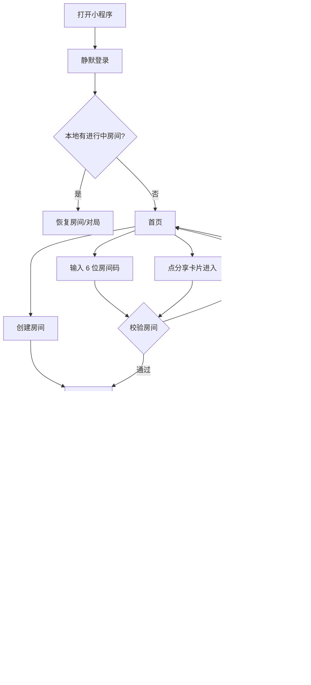
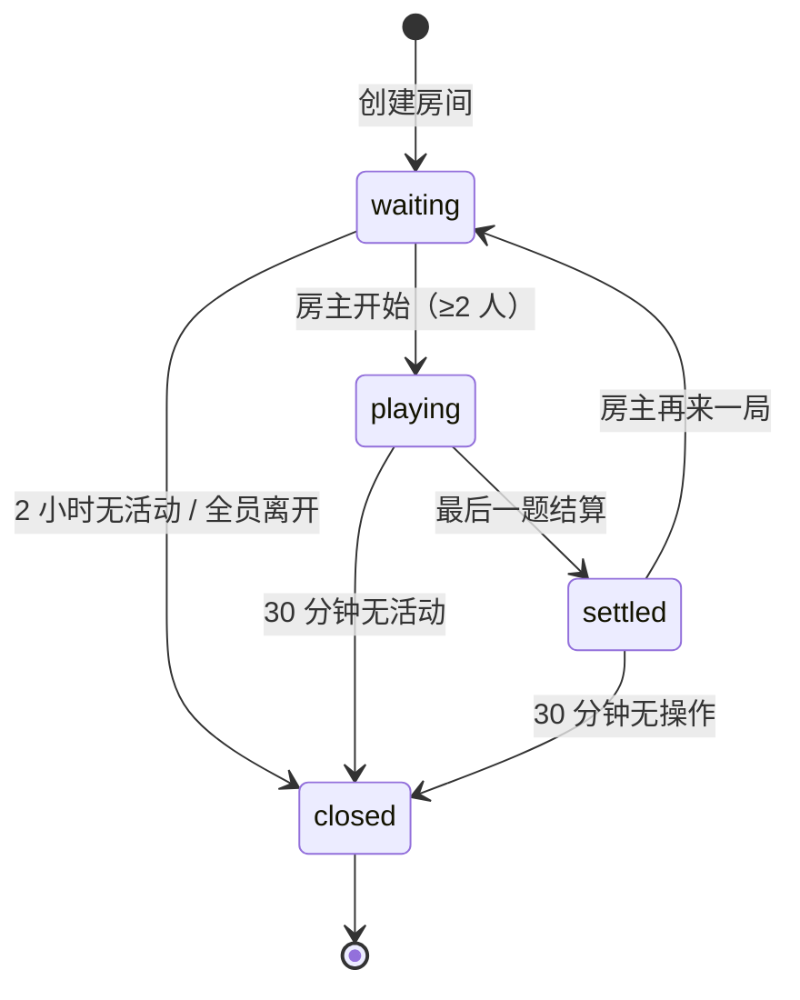

# 果果答题 · 产品需求文档

> 一款只做「熟人房间」的微信小程序答题游戏：2–4 位朋友输入同一个 6 位房间码，在同一局里限时抢答 ABCD 选择题，按答对与速度计分，并在站内周榜留下成绩。

| 项目 | 内容 |
|---|---|
| 文档版本 | v0.1.0 |
| 文档状态 | 待评审 |
| 更新日期 | 2026-10-22 |
| 适用端 | 微信小程序（原生） |
| 产品代号 | 果果答题 |
| 关联文档 | [实施文档](./实施文档.md) · [UI 设计文档](./UI设计文档.md) |
| 文档负责人 | 待定 |

## 修订记录

| 版本 | 日期 | 修改人 | 说明 |
|---|---|---|---|
| v0.1.0 | 2026-10-22 | 产品/技术 | 首版：P0 房间对战、计分、结算、周榜与异常处理 |

---

## 0. 阅读指引

### 0.1 优先级定义

| 优先级 | 含义 | 处理方式 |
|---|---|---|
| P0 | 首版必须具备，缺失则无法完成核心闭环 | 必须进入首版提审范围 |
| P1 | 首版后尽快补齐，显著影响体验或留存 | 进入下一迭代，不阻塞首发 |
| P2 | 远期能力，依赖内容、资质或平台能力 | 本期只留接口或不做 |

### 0.2 文档约定

- 「必须」表示验收硬条件；「应该」表示建议实现；「可以」表示可选。
- 每个功能需求有唯一编号 `FR-xx`，业务规则为 `BR-xx`，非功能需求为 `NFR-xx`，风险为 `RISK-xx`。
- 每条 P0 需求都带可勾选的验收标准，验收时逐条对照，不以「感觉可用」代替。
- 本文只定义产品与技术边界，不包含题库内容；题库结构见 FR-12 与实施文档。

### 0.3 一句话边界

**只做房间，不做匹配；只做熟人局，不做陌生人社交；只做答题，不做支付与广告。**

---

## 1. 产品概述

### 1.1 产品定位

果果答题是微信里的「熟人快答局」：

- **零匹配**：没有匹配大厅、没有陌生人、没有排队。
- **低门槛**：分享一张卡片或报一个 6 位码，朋友点进来就能坐进同一局。
- **短对局**：默认 10 题、每题 15 秒，一局约 3–5 分钟，适合碎片时间。
- **轻竞技**：答对得分、越快越高，四局内见分晓，输赢都能再来一局。

### 1.2 问题与机会

| 现有问题 | 果果答题的处理 |
|---|---|
| 匹配型答题容易遇到陌生人、挂机、脚本，体验不可控 | 只允许房间码/分享加入，玩家都是被邀请来的熟人 |
| 和朋友「比一比」缺少轻量载体 | 一局 5 分钟内出排名，结算页可直接再来一局 |
| 微信群约局需要反复确认时间、发链接 | 分享卡片带房间码，点开即加入，等待页实时显示人数 |
| 答题产品普遍重内容、重运营 | 首版只做玩法闭环，题库可后接，内容与玩法解耦 |

### 1.3 核心体验关键词

1. **快**：从打开到进入房间不超过 3 次点击；从创建到开局不超过 30 秒。
2. **公平**：题目同时下发、倒计时服务端权威、答案不提前泄露。
3. **热**：等待页能看到朋友头像一个个坐下；结算页有名次变化和「再来一局」。

### 1.4 产品目标与非目标

**目标**

- 让 2–4 位微信好友在 30 秒内完成「建局 → 邀请 → 开局」。
- 让一局在 8 分钟内结束（20 题 × 20 秒的极端配置也不超时）。
- 用周榜给「经常一起玩」的小圈子一个持续回来的理由。

**非目标（本期明确不做）**

- 不做随机匹配、排位赛、段位、赛季、陌生人推荐。
- 不做观战、语音、弹幕、好友私聊。
- 不做支付、广告、内购、会员。
- 不做题库管理后台、题目编辑器、题目采购。
- 不做微信好友关系链排行榜（平台限制，见 1.5）。

### 1.5 平台限制说明（重要）

微信小程序**没有开放数据域**，无法调用 `wx.getFriendCloudStorage` 读取微信好友的成绩，也无法渲染好友关系榜。因此：

- 本文中的「排行榜」一律指**站内排行榜**：只统计玩过本小程序的玩家，按周累计或历史最佳排序。
- 朋友之间的比较主要发生在**同一房间的对局内**；榜单是长期留存的补充，不是好友关系榜。
- 若未来必须做「微信好友排行榜」，需要改为微信小游戏形态并使用开放数据域，属于产品形态变更，需重新评估工作量与审核要求，不在本期范围。
- P2 可验证「同群榜」的可行性（依赖群 ID 能力与用户授权），验证通过前不写入承诺。

### 1.6 成功指标（假设目标，上线后校准）

| 指标 | 定义 | 首版目标 |
|---|---|---|
| 建局成功率 | 点击创建后成功进入等待页 / 点击创建 | ≥ 98% |
| 开局转化率 | 成功开局房间 / 成功创建房间 | ≥ 60% |
| 对局完成率 | 正常结算对局 / 开局对局 | ≥ 85% |
| 分享率 | 产生分享的对局 / 完成对局 | ≥ 25% |
| 再来一局率 | 点击再来一局 / 完成对局 | ≥ 20% |
| 次日留存 | 次日回访用户 / 当日新增用户 | ≥ 20% |
| 周榜访问率 | 访问排行榜用户 / 周活用户 | ≥ 30% |

> 以上为产品假设，不是承诺；上线两周后根据埋点校准。

---

## 2. 用户与场景

### 2.1 目标用户

- 16–35 岁，微信高频用户，有 2–4 人的固定小群（同学、同事、家人、情侣）。
- 喜欢轻量竞技，但不愿意为答题单独下载 App、不愿意和陌生人匹配。
- 对题目质量有基本要求，但不要求专业题库；更在意「和朋友一起玩」的过程。

### 2.2 典型场景

| 场景 | 描述 | 关键诉求 |
|---|---|---|
| 群内约局 | 晚饭后群里有人发「来一局」，3 人陆续点进卡片 | 加入路径短、人数实时可见、房主能立刻开始 |
| 通勤碎片 | 地铁上和对象 1v1，10 题 15 秒 | 一局够短、断网能回来、比分有悬念 |
| 聚会暖场 | 4 个朋友围坐，投屏不方便，各看各的手机 | 同时开始、倒计时一致、结算有仪式感 |
| 睡前复盘 | 打完看谁本周分最高 | 周榜稳定、排名可解释、没有黑箱 |

### 2.3 角色

| 角色 | 说明 | 关键权限 |
|---|---|---|
| 玩家 | 通过房间码或分享进入房间的人 | 加入、答题、离开、查看结算与榜单 |
| 房主 | 创建房间的玩家 | 玩家全部权限 + 开始游戏、再来一局、踢人（P1） |
| 系统 | 云函数、定时任务 | 计时、判分、结算、清理过期房间、聚合榜单 |
| 运营 | 题库与内容维护（P2） | 导入题目、上下架、查看内容安全记录 |

### 2.4 用户故事

| 编号 | 作为 | 我希望 | 以便 |
|---|---|---|---|
| US-01 | 新用户 | 打开就能用默认昵称和头像玩 | 不被资料填写拦住 |
| US-02 | 房主 | 选好题数和每题时长后一键建房 | 快速把房间码发给朋友 |
| US-03 | 房主 | 把邀请卡片发到微信群 | 朋友点一下就能加入 |
| US-04 | 玩家 | 输入 6 位房间码加入 | 不用等别人发链接 |
| US-05 | 房主 | 在等待页看到谁已经进来了 | 人数够了再开始 |
| US-06 | 玩家 | 在等待页看到房间号和成员 | 确认自己进对了房间 |
| US-07 | 玩家 | 答题时清楚看到倒计时和 ABCD | 快速做选择 |
| US-08 | 玩家 | 点下选项就提交并锁定 | 不因二次确认浪费时间 |
| US-09 | 玩家 | 每题结束知道正确答案和得分 | 知道自己输在哪 |
| US-10 | 玩家 | 看最终四人的名次和关键数据 | 和朋友复盘 |
| US-11 | 房主 | 一局结束后直接再来一局 | 不用重新建房 |
| US-12 | 玩家 | 看本周站内排名 | 有持续回来的目标 |
| US-13 | 玩家 | 断网/切后台后回来还能继续 | 不因为一次切屏就丢局 |
| US-14 | 玩家 | 修改昵称和头像 | 在朋友面前有辨识度 |

### 2.5 核心旅程



### 2.6 关键体验原则

1. **少一次点击就少一次流失**：能自动带入的房间码不要求手输；能默认的资料不弹表单。
2. **不让玩家等待未知**：任何超过 300ms 的操作都有 loading；任何失败都有可执行的原因和下一步。
3. **公平优先于炫技**：倒计时、判分、结算顺序都以服务端为准，客户端只负责表现。
4. **输也要输得明白**：结算页必须能回答「我为什么排第二」。
5. **不打扰**：没有强制分享、没有弹窗广告、没有诱导关注。

---

## 3. 名词定义

| 名词 | 定义 |
|---|---|
| 房间 | 一次 2–4 人答题活动的容器，拥有唯一 6 位数字房间码 |
| 房间码 | 6 位数字（首位非 0），用于加入房间；分享卡片也携带它 |
| 房主 | 创建房间的玩家；拥有开始游戏、再来一局等控制权 |
| 玩家 | 房间内的参与者，最多 4 人，最少 2 人可开局 |
| 对局 | 从房主点击开始到最后一题结算的完整过程 |
| 回合 | 对局中的一道题，包含题目下发、作答、揭晓三个阶段 |
| 揭晓 | 倒计时结束或全员作答后，公布正确答案与本题得分的 3 秒阶段 |
| 本题得分 | 答对时 = 100 基础分 + 速度分（0–50）；答错或未答 = 0 |
| 速度分 | 按剩余时间比例折算的加分，鼓励快速作答 |
| 本局榜 | 结算页展示的本房间四人排名 |
| 周榜 | 站内玩家按自然周累计对局得分排序的榜单 |
| 总榜 | 站内玩家按历史最佳单局得分排序的榜单（P1） |
| 站内榜 | 只统计本小程序玩家的榜单；不是微信好友关系榜 |
| playerId | 玩家在单个房间内的短标识，用于生成私有视图文档，避免暴露 openid |
| 视图快照 | 服务端写给每个玩家的只读房间状态文档，客户端轮询它来同步 |
| 时钟偏移 | 客户端本地时间与服务端时间的差值，用于校正倒计时显示 |
| 有效对局 | 至少 2 人参与、正常打完最后一题并完成结算的对局；只有有效对局计入榜单 |

---

## 4. 功能需求

### 4.0 功能地图

| 编号 | 模块 | 优先级 | 一句话说明 |
|---|---|---|---|
| FR-01 | 登录与用户资料 | P0 | 静默登录，默认资料可直接玩，可改昵称头像 |
| FR-02 | 首页 | P0 | 创建、加入、榜单、我的四个入口 |
| FR-03 | 创建房间 | P0 | 配置题数与时长，生成 6 位房间码 |
| FR-04 | 加入房间 | P0 | 房间码/分享两种加入方式与完整校验 |
| FR-05 | 房间等待与房主控制 | P0 | 成员、邀请、开始、离开、房主转移 |
| FR-06 | 对局答题 | P0 | 题目、ABCD、倒计时、提交、揭晓 |
| FR-07 | 对局结算与再来一局 | P0 | 排名、数据、再来一局、分享 |
| FR-08 | 排行榜 | P0 周榜 / P1 总榜 | 站内周榜 Top 50 与我的排名 |
| FR-09 | 分享与邀请 | P0 | 分享卡片携带房间码，合规不诱导 |
| FR-10 | 断线重连与异常 | P0 | 恢复房间、弱网重试、房主转移、回收 |
| FR-11 | 设置与体验 | P1 | 音效、振动、隐私、清除本地记录 |
| FR-12 | 题库接入 | P0 读接口 / P2 管理 | 抽题接口与占位题；题库内容不在本期 |

> 说明：FR-12 的「读接口 + 占位题」是 P0，因为对局必须有题可出；「题库管理、批量导入、分类运营」是 P2，本期不设计内容。

### FR-01 登录与用户资料（P0）

#### 描述

用户打开小程序后自动完成登录，不需要授权手机号，也不强制授权头像昵称。默认资料足以创建/加入房间；愿意完善资料的玩家可以在「我的」页修改昵称和头像。

#### 规则

1. **静默登录**
   - 小程序启动时初始化云开发环境，调用云函数 `auth.login`。
   - 服务端从云函数上下文取 `OPENID` 作为唯一用户标识，不依赖客户端传入。
   - 首次登录自动创建用户记录；再次登录更新 `lastLoginAt`。
   - 登录不要求 `wx.login` 换取 code，也不建立自建 token；云开发调用身份即登录态。
2. **默认资料**
   - 昵称：`果友` + 4 位随机数字，例如「果友3721」；同一用户首次生成后固定，除非主动修改。
   - 头像：从 8 个水果 emoji 中随机分配一个（🍎 🍋 🍇 🍉 🍑 🥝 🍊 🍓），配固定背景色；以「emoji + 背景色」形式存储，不占用图片资源。
   - 默认资料在等待页、对局页、结算页、排行榜统一展示。
3. **修改昵称**
   - 入口：「我的」→ 资料编辑。
   - 长度 2–12 个字符（按 Unicode 字符计，emoji 算 1 个）；去除首尾空格；不允许纯空白。
   - 必须通过微信内容安全检测（`msgSecCheck` 云调用）；不通过时提示「昵称包含不合适内容，请修改」，不写入数据库。
   - 修改成功后，新昵称用于后续房间与榜单；历史榜单条目保留当时快照，不回溯修改。
4. **修改头像**
   - 使用微信「头像昵称填写能力」：`<button open-type="chooseAvatar">` 选择头像，`<input type="nickname">` 填写昵称（基础库 ≥ 2.21.2）。
   - 头像文件上传到云存储 `avatars/{openid}.{ext}`，数据库保存 `fileID`。
   - 文件大小 ≤ 2MB；上传失败保留旧头像并提示。
   - 头像同样建议做图片内容安全检测（P1）；检测未通过时回退默认水果头像。
5. **隐私授权**
   - 首次触发头像/昵称能力前，按微信隐私规范展示隐私授权弹窗；拒绝授权时仍可使用默认资料玩。
   - 「我的」页与首页底部提供隐私协议、用户协议入口。
6. **资料可见性**
   - 昵称与头像对同房间玩家、榜单访问者可见。
   - 不展示 openid、手机号、地理位置等敏感信息。
   - P1 提供「不参与排行榜」开关；开启后不写入榜单，但本局结算仍展示。

#### 异常与兜底

| 场景 | 处理 |
|---|---|
| 云环境初始化失败 | 全屏错误页，展示「重试」；连续失败展示网络排查提示 |
| `auth.login` 超时 | 自动重试 2 次（1s/2s 退避），仍失败则提示重试 |
| 本地有缓存用户但登录失败 | 可浏览静态页面，但创建/加入/答题必须登录成功 |
| 昵称内容安全接口不可用 | 先本地敏感词粗筛；接口失败时放行并记录日志（不阻断玩家） |
| 头像上传失败 | 保留旧头像，提示「头像没换成功，再试一次」 |

#### 验收标准

- [ ] 首次打开小程序，未做任何授权即可完成登录并看到首页。
- [ ] 默认昵称为「果友 + 4 位数字」，默认头像为水果 emoji，刷新后不变。
- [ ] 昵称长度、空白、敏感内容校验均生效，失败时不写库。
- [ ] 头像修改成功后，等待页与结算页展示新头像。
- [ ] 拒绝隐私授权后仍可创建/加入房间并使用默认资料。
- [ ] 登录接口失败时有明确重试入口，不会白屏。

### FR-02 首页（P0）

#### 描述

首页是唯一的分发入口，必须让玩家在 3 次点击内完成「创建房间」或「加入房间」，并让老玩家一眼看到「继续游戏」。

#### 页面结构

1. **品牌区**：产品名「果果答题」+ 一句 slogan（示例：「四个人，一道题，看谁手快」）+ 本周小战绩（P1）。
2. **主操作区**
   - 主按钮「创建房间」：进入创建页。
   - 次按钮「加入房间」：展开 6 位房间码输入面板，或进入加入页。
   - 输入框支持数字键盘、自动分格、粘贴 6 位数字、回车加入。
3. **进行中房间卡片**（条件展示）
   - 本地缓存存在未结束房间时展示，显示房间码、状态（等待中/对局中）、在线人数。
   - 点击直接恢复到等待页或对局页。
4. **次级入口**
   - 排行榜（TabBar 也有）。
   - 我的（TabBar 也有）。
   - 玩法说明。
5. **底部**：隐私协议、用户协议、版本号。

#### 规则

- 首页不自动弹任何授权、广告、活动弹窗。
- 冷启动带分享参数 `code` 时，不经过首页，直接进入加入流程（见 FR-04）。
- 首页数据（本周战绩、进行中房间）优先读本地缓存，再异步刷新；不阻塞首屏。
- 首页展示的「进行中房间」以服务端 `auth.login` 返回的 `activeRoom` 为准；本地缓存仅用于首屏占位。

#### 异常与空状态

| 场景 | 表现 |
|---|---|
| 无进行中房间 | 不展示继续游戏卡片 |
| 本周无战绩（P1） | 展示「本周还没开张，先来一局」 |
| 登录失败 | 主操作按钮置灰，顶部提示「网络开小差了，点此重试」 |
| 云环境未配置 | 展示配置错误说明（仅开发环境） |

#### 验收标准

- [ ] 首页包含创建、加入、排行榜、我的四个入口。
- [ ] 输入 6 位房间码后可直接加入，不需要再点一次确认（或最多一次确认）。
- [ ] 本地存在进行中房间时，首页出现「继续游戏」，点击能回到正确页面。
- [ ] 分享卡片冷启动不经过首页，直接进入加入流程。
- [ ] 首页首屏不依赖网络即可渲染骨架，网络失败有重试。

### FR-03 创建房间（P0）

#### 描述

房主选择题目数量和每题时长，创建一间最多 4 人的房间，拿到 6 位房间码后邀请朋友。创建动作必须快，配置项只保留对体验影响最大的两个。

#### 配置项

| 配置 | 可选值 | 默认 | 说明 |
|---|---|---|---|
| 题目数量 | 10 / 15 / 20 | 10 | 决定对局长度；20 题约 6–8 分钟 |
| 每题时长 | 10 / 15 / 20 秒 | 15 | 决定答题压力与速度分空间 |
| 题目分类 | 随机（首版唯一） | 随机 | P1 开放分类选择 |
| 人数上限 | 4（固定） | 4 | 不支持修改 |

> 揭晓时长固定 3 秒，开局倒数固定 3 秒，均不开放配置，避免对局节奏失控。

#### 规则

1. **入口**：首页「创建房间」按钮。未登录或登录失败时不可进入。
2. **创建流程**
   - 玩家调整配置 → 点击「创建并邀请」→ 调用 `room.create`。
   - 服务端生成 6 位数字房间码（首位非 0），创建房间并将房主放入 1 号座位。
   - 创建成功后进入等待页，房间码大字展示，提供「复制房间码」和「邀请好友」。
3. **单房间约束**
   - 同一用户同时只能拥有一个进行中的房间（`waiting` 或 `playing`）。
   - 若已有一个 `waiting` 房间：创建请求直接返回该房间信息，客户端跳转到等待页，并提示「你已有一个等待中的房间」。
   - 若已在一个 `playing` 房间：创建请求返回 `ALREADY_IN_ROOM` 错误，客户端提示「对局还没结束，先回去打完吧」，并提供「回到对局」。
   - 若已在别人的 `waiting` 房间：允许创建吗？**不允许**。先提示「你已经在 XXX 的房间」，可选择「留在原房间」或「退出并新建」。退出并新建需要二次确认。
4. **房间码**
   - 6 位数字，首位 1–9；不允许 `000000` 这类无效码。
   - 生成时检查唯一性，冲突则重试，最多 5 次；仍失败返回系统错误。
   - 房间码只用于加入，不代表权限；房主身份由服务端记录判断。
5. **频率限制**
   - 同一 openid 每分钟最多创建 3 次；超限返回 `RATE_LIMITED`，提示「操作太频繁，稍后再试」。
   - 客户端在请求进行中禁用按钮，防止连点产生多间房。
6. **配置校验**
   - 题目数量必须属于 `[10, 15, 20]`；每题时长必须属于 `[10, 15, 20]`。
   - 非法配置返回 `INVALID_CONFIG`，不创建房间。

#### 页面与交互

- 创建页顶部展示「创建房间」标题与返回。
- 两组分段选择器（题数、时长），选中态明显，附一行说明文案：
  - 10 题 / 15 秒：「约 3 分钟，适合随手一局」
  - 20 题 / 20 秒：「约 8 分钟，硬核长局」
- 底部固定主按钮「创建并邀请」，点击后有 loading，成功后 `wx.redirectTo` 等待页。
- 创建失败按错误码展示不同文案，保留当前配置，允许重试。

#### 验收标准

- [ ] 默认配置为 10 题、每题 15 秒。
- [ ] 只允许选择 10/15/20 三档，非法值无法提交。
- [ ] 创建成功后房间码为 6 位数字且首位非 0，可一键复制。
- [ ] 连续点击创建按钮只产生一个房间。
- [ ] 已有等待中房间时再次创建，直接回到原房间而不是新建。
- [ ] 对局中再次创建，提示先回对局，不产生新房间。
- [ ] 创建频率超过限制时提示明确，不产生脏数据。

### FR-04 加入房间（P0）

#### 描述

玩家通过两种方式进入房间：输入 6 位房间码，或点击好友分享的卡片。加入前必须完成完整校验，避免进入已满、已开局或已解散的房间。

#### 入口与路径

| 方式 | 路径 | 说明 |
|---|---|---|
| 首页输入 | 首页 → 输入 6 位码 → 加入 | 支持粘贴、数字键盘、自动分格 |
| 分享卡片 | `/pages/join/index?code=123456&from=share` | 冷启动/热启动都支持 |
| 房间码深链 | 同上，`from` 可为空 | 分享文案外的复制场景 |

#### 校验顺序与文案

服务端按以下顺序校验，命中即返回对应错误；客户端只展示服务端给的稳定文案，不自行猜测：

| 顺序 | 校验 | 错误码 | 用户可见文案 |
|---|---|---|---|
| 1 | 房间码格式（6 位数字） | `INVALID_PARAM` | 「房间码是 6 位数字哦」 |
| 2 | 房间存在 | `ROOM_NOT_FOUND` | 「房间不存在，检查一下房间码」 |
| 3 | 房间未关闭/未过期 | `ROOM_CLOSED` | 「房间已解散」 |
| 4 | 房间未开局（`waiting`） | `ROOM_STARTED` | 「这局已经开始了，等下一局吧」 |
| 5 | 人数未满（< 4） | `ROOM_FULL` | 「房间满了，4 个人已经到齐」 |
| 6 | 未被房主移出 | `KICKED` | 「你已被房主移出房间」 |
| 7 | 是否已在其他对局 | `ALREADY_IN_ROOM` | 「你还有一局没打完」+「回到对局」 |

补充规则：

1. **重复加入幂等**：已在房间内的玩家再次加入，直接返回当前快照，不重复占座、不报错。
2. **不允许中途加入**：`playing` 状态一律拒绝，即使有空位。保证同一局所有玩家从第 1 题开始，计分公平。
3. **房主自己加入**：房主通过分享链接点回自己的房间，直接回到等待页。
4. **被踢玩家**：P1 踢人上线后，被踢玩家再次加入返回 `KICKED`；房主可撤销？本期不做撤销。
5. **失败限流**：同一 openid 1 分钟内最多 10 次失败；超过后返回 `RATE_LIMITED`，提示「尝试次数过多，1 分钟后再试」。
6. **加入成功**
   - 分配房间内 `playerId`（8 位短标识），写入座位。
   - 座位顺序按加入时间；房主固定 1 号位。
   - 返回房间快照，客户端进入等待页；若分享进入，替换当前页面栈，避免返回首页再进一次。

#### 6 位码输入交互

- 6 个独立输入格，聚焦时高亮；支持系统数字键盘。
- 输入满 6 位自动触发加入，不需要额外点「加入」；同时保留一个显式按钮，防止自动触发失败后无法重试。
- 支持粘贴：粘贴含空格或 `房间码：123456` 的文本时，提取连续 6 位数字。
- 输入错误时清空并重新聚焦，附轻提示，不弹全屏错误。
- 加入请求进行中禁用输入与按钮，防止重复提交。

#### 分享进入处理

1. 冷启动：`onLaunch` 解析 `query.code`，登录完成后跳转加入页；加入成功进入等待页。
2. 热启动：已在首页时点分享卡片，`onShow` 解析新参数并执行加入。
3. 加入失败：展示失败原因 + 「返回首页」；若失败原因是 `ROOM_STARTED` 且自己是该房间玩家，提供「回到对局」。
4. 分享参数只信任 `code`，忽略其他可能被伪造的参数（如昵称、房主标识）。

#### 验收标准

- [ ] 输入 6 位数字后自动加入，加入成功进入等待页。
- [ ] 房间不存在、已满、已开始、已解散分别给出正确提示。
- [ ] 第 5 位玩家无法加入，房间人数保持 4。
- [ ] 已在房间内重复加入不重复占座。
- [ ] 分享卡片冷启动、热启动都能正确加入。
- [ ] 粘贴带空格的房间码能正确识别。
- [ ] 1 分钟内连续失败 10 次后被限流。
- [ ] 对局中不允许中途加入。

### FR-05 房间等待与房主控制（P0）

#### 描述

等待页是「约局」发生的地方：玩家看到房间码、四个座位和彼此的头像，房主在人数足够时开始游戏。等待页的成员变化必须在 2 秒内可见。

#### 页面结构

1. **顶部**：返回首页（保留房间）、房间码大字、复制按钮、分享按钮。
2. **配置摘要**：`10 题 · 每题 15 秒 · 最多 4 人`。
3. **座位区**：2×2 四个座位卡片。
   - 已入座：头像、昵称、房主皇冠标识、在线/离线状态、准备状态（首版无准备态，展示「已加入」）。
   - 空位：虚线框 + 「邀请好友」。
   - 自己：高亮边框 + 「我」标识。
4. **底部操作**
   - 房主：「开始游戏」主按钮（人数 ≥ 2 可点；< 2 置灰并提示「再邀请 1 位好友」）；「离开房间」次按钮。
   - 非房主：「等待房主开始」文案 + 「邀请好友」按钮 + 「离开房间」。
5. **提示区**：成员加入/离开的轻提示（toast 或座位动效）。

#### 规则

1. **人数**
   - 最少 2 人、最多 4 人；1 人不能开始（开发环境可通过调试开关允许 1 人，仅用于联调）。
   - 满员后仍可继续分享，但新玩家加入会收到「房间满了」。
2. **开始游戏**
   - 仅房主可调用 `room.start`；服务端再次校验人数与状态。
   - 点击后按钮进入 loading，成功后所有客户端在 3 秒内进入开局倒数。
   - 开始失败（人数不足/状态已变）时提示原因并刷新房间。
   - 防连点：请求中禁用按钮；重复 start 幂等，返回当前状态。
3. **邀请**
   - `onShareAppMessage` 标题示例：「果友3721 喊你来答题，房间 123456」。
   - 路径：`/pages/join/index?code=123456&from=share`。
   - 分享按钮点击不强制、不奖励、不校验是否真的分享。
4. **离开房间**
   - 等待页离开需二次确认（「离开后座位会空出来」）。
   - 房主离开：房主身份自动转移给**最早加入且未离开**的玩家；若没有其他玩家，房间直接关闭。
   - 非房主离开：座位释放，房间人数减一，其他玩家看到「XXX 离开了」。
   - 离开后本地房间缓存清除；可通过房间码重新加入（若仍未开局）。
5. **离线与心跳**
   - 客户端每 15 秒上报一次心跳；超过 45 秒未上报标记为离线（座位置灰、显示「离线」）。
   - 离线玩家仍占座，不会被自动移出；房主可等待其回来，或 P1 踢人。
   - 离线不阻止房主开始；开始后离线玩家本题按未作答处理。
6. **房主转移**
   - 仅在房主**主动离开**或**房间被系统关闭**时发生；短暂断网不转移。
   - 转移后所有客户端收到「房主已转让给 XXX」提示，按钮权限同步更新。
   - 转移目标按加入顺序选择，跳过已离开玩家。
7. **踢人（P1）**
   - 房主在等待页长按/点击成员菜单可移除成员；需二次确认。
   - 被踢玩家立即收到提示并回到首页；被踢玩家不能再次加入该房间。
   - 对局中不可踢人。
8. **房间过期**
   - 等待超过 2 小时无活动，系统关闭房间；客户端提示「房间已过期」并回首页。
   - 房主与成员都离开后，房间立即进入关闭流程（可延迟 1 分钟以便重连）。

#### 验收标准

- [ ] 等待页展示房间码、配置、四个座位、在线状态。
- [ ] 人数 < 2 时房主无法开始，按钮置灰且有提示。
- [ ] 人数 ≥ 2 时房主点击开始，所有已加入玩家同时进入 3 秒倒数。
- [ ] 第 5 人加入被拒绝，座位仍为 4。
- [ ] 成员加入/离开在 2 秒内反映到其他客户端。
- [ ] 房主离开后房主转移给最早加入且未离开的玩家；无其他人时房间关闭。
- [ ] 非房主离开后座位释放，可通过房间码重新加入（未开局时）。
- [ ] 断网 45 秒后其他玩家看到「离线」，恢复后状态恢复。
- [ ] 分享标题与路径正确，分享进入能落到同一房间。

### FR-06 对局答题（P0）

#### 描述

对局是产品的核心。所有玩家看到同一道题、同一个倒计时；点击选项即提交并锁定；倒计时结束或全员作答后揭晓答案与本题得分，3 秒后进入下一题。

#### 对局节奏

| 阶段 | 时长 | 说明 |
|---|---|---|
| 开局倒数 | 3 秒 | 显示「3、2、1、开始」，题目暂不可作答 |
| 答题 | 10/15/20 秒（房间配置） | 可点击 ABCD；点击即提交并锁定 |
| 揭晓 | 3 秒 | 展示正确答案、我的得分、其他玩家对错 |
| 下一题缓冲 | 1 秒 | 展示「下一题」过渡，服务端已下发下一题 |

- 第 1 题从 `startAt` 开始；后续每题开始前预留 1 秒缓冲，减少网络差异。
- 单局总时长上限：20 题 × (20 + 3 + 1) 秒 + 3 秒 ≈ 8 分钟。

#### 页面结构

1. **顶部**
   - 进度：`第 3 / 10 题`。
   - 倒计时：环形进度 + 剩余秒数；最后 5 秒变红、脉冲；可配置振动（默认开）。
   - 当前总分（小字）。
2. **题干区**
   - 题干文本，居中或左对齐，最多 3 行可见；超长可滚动（P1）。
   - 题号、分类标签（P1）可选展示。
3. **选项区**
   - 4 个选项卡片，纵向排列；每张卡片左侧为 A/B/C/D 字母徽标，右侧为选项文本。
   - 选项文本最多 2 行，超出省略并可在揭晓时展开（P1）。
4. **底部状态区**
   - 未作答：「点击选项作答」。
   - 已提交：「已提交，等待其他人…」+ 其他玩家头像上显示「已答/思考中」状态（不显示具体选项）。
   - 所有人已答：显示「即将揭晓」。
5. **揭晓浮层/状态**
   - 正确选项绿色高亮 + ✓；我的错误选择红色 + ✗；其他选项置灰。
   - 我的本题得分：`+140`（答对）或 `+0`（答错/未答）。
   - 每个玩家头像旁展示 ✓/✗ 与本题得分。
   - 顶部总分实时更新，可做数字滚动动效。

#### 规则

1. **题目下发**
   - 服务端在房间文档中保存题目快照（题干、4 个选项、正确项索引），下发给客户端的视图**不包含正确项**。
   - 正确项只在本题结算后写入视图；结算前任何接口都不得返回。
   - 4 个选项顺序对所有玩家一致，不做逐人乱序；选项内容不允许重复。
2. **作答**
   - 点击任一选项即提交，**不可更改、不可撤销**；不需要二次确认。
   - 客户端立即展示选中态与「已提交」，同时调用 `room.answer`；服务端响应后以服务端快照为准。
   - 每位玩家每题只能提交一次；重复提交返回 `ALREADY_ANSWERED`，客户端忽略并保持已提交态。
   - 提交内容只有选项索引（0–3），不传昵称、分数等任何可伪造字段。
3. **时间与宽限**
   - 服务端以 `endsAt` 为准；正常提交截止到 `endsAt`。
   - 网络抖动宽限 800ms：`endsAt` 后 800ms 内到达的提交仍算有效，但速度分按 0 计算；超过宽限返回 `ROUND_ENDED`。
   - 客户端在 `endsAt` 时立即禁用选项；宽限只用于网络补救，不用于 UI 倒计时。
   - 超时未提交视为未作答，本题 0 分。
4. **提前结算**
   - 所有未离开的玩家都已提交 → 服务端立即结算，不必等到 `endsAt`。
   - 提前结算后，揭晓时长仍为 3 秒。
5. **计分**
   - 答对：`100 + round(50 × 剩余时间 / 本题时长)`，速度分范围 0–50。
   - 答错或未答：0 分。
   - 每题最高 150 分；本题得分写入玩家累计分。
   - 示例（15 秒题）：
     | 提交时剩余 | 速度分 | 本题得分 |
     |---|---|---|
     | 15.0 秒 | 50 | 150 |
     | 12.0 秒 | 40 | 140 |
     | 2.4 秒 | 8 | 108 |
     | 0.4 秒（宽限内） | 0 | 100 |
     | 答错 | 0 | 0 |
6. **结算与揭晓**
   - 服务端结算时写入：正确项索引、每位玩家的选择与对错、本题得分、累计分、本题排名。
   - 客户端只展示服务端结果，不自行判分。
   - 揭晓期间禁止作答；点击选项无响应。
7. **进入下一题**
   - 揭晓结束后，任意在线客户端可触发 `room.advance`；服务端校验时间后进入下一题。
   - 客户端不应依赖某一个玩家（包括房主）在线；多人同时触发时服务端只推进一次。
   - 最后一题揭晓结束后，进入对局结算。
8. **离开对局**
   - 对局中允许退出，但需二次确认（「退出后本局成绩保留，但不会计入周榜」）。
   - 退出后不再参与后续题目与「全员作答」判断，分数保留在房间结果中。
   - 对局中退出不返还分数，不可重新加入本局。
9. **断线与切后台**
   - 切后台不暂停倒计时；回前台按服务端时间重新对齐。
   - 断线恢复见 FR-10；恢复后若当前题仍在作答，可继续作答；若已揭晓，展示揭晓；若已进入下一题，直接展示新题。
10. **公平性约束**
    - 同一房间所有玩家题目、选项顺序、开始时间、结束时间完全一致。
    - 服务端不接受客户端上报的时间戳作为计分依据，只接受选项索引。

#### 异常与兜底

| 场景 | 处理 |
|---|---|
| 提交请求超时 | 客户端保持「提交中」，自动重试 1 次（携带相同 roundIndex/choice）；仍失败提示「提交失败，检查网络」 |
| 提交时本题已结算 | 返回 `ROUND_ENDED`，客户端拉取最新快照，展示揭晓结果 |
| 全员作答但结算失败 | 客户端在 1 秒后重试 `room.settle`；服务端幂等 |
| 倒计时结束无人触发结算 | 任意在线客户端在 `endsAt + 1s` 后触发 `room.settle`；服务端校验时间 |
| 揭晓结束无人触发下一题 | 任意在线客户端在 `revealEndsAt + 300ms` 后触发 `room.advance` |
| 所有玩家离线 | 房间保留；定时任务在 30 分钟无活动后关闭并标记 abandoned，不计入榜单 |
| 题目数据异常（选项不足 4 个） | 服务端拒绝开局并记录错误；客户端提示「题目加载失败，请重试」 |

#### 验收标准

- [ ] 开局时所有玩家看到同一道题，题目下发不含正确答案。
- [ ] 倒计时基于服务端时间，客户端改系统时间不影响作答截止。
- [ ] 点击选项立即锁定，重复点击/重复请求不会产生第二次提交。
- [ ] 4 人全部作答后立即结算，只结算一次。
- [ ] 超时未作答按 0 分，且不能补交。
- [ ] 宽限期内到达的提交有效、速度分为 0；超过宽限无效。
- [ ] 揭晓展示正确项、我的选择、本题得分、其他玩家对错。
- [ ] 揭晓 3 秒后自动进入下一题；多人同时触发只推进一次。
- [ ] 最后一题后进入结算页，分数与排名正确。
- [ ] 对局中退出后不再参与后续题目，成绩保留但不计入周榜。

### FR-07 对局结算与再来一局（P0）

#### 描述

最后一题揭晓结束后进入结算页。结算页要回答三个问题：谁赢了、我打得怎么样、要不要再来一局。

#### 页面结构

1. **结果头部**
   - 冠军文案：「果友3721 拿下本局」+ 冠军头像/得分。
   - 领奖台：前 3 名按 2-1-3 高度排列（不足 3 人时按实际人数展示），展示头像、昵称、总分。
   - 第 4 名在领奖台下方单独一行。
2. **完整排名表**
   - 列：名次、头像昵称、总分、答对数、平均用时。
   - 自己所在行高亮；已离开玩家标记「已离开」。
   - 点击某一行可展开该玩家的逐题对错（P1）。
3. **我的数据卡**
   - 总分、正确率（答对/总题数）、平均用时、最快一题用时。
   - 与个人历史最佳的对比（P1）：「比上次高 120 分」。
4. **操作区**
   - 主按钮「再来一局」：仅房主可点；非房主展示「等房主再来一局」。
   - 次按钮「返回首页」。
   - 分享按钮：「晒战绩」。
5. **底部**：本局房间码、开始时间、版本号。

#### 排名规则

按以下顺序比较，全部相同则按 `playerId` 字典序兜底，保证名次唯一：

1. 总分高者在前。
2. 答对题数多者在前。
3. 正确题的总用时短者在前（只累计答对的题；未答不计）。
4. 加入房间时间早者在前。

> 说明：不比较答错题用时，避免「乱点更快」反而占优。

#### 规则

1. **成绩有效性**
   - 中途退出的玩家仍参与本局排名，但标记「已离开」，且本局不计入其周榜。
   - 房间结算时，未离开且完成最后一题的玩家计入周榜（需满足有效对局条件，见 BR-05）。
2. **再来一局**
   - 仅房主可发起；服务端校验房间状态为 `settled`。
   - 房间码不变，状态回到 `waiting`，成员保留（已离开玩家不自动回座），分数、答题记录、题目全部清空。
   - 配置保留上一局设置；房主可在等待页重新创建房间来改配置。
   - 点击后所有仍在对局页/结算页的玩家自动回到等待页，并提示「房主开启了新一局」。
   - 已离开或已关闭页面的玩家不会被动拉回；他们可凭房间码重新加入（若未开局）。
   - 重复点击幂等，不会重置两次。
3. **房主不可用**
   - 房间已关闭、无房主或自己不是房主时，「再来一局」置灰；非房主文案为「等房主再来一局」。
   - 房主主动离开时，房主已按 FR-05 转移给最早加入且未离开的玩家；新房主可以发起再来一局，不会因为原房主离开而失效。
   - 非房主可自行返回首页或凭房间码加入其他房间。
4. **战绩分享**
   - 分享标题示例：「我在果果答题拿了 1280 分，排第 2，来一局？」
   - 分享路径回首页（不直接进结算页，避免非房间成员看到结果）。
   - 分享不附带任何奖励或解锁条件。
5. **数据留存**
   - 对局写入 `games` 历史，保留房间码、玩家快照、逐题结果、开始/结束时间。
   - 房间在结算后保留 30 分钟，供再来一局或查看结果；超时关闭。

#### 异常与兜底

| 场景 | 处理 |
|---|---|
| 结算页加载时房间已被关闭 | 展示本地缓存的最终结果（若有），并提供「返回首页」 |
| 再来一局请求失败 | 提示原因并刷新房间状态；不重复重置 |
| 非房主点击「再来一局」 | 按钮置灰，不发送请求；若被绕过，服务端返回 `NOT_OWNER` |
| 对局数据缺失（极端异常） | 展示「本局数据不完整」，仍可返回首页；该局不计入榜单 |

#### 验收标准

- [ ] 结算页展示四人完整排名、总分、答对数、平均用时。
- [ ] 排名与计分一致，平局按正确数、正确题用时、加入顺序依次比较。
- [ ] 冠军标识、自己高亮、离开标记正确。
- [ ] 房主点击「再来一局」后，所有人回到等待页，分数清零、房间码不变。
- [ ] 非房主不能发起再来一局。
- [ ] 已离开玩家不自动回座，可凭房间码重新加入。
- [ ] 结算页分享路径回首页，标题含分数与名次。
- [ ] 重复点击「再来一局」不会重复重置。

### FR-08 排行榜（P0 周榜 / P1 总榜）

#### 描述

排行榜是站内榜，给「经常一起玩」的玩家一个持续回来的理由。首版只做周榜；总榜为 P1。榜单必须口径清晰、可解释、可刷新。

#### 页面结构

1. **顶部**
   - 标题「排行榜」。
   - Tab：周榜（默认）/ 总榜（P1，未上线时不展示或标「敬请期待」）。
   - 周期说明：`本周 10.19–10.25`（按 Asia/Shanghai）。
2. **我的排名卡**
   - 展示我的名次（如「第 12 名」）、本周累计分、场次、胜场。
   - 未上榜：「本周还没成绩，开一局就能上榜」+「去创建房间」。
   - 关闭上榜（P1）：「你已关闭上榜」+ 设置入口。
3. **Top 3 领奖台**
   - 头像、昵称、分数；冠军皇冠。
4. **榜单列表（Top 50）**
   - 列：名次、头像、昵称、分数、场次/胜场。
   - 前三名特殊样式；自己所在行高亮；分数使用等宽数字。
   - 支持下拉刷新；进入页面自动刷新；客户端缓存 30 秒。
5. **底部**
   - 「榜单规则」入口：说明统计口径、有效对局、同分规则、更新时间。
   - 空状态：插画 + 「本周还没有人上榜，来当第一个」。

#### 统计口径

1. **周榜**
   - 周期：每周一 00:00:00（Asia/Shanghai）开始，下周一 00:00:00 结束。
   - 分数：本周所有**有效对局**的最终总分之和。
   - 场次：本周有效对局数。
   - 胜场：本周有效对局中排名第 1 的次数（不设并列冠军；按 FR-07 规则产生唯一第 1）。
   - 排序：累计分降序 → 胜场降序 → 本周最佳单局分降序 → 首次上榜时间升序。
   - 展示：Top 50；我的排名单独计算，可以超过 50。
2. **有效对局**
   - 开局时至少 2 人；
   - 正常打完最后一题并完成结算；
   - 结算时至少 2 人未离开；
   - 玩家本人未在结算前离开；
   - 系统标记为 `abandoned` 的对局不计入。
3. **总榜（P1）**
   - 分数：历史最佳单局总分。
   - 排序：最佳单局分降序 → 达成时间升序。
   - 仅统计有效对局；同一玩家只出现一次。
4. **周切换**
   - 周一 00:00 后第一次请求即切换到新周期；旧周数据保留 8 周用于查询，之后由定时任务清理。
   - 客户端展示的周期文案必须与服务端返回的 `weekKey` 一致，不使用客户端本地日期自行计算。
5. **防刷分**
   - 1 人对局、异常对局、中途退出对局不计入。
   - 同一玩家同一局只计一次。
   - 榜单写入由服务端在结算事务中完成，客户端无写权限。
   - 发现异常高频对局时，服务端可标记 `flagged` 并从榜单剔除（P1 人工处理）。

#### 异常与兜底

| 场景 | 处理 |
|---|---|
| 榜单加载失败 | 展示缓存数据（若有）+ 顶部「刷新」；无缓存时展示错误态 |
| 我的排名查询失败 | 我的排名卡展示「—」，不阻塞榜单列表 |
| 周切换瞬间数据为空 | 展示新周期空状态，不展示上周数据冒充本周 |
| 榜单数据延迟 | 结算后最多 5 秒内可查；超出时提示「榜单更新中，稍后刷新」 |

#### 验收标准

- [ ] 周榜按 Asia/Shanghai 周一 00:00 切周，周期文案正确。
- [ ] 累计分等于本周有效对局总分之和，场次/胜场正确。
- [ ] 1 人对局、中途退出对局不计入。
- [ ] 同分排序符合「胜场 → 最佳单局 → 首次上榜」规则。
- [ ] Top 50 与我的排名一致；我的排名可超过 50。
- [ ] 下拉刷新、30 秒缓存、失败重试均生效。
- [ ] 空状态与服务端返回的空数据一致。
- [ ] P1 总榜上线前不展示假数据或占位名次。

### FR-09 分享与邀请（P0）

#### 描述

分享是唯一的拉人方式。分享必须轻、可追踪、合规，不设置任何「分享后才能开始/领奖」的门槛。

#### 分享场景

| 场景 | 标题示例 | 路径 | 封面 |
|---|---|---|---|
| 等待页邀请 | 「果友3721 喊你来答题，房间 123456」 | `/pages/join/index?code=123456&from=share` | 品牌默认图 |
| 结算页晒战绩 | 「我在果果答题拿了 1280 分，排第 2」 | `/pages/index/index?from=share` | 品牌默认图（P1 战绩图） |
| 首页分享 | 「四个人，一道题，看谁手快」 | `/pages/index/index?from=share` | 品牌默认图 |

#### 规则

1. **分享卡片**
   - 标题不超过 30 个汉字；含房间码时必须是当前有效房间码。
   - 封面优先使用品牌默认图；P1 支持生成战绩海报作为封面。
   - 分享路径必须能在冷启动下正确解析；不允许携带 openid、分数等可伪造的敏感参数作为权限依据。
2. **分享进入**
   - 等待页邀请：进入加入流程，校验通过后直接入座（见 FR-04）。
   - 战绩/首页分享：进入首页，不自动加入任何房间。
   - 对局已开始时点邀请卡片：提示「这局已经开始了」，不进入房间。
3. **合规**
   - 不使用「分享给 3 个群才能开始」「分享得复活」等诱导文案。
   - 不强制分享、不检测分享是否成功、不给分享奖励。
   - 分享标题与图片不得含二维码、联系方式、外部引流信息。
4. **分享统计**
   - 客户端上报 `share_click`（点击分享按钮）与 `share_enter`（从分享卡片进入），用于计算分享率。
   - 微信不提供分享成功回调，文档与看板中明确「分享率」为点击口径，不是成功口径。
5. **朋友圈（P1）**
   - 支持 `onShareTimeline`，标题与查询参数同上；朋友圈进入统一落首页。

#### 验收标准

- [ ] 等待页分享卡片带正确房间码，好友点开可直接加入。
- [ ] 结算页分享标题含分数与名次，路径回首页。
- [ ] 分享进入在冷启动、热启动下都能正确解析。
- [ ] 分享无奖励、无强制、无诱导文案。
- [ ] 对局已开始时点邀请卡片有明确提示。
- [ ] 分享点击与分享进入埋点可查。

### FR-10 断线重连与异常处理（P0）

#### 描述

微信小程序的切后台、锁屏、弱网、杀进程都很常见。断线不能导致丢局、重复结算或分数错误；恢复后玩家应回到正确页面和正确题目。

#### 本地会话缓存

客户端在小程序本地存储中保存最小会话信息：

| 字段 | 说明 |
|---|---|
| `roomCode` | 当前房间码 |
| `playerId` | 本房间内的玩家短标识 |
| `viewId` | 私有视图文档 ID（`roomCode_playerId`） |
| `lastPhase` | 最近状态：`waiting` / `playing` / `settled` |
| `savedAt` | 保存时间戳 |

- 进入房间/对局/结算时更新；主动离开、房间关闭、对局结束且返回首页时清除。
- 缓存只用于恢复定位，不作为权限依据；服务端返回的 `activeRoom` 才是权威。

#### 恢复规则

1. **冷启动**
   - 登录成功后，若服务端返回 `activeRoom`，按房间状态跳转：`waiting` → 等待页；`playing` → 对局页；`settled` → 结算页。
   - 若服务端无 `activeRoom` 但本地有缓存：调用 `room.state` 校验；不存在/已关闭则清除缓存并提示「房间已结束」。
   - 若本地缓存与 `activeRoom` 冲突，以服务端为准，覆盖本地。
2. **热启动/切前台**
   - `onShow` 时立即拉取最新视图快照，并按服务端时间重算当前阶段。
   - 若当前题已过 `endsAt` 且未结算：触发 `room.settle`（幂等）。
   - 若揭晓已过 `revealEndsAt` 且未进入下一题：触发 `room.advance`（幂等）。
   - 若已进入下一题：直接展示新题，不补看上一题。
   - 若已结算：跳转结算页。
3. **对局中杀进程**
   - 服务端保留玩家座位与分数；重新进入后从当前题继续。
   - 若当前题已结束，展示揭晓或下一题；不补答。
4. **主动退出与断线的区别**
   - 主动退出 = 调用 `room.leave`，标记 `left=true`，不可重新加入本局。
   - 断线 = 心跳超时，座位保留，可恢复；不标记 `left`。
   - 客户端必须能区分两者，避免「切后台回来发现自己已退出」。

#### 网络异常处理

| 场景 | 客户端行为 |
|---|---|
| 单次轮询失败 | 静默重试，下一次轮询按退避间隔（1s → 2s → 4s → 8s，上限 10s） |
| 连续 3 次失败 | 顶部显示「网络不稳定，正在重连…」，不阻断当前页面 |
| 连续 30 秒失败 | 展示「重连」按钮 + 「返回首页」；保留本地快照，不清空分数 |
| 操作请求超时 | 6 秒超时；幂等操作自动重试 1 次；非幂等操作提示用户重试 |
| 操作返回 `CONFLICT` | 拉取最新快照后按新状态渲染，不盲目重放 |
| 云函数整体不可用 | 全屏错误页，展示重试与客服入口（P1） |

#### 离线判定

- 客户端每 15 秒调用 `room.heartbeat`；服务端更新 `lastSeenAt`，并节流刷新在线视图（最多每 10 秒一次），降低写入。
- 超过 45 秒无心跳，其他客户端将其标记为离线：头像置灰、显示「离线」。
- 离线玩家仍占座；不参与「全员作答」的等待，但倒计时结束仍会结算。
- 离线玩家回来并发送心跳后，状态恢复在线；不需要重新加入。
- 对局中离线玩家的本题按未作答处理，不补分。

#### 房主异常

| 场景 | 处理 |
|---|---|
| 房主短暂离线 | 不转移房主；等待页显示离线；开始按钮仍属于房主，其他人不能操作 |
| 房主主动离开 | 立即转移给最早加入且未离开的玩家；无其他人则关闭房间 |
| 房主长时间离线且对局无法推进 | 任意在线玩家可在倒计时结束后触发 `settle` / `advance`，不依赖房主 |
| 房主回来后发现已转移 | 以服务端为准，展示新房主；原房主变为普通玩家 |

#### 房间失效

- 房间不存在、已关闭、已过期：清空本地会话，提示「房间已结束」，回首页。
- 自己被移出（P1）：提示「你已被房主移出房间」，回首页并清除会话。
- 房间存在但不是成员：返回 `NOT_IN_ROOM`，提示「你不在这个房间里」，回首页。

#### 验收标准

- [ ] 对局中杀进程，重新打开能回到当前题并继续作答。
- [ ] 切后台 30 秒回来，倒计时按服务端时间正确显示，不出现负数或跳题。
- [ ] 切后台超过 45 秒，其他玩家看到「离线」，回来后可恢复。
- [ ] 主动退出后不能重新加入本局，且不会被自动拉回。
- [ ] 弱网下操作失败有明确提示，不产生重复提交或重复结算。
- [ ] 房间已关闭时，冷启动/热启动都能正确清理并回首页。
- [ ] 房主主动离开后房主转移；短暂断网不转移。

### FR-11 设置与体验（P1）

#### 描述

提供最小可用的体验设置，不引入账号体系复杂度。

#### 功能

1. **音效开关**：答对、答错、倒计时最后 3 秒、结算音效；默认开启；本地持久化。
2. **振动开关**：选项提交、最后 5 秒、揭晓；默认开启；本地持久化。
3. **清除本地记录**：清除房间缓存、音效/振动设置、最近战绩缓存；需二次确认；不删除服务端账号与榜单数据。
4. **隐私与协议**：隐私协议、用户协议、第三方信息共享清单（如有）。
5. **关于**：版本号、玩法说明、反馈入口（客服会话，P1）。
6. **深色模式**：P2，跟随系统。
7. **不参与排行榜**：P1，开启后不写入周榜/总榜，本局结算仍正常展示；关闭后从下一次有效对局开始重新上榜。

#### 规则

- 设置只影响本机，不跨设备同步。
- 清除本地记录后，正在进行的房间仍可通过服务端 `activeRoom` 恢复；若用户希望彻底退出，需使用「离开房间」。
- 隐私协议内容必须与实际收集字段一致（openid、昵称、头像、对局记录）。

#### 验收标准

- [ ] 音效/振动开关即时生效，重启小程序后保持。
- [ ] 清除本地记录有二次确认，清除后不影响服务端数据。
- [ ] 隐私协议、用户协议可正常打开。
- [ ] 关闭上榜后，榜单不再出现该玩家（P1）。

### FR-12 题库接入（P0 读接口 / P2 管理与内容）

#### 描述

本期不设计题库内容与运营后台，但必须定义题目结构、抽题接口和开发期占位题，保证对局可以独立开发和联调。

#### 题目结构

| 字段 | 类型 | 必填 | 说明 |
|---|---|---|---|
| `_id` | string | 是 | 题目唯一 ID |
| `category` | string | 是 | 分类，首版统一 `general`；P1 扩展 |
| `stem` | string | 是 | 题干，1–80 字 |
| `options` | string[4] | 是 | 4 个选项，每个 1–30 字，互不重复 |
| `answerIndex` | number | 是 | 正确项索引 0–3，仅服务端可见 |
| `explain` | string | 否 | 解析，≤ 120 字；揭晓时展示（P1） |
| `difficulty` | number | 否 | 1–3，首版不参与抽题 |
| `tags` | string[] | 否 | 标签，P2 |
| `enabled` | boolean | 是 | 是否可抽 |
| `source` | string | 否 | 来源/版权备注 |
| `version` | number | 是 | 题目版本，便于追踪 |
| `createdAt` | number | 是 | 创建时间 |

#### 规则

1. **抽题**
   - 按房间配置数量抽取，同一局内不重复。
   - 只抽 `enabled=true` 的题；首版分类固定随机。
   - 抽题只发生在开局时，题目快照写入房间，后续不因题库变更而改变。
   - 抽题失败（可用题不足）返回 `QUESTION_NOT_ENOUGH`，不开始对局，提示「题库准备中，稍后再试」。
2. **答案保护**
   - 题目文档不对客户端开放读权限；视图文档在结算前不包含 `answerIndex`。
   - 抽题接口不返回答案；只有结算后的视图包含正确项。
3. **内容校验**
   - 4 个选项必须非空且互不重复；`answerIndex` 必须在 0–3。
   - 题干/选项去除首尾空格；拒绝纯空白、HTML 标签、外链。
   - 上线前人工审核；涉及版权、时政、医疗等敏感内容需额外合规评估。
4. **开发期占位题**
   - 提供 10 道示例题（水果/常识主题）写入开发环境，仅用于联调，不进入生产题库。
   - 占位题不参与正式榜单统计？**参与**。开发环境与生产环境分离，生产环境由运营导入正式题目后才会开放对局。
5. **题库管理（P2）**
   - 批量导入 JSON、上下架、分类维护、内容安全记录、抽题命中率统计。
   - 管理端不放在小程序内，使用云开发控制台或独立后台。

#### 验收标准

- [ ] 开局时按配置数量抽题，同一局不重复。
- [ ] 客户端在任何结算前的响应中都拿不到正确答案。
- [ ] 选项不足 4 个、答案越界、重复选项的题目不会被抽中。
- [ ] 可用题不足时开局失败并提示，不产生半开局状态。
- [ ] 开发环境 10 道占位题可完成一整局联调。
- [ ] 生产环境题库导入前，对局入口有明确「题库准备中」提示。

---

## 5. 业务规则

### BR-01 房间规则

| 规则 | 值 |
|---|---|
| 人数下限 / 上限 | 2 / 4 |
| 房间码 | 6 位数字，首位 1–9 |
| 房间状态 | `waiting` / `playing` / `settled` / `closed` |
| 等待超时 | 2 小时无活动 |
| 对局超时 | 30 分钟无活动视为 abandoned |
| 结算后保留 | 30 分钟，可再来一局 |
| 同一用户进行中房间 | 最多 1 个 |
| 创建频率 | 3 次/分钟/openid |
| 加入失败频率 | 10 次/分钟/openid |
| 心跳 | 15 秒/次；45 秒无心跳标记离线 |
| 房主转移 | 仅房主主动离开；按加入顺序转移 |

### BR-02 对局节奏

| 规则 | 值 |
|---|---|
| 题数 | 10 / 15 / 20，默认 10 |
| 每题时长 | 10 / 15 / 20 秒，默认 15 |
| 开局倒数 | 3 秒 |
| 揭晓 | 3 秒 |
| 下一题缓冲 | 1 秒 |
| 提交宽限 | 800ms，速度分按 0 |
| 超时结算触发 | `endsAt + 1000ms` 后，任意在线客户端可触发 |
| 提前结算 | 所有未离开玩家均已提交 |
| 下一题触发 | `revealEndsAt + 300ms` 后，任意在线客户端可触发 |
| 单局最长 | 约 8 分钟（20 题 × 20 秒） |

### BR-03 计分

1. 每题：
   - 答对：`100 + round(50 × max(0, endsAt - submittedAt) / durationMs)`。
   - 答错：0。
   - 未答：0。
   - 宽限期内提交：100 分，速度分 0。
2. 每题上限 150 分；下限 0 分。
3. 总分 = 所有题目得分之和；最高 3000 分（20 题）。
4. 重复提交只计第一次；服务端以首次有效提交为准。
5. 客户端展示的得分以服务端返回为准；客户端不做本地计分。

### BR-04 排名

1. 本局排名依次比较：总分降序 → 答对题数降序 → 正确题总用时升序 → 加入时间升序 → `playerId` 字典序。
2. 每局产生唯一第 1 名，不设并列冠军。
3. 正确题总用时只累计答对的题；未答不计入。
4. 中途退出玩家仍参与本局排名，但标记「已离开」，且不计入周榜。

### BR-05 排行榜

1. 周榜周期：周一 00:00:00 至下周一 00:00:00（Asia/Shanghai）。
2. 周榜分数 = 本周有效对局总分之和。
3. 有效对局条件：
   - 开局时 ≥ 2 人；
   - 正常完成最后一题并结算；
   - 结算时 ≥ 2 人未离开；
   - 该玩家未在结算前离开；
   - 房间/对局未被标记为 abandoned。
4. 同分排序：胜场降序 → 本周最佳单局分降序 → 首次上榜时间升序。
5. 展示 Top 50；我的排名按同一口径单独计算，可超过 50。
6. 总榜（P1）：历史最佳单局分降序 → 达成时间升序。
7. 关闭上榜（P1）：不写入榜单；已产生的历史条目在关闭时隐藏（不删除，便于重新开启）。

### BR-06 房间生命周期



- 关闭原因记录在房间文档：`expired` / `empty` / `abandoned` / `manual`。
- 关闭后客户端视图文档删除；对局历史保留。
- 房间关闭不影响已产生的榜单数据（有效对局已计入）。

### BR-07 分享规则

1. 分享是邀请手段，不是解锁条件；不设置分享奖励。
2. 分享标题、图片、路径必须真实、可解析、无诱导、无外链。
3. 分享进入的权限校验与手动输入房间码完全一致，不因来自分享而放宽。
4. 分享统计只统计点击与进入，不宣称分享成功。

### BR-08 内容与隐私

1. 收集字段：openid（平台提供）、昵称、头像、对局记录、设备与网络诊断信息（可选）。
2. 用途：登录识别、房间展示、榜单展示、异常排查。
3. 保存期限：对局记录 180 天；榜单周数据 8 周；日志 30 天（以实际配置为准）。
4. 昵称/头像公开展示于房间与榜单；提供关闭上榜能力（P1）。
5. 不收集手机号、地理位置、通讯录；不向第三方共享。
6. 隐私协议必须在首次触发头像昵称能力前可访问，并随实际字段更新。

## 6. 页面与交互

### 6.1 信息架构

**TabBar（3 个）**

| Tab | 页面 | 说明 |
|---|---|---|
| 首页 | `pages/home/index` | 创建、加入、进行中房间 |
| 排行榜 | `pages/rank/index` | 周榜 / 总榜（P1） |
| 我的 | `pages/profile/index` | 资料、战绩、设置 |

**非 Tab 页面**

| 页面 | 路径 | 说明 |
|---|---|---|
| 创建房间 | `pages/create/index` | 配置题数与时长 |
| 加入房间 | `pages/join/index` | 6 位码输入 / 分享进入 |
| 房间等待 | `pages/room/index` | 成员、邀请、开始 |
| 对局 | `pages/game/index` | 答题、倒计时、揭晓 |
| 结算 | `pages/result/index` | 排名、再来一局、分享 |
| 玩法说明 | `pages/rules/index` | 规则、计分、榜单口径 |
| 隐私协议 | `pages/privacy/index` | 隐私协议与用户协议 |

### 6.2 关键页面线框

> 线框用于确认信息层级，不代表最终视觉。宽度按 750rpx 设计。

**首页**

```text
┌──────────────────────────────┐
│ 果果答题              [规则] │
│ 四个人，一道题，看谁手快      │
│                              │
│ ┌──────────────────────────┐ │
│ │        创建房间           │ │
│ └──────────────────────────┘ │
│ ┌──────────────────────────┐ │
│ │ 加入房间   [1][2][3][4][5][6]│
│ └──────────────────────────┘ │
│                              │
│ ┌──────────────────────────┐ │
│ │ 房间 123456 · 等待中 3/4  │ │
│ │ 继续游戏                  │ │
│ └──────────────────────────┘ │
│                              │
│ 本周 3 局 · 最佳 1280 分      │
│                              │
│       [排行榜]  [我的]        │
└──────────────────────────────┘
```

**创建房间**

```text
┌──────────────────────────────┐
│ [<] 创建房间                 │
│                              │
│ 题目数量                      │
│ [ 10 ]  [ 15 ]  [ 20 ]       │
│ 约 3 分钟，适合随手一局        │
│                              │
│ 每题时长                      │
│ [ 10s ] [ 15s ] [ 20s ]      │
│ 适中，考验手速                │
│                              │
│ 人数上限 4 人（固定）          │
│                              │
│ ┌──────────────────────────┐ │
│ │       创建并邀请          │ │
│ └──────────────────────────┘ │
└──────────────────────────────┘
```

**加入房间**

```text
┌──────────────────────────────┐
│ [<] 加入房间                 │
│                              │
│ 输入朋友分享的 6 位房间码      │
│                              │
│  [ 1 ][ 2 ][ 3 ][ 4 ][ 5 ][ 6 ]│
│                              │
│  从聊天卡片进入会自动填入       │
│                              │
│ ┌──────────────────────────┐ │
│ │          加入             │ │
│ └──────────────────────────┘ │
└──────────────────────────────┘
```

**房间等待**

```text
┌──────────────────────────────┐
│ [<] 房间 123456  [复制] [邀请]│
│ 10 题 · 每题 15 秒 · 最多 4 人 │
│                              │
│ ┌───────────┐ ┌───────────┐  │
│ │ 👑 房主    │ │  + 邀请    │  │
│ │ 果友3721  │ │  空位      │  │
│ └───────────┘ └───────────┘  │
│ ┌───────────┐ ┌───────────┐  │
│ │ 果友8842  │ │ 果友阿明   │  │
│ │ 已加入     │ │ 离线      │  │
│ └───────────┘ └───────────┘  │
│                              │
│ ┌──────────────────────────┐ │
│ │  开始游戏（2/4 人）       │ │
│ └──────────────────────────┘ │
│        离开房间               │
└──────────────────────────────┘
```

**对局（作答中）**

```text
┌──────────────────────────────┐
│ 第 3 / 10 题        ◔ 12s    │
│ ──────────────────────────── │
│ 下列哪种水果的维生素 C         │
│ 含量通常最高？                │
│                              │
│ ┌──────────────────────────┐ │
│ │ A   猕猴桃                │ │
│ └──────────────────────────┘ │
│ ┌──────────────────────────┐ │
│ │ B   苹果                  │ │
│ └──────────────────────────┘ │
│ ┌──────────────────────────┐ │
│ │ C   香蕉                  │ │
│ └──────────────────────────┘ │
│ ┌──────────────────────────┐ │
│ │ D   西瓜                  │ │
│ └──────────────────────────┘ │
│                              │
│ 已提交，等待其他人…            │
│ [我✓] [果友88 ✓] [阿明 …]     │
└──────────────────────────────┘
```

**对局（揭晓）**

```text
┌──────────────────────────────┐
│ 第 3 / 10 题        +140     │
│ ──────────────────────────── │
│ 下列哪种水果的维生素 C         │
│ 含量通常最高？                │
│                              │
│ ┌──────────────────────────┐ │
│ │ A   猕猴桃          ✓ 正确 │ │
│ └──────────────────────────┘ │
│ ┌──────────────────────────┐ │
│ │ B   苹果            ✗ 你的 │ │
│ └──────────────────────────┘ │
│ │ C   香蕉                  │ │
│ │ D   西瓜                  │ │
│                              │
│ 果友3721 ✓ +150  果友88 ✗ +0  │
│ 3 秒后进入下一题…             │
└──────────────────────────────┘
```

**结算**

```text
┌──────────────────────────────┐
│         本局结束              │
│      🥇 果友3721 1280         │
│   🥈 我 1200   🥉 果友88 980  │
│        4  果友阿明 640        │
│                              │
│ 名次  玩家        总分  答对   │
│ 1     果友3721    1280  9/10  │
│ 2     我          1200  8/10  │
│ 3     果友88       980  7/10  │
│ 4     果友阿明     640  4/10  │
│                              │
│ 我的正确率 80% · 平均 6.2s    │
│                              │
│ ┌──────────────────────────┐ │
│ │       再来一局            │ │
│ └──────────────────────────┘ │
│   返回首页        晒战绩      │
└──────────────────────────────┘
```

**排行榜**

```text
┌──────────────────────────────┐
│ 排行榜                       │
│ [ 周榜 ]  [ 总榜 P1 ]         │
│ 本周 10.19 – 10.25            │
│                              │
│ ┌──────────────────────────┐ │
│ │ 我的排名  第 12 名         │ │
│ │ 860 分 · 6 场 · 2 胜      │ │
│ └──────────────────────────┘ │
│                              │
│      🥇        🥈        🥉   │
│    果友A     果友B     果友C  │
│    1980      1760      1540   │
│                              │
│ 4   果友D          1420      │
│ 5   果友E          1380      │
│ …                            │
│ 12  我              860      │
│                              │
│           [榜单规则]          │
└──────────────────────────────┘
```

**我的**

```text
┌──────────────────────────────┐
│ 我的                         │
│ ┌────┐  果友3721      [编辑] │
│ │ 🍎 │  本周 3 局 · 2 胜     │
│ └────┘  历史最佳 1280        │
│                              │
│ 音效                    [开] │
│ 振动                    [开] │
│ 不参与排行榜（P1）       [关] │
│ 隐私协议                 [>] │
│ 用户协议                 [>] │
│ 清除本地记录             [>] │
│ 玩法说明                 [>] │
│ 版本 v0.1.0                  │
└──────────────────────────────┘
```

### 6.3 通用状态

| 状态 | 表现 | 使用场景 |
|---|---|---|
| 骨架屏 | 灰块占位，保持布局稳定 | 首页、排行榜首次加载 |
| 局部 loading | 按钮内转圈、按钮禁用 | 创建、加入、开始、提交 |
| 空状态 | 插画 + 一句解释 + 一个行动按钮 | 榜单为空、无进行中房间 |
| 错误态 | 原因 + 重试按钮 + 返回 | 登录失败、云函数不可用 |
| 离线条 | 顶部细条「网络不稳定，正在重连…」 | 轮询连续失败 |
| Toast | 1.5 秒自动消失，不遮挡操作 | 加入成功、复制成功、轻错误 |
| Modal | 需要用户决策时使用 | 离开房间、退出对局、清除记录 |
| 全屏结果 | 只用于对局结算 | 结算页 |

### 6.4 动效

| 动效 | 时长 | 说明 |
|---|---|---|
| 选项按下 | 120ms | 轻微缩放 + 阴影收缩 |
| 选项选中 | 160ms | 边框变主色、背景浅色填充 |
| 倒计时最后 5 秒 | 每秒一次 | 数字放大回弹、颜色转红、可选振动 |
| 正确/错误揭晓 | 240ms | 卡片高亮、✓/✗ 弹入 |
| 分数变化 | 400ms | 数字滚动，不做花哨粒子 |
| 领奖台 | 400ms | 从下往上错峰进入 |
| 页面切换 | 默认 | 使用小程序原生转场，不自定义过度动画 |

原则：动效服务于状态变化，不阻塞操作；低端机上可降级为无动画。

### 6.5 视觉方向

**品牌气质**：轻松、温暖、有一点果冻感。避免电竞风、暗黑风、过度拟物。

**色板（design token 初稿）**

| Token | 值 | 用途 |
|---|---|---|
| `--color-bg` | `#FFF8F0` | 页面底色 |
| `--color-surface` | `#FFFFFF` | 卡片 |
| `--color-primary` | `#FF7A45` | 主按钮、选中态 |
| `--color-primary-dark` | `#E85D2A` | 按压态 |
| `--color-text` | `#2D2A26` | 主文字 |
| `--color-text-secondary` | `#8A8178` | 次要文字 |
| `--color-success` | `#2FBF71` | 正确 |
| `--color-danger` | `#F2545B` | 错误、倒计时告急 |
| `--color-warning` | `#F5A623` | 提示 |
| `--color-border` | `#F0E4D8` | 分割线、描边 |

选项字母徽标固定四色：A `#4E8CFF`、B `#2FBF71`、C `#F5A623`、D `#8B5CF6`，与正确/错误状态色区分开，避免语义混淆。

> 可访问性微调：实际 UI 中正文次级文字加深为 `#6F6259`，主按钮使用深可可色文字 `#2D1A10`（白字在亮橙上对比度不足）。完整 token、按钮状态与页面标注见 [UI 设计文档](./UI设计文档.md) 第 2、3 节。

**字体与数字**

- 使用系统字体（PingFang SC / 思源黑体 / 系统默认），不引入字体包。
- 标题 44–48rpx，题干 34–36rpx，选项 30–32rpx，说明 24rpx。
- 所有分数、倒计时、名次使用等宽数字（`font-variant-numeric: tabular-nums`），避免跳动。

**间距与圆角**

- 间距梯度：8 / 16 / 24 / 32 / 48rpx。
- 卡片圆角 24–32rpx；按钮圆角 999rpx（胶囊）或 24rpx，全局统一。
- 页面左右安全边距 32rpx。

**头像**

- 默认头像为 8 个水果 emoji + 固定背景色，零图片资源。
- 用户上传头像裁成圆形展示；加载失败回退到默认水果头像。
- 头像尺寸：等待页 96rpx、榜单 72rpx、结算页 112rpx。

**图标**

- 首版可使用 emoji（🏆 ⏱️ 🔗）过渡，但需统一大小与基线。
- P1 替换为 2rpx 线性图标，本地 PNG 或 iconfont，不引入大图。

### 6.6 文案规范

- 人称统一用「你」，不用「您」；语气轻松但不油腻。
- 按钮用动词：「创建房间」「开始游戏」「再来一局」「复制房间码」。
- 错误文案 = 发生了什么 + 你可以做什么，例如「房间满了，4 个人已经到齐」+「返回首页」。
- 不使用「失败」「错误」作为唯一信息；不暴露错误码（开发环境可显示）。
- 不写「分享给 3 个好友即可开始」这类诱导文案。

### 6.7 适配与无障碍

- 仅支持竖屏；`pageOrientation` 固定 `portrait`。
- 适配 iPhone 刘海/灵动岛与底部安全区：`env(safe-area-inset-top/bottom)`。
- 点击热区不小于 88rpx × 88rpx；选项卡片整卡可点。
- 正确/错误不能只靠颜色区分，必须同时有 ✓/✗ 图标与文字。
- 文字对比度 ≥ 4.5:1；倒计时红色状态同时改变数字与环形进度。
- 小屏（iPhone SE）下题干最多 3 行，选项最多 2 行，超出省略并提供揭晓展开。
- 支持系统字体放大时布局不重叠（P1 做专项适配）。

---

## 7. 非功能需求

### 7.1 性能

| 编号 | 指标 | 目标 |
|---|---|---|
| NFR-01 | 冷启动到首页可交互 | ≤ 2s（4G，中端机）；云函数冷启动不计入首屏骨架 |
| NFR-02 | 登录接口 P95 | ≤ 800ms |
| NFR-03 | 创建/加入接口 P95 | ≤ 800ms |
| NFR-04 | 提交答案接口 P95 | ≤ 500ms |
| NFR-05 | 非操作方状态同步延迟 | ≤ 1.5s（轮询 1s + 网络） |
| NFR-06 | 倒计时显示误差 | ≤ 300ms（相对服务端） |
| NFR-07 | 主包体积 | ≤ 2MB；总体积 ≤ 20MB（以平台当前限制为准） |
| NFR-08 | 云函数错误率 | < 0.5% |
| NFR-09 | 首屏图片总字节 | ≤ 300KB，优先 emoji/CSS，减少位图 |

### 7.2 兼容性

- 微信版本 ≥ 8.0；小程序基础库 ≥ 2.21.2（头像昵称填写能力所需）。
- iOS 14+、Android 8+；覆盖 iPhone SE/13/15、主流 Android 中端机。
- 云开发能力依赖微信客户端与云环境，低版本基础库需降级为默认资料 + 手动输入。
- 不支持横屏、平板专属布局、PC 端微信（可使用但不承诺体验）。

### 7.3 弱网与稳定性

- 所有网络请求 6 秒超时；幂等操作自动重试 1 次，指数退避。
- 轮询失败退避 1s/2s/4s/8s，上限 10s；恢复后回到正常频率。
- 对局关键操作（提交、结算、下一题）必须幂等；重复请求返回当前快照。
- 网络切换（Wi-Fi ↔ 4G）时立即刷新快照并重算时钟偏移。
- 不做「离线单机模式」；无网络时只允许浏览静态页面。

### 7.4 安全

| 编号 | 要求 |
|---|---|
| NFR-10 | 正确答案不下发给客户端，结算前任何响应不得包含 `answerIndex` |
| NFR-11 | 判分、排名、榜单写入全部在服务端完成，客户端无数据库写权限 |
| NFR-12 | 服务端以 `OPENID` 识别用户，不信任客户端传入的身份、分数、时间 |
| NFR-13 | 所有 action 做参数类型/范围校验；非法参数返回统一错误码 |
| NFR-14 | 创建/加入/提交做频率限制；房间码失败限流防爆破 |
| NFR-15 | 数据库安全规则最小权限；题目、房间原始文档不对客户端开放 |
| NFR-16 | 昵称内容安全检测；头像图片安全检测（P1） |
| NFR-17 | 日志脱敏：不记录完整 openid、昵称、头像 URL；必要时哈希 |
| NFR-18 | 防重放：答题按「房间 + 回合 + 玩家」天然幂等；结算/推进用状态条件更新 |

> 说明：客户端可被逆向和篡改，任何「前端校验」都只用于体验，不作为安全边界。

### 7.5 隐私与合规

- 收集字段、用途、保存期限见 BR-08；隐私协议必须与实际一致。
- 首次触发头像/昵称能力前完成隐私授权；拒绝后可用默认资料。
- 提供「清除本地记录」；账号注销/数据删除为 P1。
- 无支付、无广告、无抽奖、无现金兑换；不做未成年人消费场景。
- 若被平台归入游戏类目，需评估版号、实名、防沉迷等资质要求（见 RISK-01）。
- 分享遵守《微信外部链接内容管理规范》与小程序运营规范，不诱导分享。

### 7.6 可观测性

- 前端：全局 `onError` / `onUnhandledRejection` 上报；关键页面停留、接口耗时、轮询失败次数。
- 服务端：云函数调用量、错误率、P95 耗时、慢查询、数据库读写量。
- 业务：开局数、完成数、异常对局数、榜单写入失败数。
- 告警：云函数错误率 > 2% 持续 5 分钟；结算失败 > 5 次/10 分钟；数据库写入失败。
- 日志保留 30 天；关键错误带 `traceId`（客户端生成，服务端透传）。

### 7.7 成本

- 主要成本来自：云函数调用、数据库读写（轮询）、云存储（头像）。
- 优化手段：自适应轮询频率、视图文档精简、后台停止轮询、榜单缓存、头像压缩。
- 首版按「日活 1000、日均 1000 局」做容量估算；具体单价以云开发控制台账单为准，不在本文写死。

### 7.8 审核相关

- 类目：优先确认「工具/教育类答题」是否可过；若必须归入游戏类目，提前准备资质。
- 不出现赌博、抽奖、返现、诱导分享、外部引流。
- 题目内容合规：无时政敏感、无医疗诊断建议、无侵权内容。
- 隐私协议、用户协议、客服入口齐全。

---

## 8. 数据指标与埋点

### 8.1 北极星与漏斗

- **北极星指标**：每日完成的有效对局数。
- **核心漏斗**：启动 → 登录成功 → 首页 → 创建/加入 → 等待页 → 开局 → 完成 → 再来一局/分享。
- **分渠道**：分享进入 vs 自然进入；房间码 vs 分享卡片。

### 8.2 事件表

| 事件名 | 触发时机 | 关键参数 | 用途 |
|---|---|---|---|
| `app_launch` | 小程序启动 | `scene`, `from`, `version` | 启动量、来源 |
| `login_result` | 登录完成 | `success`, `durationMs`, `errorCode` | 登录成功率 |
| `home_view` | 首页展示 | `hasActiveRoom` | 首页到达 |
| `room_create` | 创建成功 | `questionCount`, `durationSec`, `roomCodeHash` | 配置偏好 |
| `room_create_fail` | 创建失败 | `errorCode` | 失败原因 |
| `room_join` | 加入成功 | `source`（code/share）, `playerCount` | 加入转化 |
| `room_join_fail` | 加入失败 | `errorCode`, `source` | 流失原因 |
| `room_leave` | 主动离开 | `phase`, `playerCount` | 流失点 |
| `game_start` | 开局 | `playerCount`, `questionCount`, `durationSec` | 开局量 |
| `question_show` | 每题展示 | `roundIndex`, `questionId` | 题量、停留 |
| `answer_submit` | 提交成功 | `roundIndex`, `choice`, `correct`, `elapsedMs`, `inGrace` | 正确率、速度分布 |
| `round_settle` | 本题结算 | `roundIndex`, `correctIndex`, `answeredCount` | 结算健康度 |
| `game_finish` | 对局结算 | `score`, `rank`, `correctCount`, `durationMs`, `valid` | 完成率、分数分布 |
| `rematch_click` | 点击再来一局 | `isOwner` | 复玩意愿 |
| `share_click` | 点击分享 | `scene`（invite/result/home） | 分享率（点击口径） |
| `share_enter` | 从分享进入 | `scene`, `hasCode` | 拉新效果 |
| `rank_view` | 排行榜展示 | `tab`, `weekKey`, `myRank` | 榜单使用 |
| `profile_edit` | 修改资料 | `field`, `success` | 资料完善率 |
| `client_error` | 前端异常 | `code`, `message`, `page` | 稳定性 |

### 8.3 上报规则

- 客户端批量上报（最多 20 条/批，5 秒或页面隐藏时 flush），失败丢弃，不阻塞体验。
- 不上报昵称、头像 URL、openid 明文；房间码只上报哈希后 6 位。
- 服务端事件（开局、结算、榜单写入）由云函数直接写入，保证准确。
- 采样：`question_show` 可 100% 记录（10 题/局量可控）；`client_error` 100%；其余 100%，后续按量调整。
- 保留 90 天，超期由定时任务清理。

### 8.4 看板

1. **规模**：DAU、启动次数、新增用户、分享进入占比。
2. **转化**：建局成功率、开局转化率、对局完成率、再来一局率、分享率。
3. **玩法**：题均正确率、题均用时、宽限期提交占比、超时未答率、平均对局时长。
4. **留存**：次日/7 日留存、周榜访问率、周榜 Top 50 活跃度。
5. **稳定性**：登录失败率、接口 P95、轮询失败率、结算失败数、异常对局数。

## 9. 版本范围

### 9.1 P0（首发必须）

- 登录与默认资料、昵称头像修改（含内容安全）。
- 首页：创建、加入、进行中房间、排行榜/我的入口。
- 创建房间：10/15/20 题、10/15/20 秒、6 位房间码。
- 加入房间：房间码、分享卡片、完整校验与限流。
- 等待页：四座位、在线状态、邀请、房主开始、离开、房主转移。
- 对局：题目下发、ABCD、服务端倒计时、点击即提交、提前/超时结算、3 秒揭晓、下一题。
- 结算：排名、数据、再来一局、分享战绩。
- 周榜：Top 50、我的排名、周期切换、有效对局口径。
- 分享邀请与合规文案。
- 断线重连、心跳、弱网重试、房间过期回收。
- 题库读接口 + 10 道开发占位题（生产题库另行导入）。
- 基础埋点、错误上报、隐私协议入口。

### 9.2 P1（首发后 1–2 个迭代）

- 总榜（历史最佳单局）。
- 音效与振动设置、玩法说明完善。
- 踢人、关闭上榜、账号注销/数据删除。
- 逐题解析 `explain` 展示。
- 战绩海报分享、朋友圈分享。
- 题目分类选择、难度抽题。
- 头像图片内容安全检测。
- 榜单异常账号标记与人工处理。

### 9.3 P2（远期）

- 题库管理后台、批量导入、内容审核工作流。
- 同群榜（需真机验证群 ID 能力与授权，不承诺）。
- 订阅消息邀请提醒。
- 深色模式、平板/PC 适配。
- 观战、表情互动、赛季玩法（需重新评估产品边界）。

### 9.4 MVP 边界

首发只保证 **「2–4 人、房间码、限时 ABCD、结算、周榜」** 这条主链路可用、稳定、可提审。任何不直接影响这条链路的体验优化，都放到 P1 之后，不在首发前插入。

---

## 10. 风险与待确认项

### 10.1 风险清单

| 编号 | 风险 | 影响 | 可能性 | 应对 |
|---|---|---|---|---|
| RISK-01 | 小程序类目被归入「游戏」，要求版号、实名、防沉迷等资质 | 高：可能无法上线或需改形态 | 中 | 提审前确认类目与主体资质；准备「工具/教育类答题」与「游戏类」两套方案；必要时改为小游戏并补资质 |
| RISK-02 | 小程序无法做微信好友关系榜 | 中：用户预期偏差 | 已发生 | 产品明确站内榜定位；房间内完成好友比较；文档与页面文案说明；不承诺好友榜 |
| RISK-03 | 云开发数据库实时推送并发额度不足，或轮询读次数/成本超预期 | 中：体验或成本 | 中 | 首发用自适应轮询，watch 仅作 P1；视图文档精简；后台停止轮询；按量监控 |
| RISK-04 | 头像昵称填写能力依赖基础库 2.21.2+，隐私授权审核口径变化 | 中：资料功能不可用 | 中 | 默认资料兜底；低版本降级为默认头像昵称；隐私弹窗按官方最新规范实现 |
| RISK-05 | 题库版权、内容合规、题目质量 | 高：下架或投诉 | 中 | 只用自制/授权题；上线前人工审核；建立下架与替换流程；保留来源字段 |
| RISK-06 | 云函数冷启动导致首局操作慢 | 低：体验 | 中 | 首屏预热调用；loading 与超时提示；关键函数保持轻量；必要时使用预留实例（以套餐支持为准） |
| RISK-07 | 6 位房间码被枚举/爆破 | 低：隐私与骚扰 | 低 | 加入失败限流；房间码仅短期有效；不展示敏感信息；异常请求告警 |
| RISK-08 | 分享文案被判定诱导分享 | 低：审核驳回 | 低 | 无奖励、无强制、无「分享后解锁」；提审前逐条检查 |
| RISK-09 | 客户端时钟偏差导致倒计时争议 | 低：体验 | 中 | 服务端时间下发 + RTT/2 校正；宽限期 800ms；基准以服务端为准 |
| RISK-10 | 并发提交/结算导致重复计分 | 高：公平性 | 低 | 事务 + 状态条件更新 + 幂等键；单测覆盖重复请求；压测 4 人同时提交 |
| RISK-11 | 房间内昵称/头像展示引发骚扰 | 低 | 低 | 内容安全；踢人（P1）；举报入口（P1）；不展示 openid |

### 10.2 待确认项

| 编号 | 问题 | 影响范围 | 建议决策时间 | 负责人 |
|---|---|---|---|---|
| Q-01 | 小程序主体类型与可选类目？是否具备游戏类资质？ | 上线可行性 | 开发启动前 | 产品/法务 |
| Q-02 | 生产题库由谁提供、版权归属、首批题目数量？ | 首发内容 | 开发第 2 周 | 产品/内容 |
| Q-03 | 云开发套餐与预算上限？是否接受轮询产生的读次数？ | 技术方案与成本 | 开发第 1 周 | 技术/财务 |
| Q-04 | 是否需要「不参与排行榜」在首发上线？ | 隐私与 P1 范围 | 提审前 | 产品 |
| Q-05 | 是否要做「同群榜」验证？ | P2 范围 | 首发后 | 产品/技术 |
| Q-06 | 客服/反馈渠道用微信客服还是表单？ | 审核材料 | 提审前 | 运营 |

---

## 11. 验收清单

> 验收方式：开发自测 → 4 人真机联调 → 产品按本清单逐条勾选 → 提审。P0 项全部通过才允许提审；P1 项不阻塞首发。

### 11.1 账号与资料

- [ ] 首次打开自动登录，无授权也能玩（FR-01）
- [ ] 默认昵称/头像稳定，重启不变（FR-01）
- [ ] 昵称长度/空白/敏感词校验生效（FR-01）
- [ ] 头像修改后等待页/结算页生效（FR-01）
- [ ] 拒绝隐私授权仍可玩（FR-01）

### 11.2 房间

- [ ] 创建配置只允许 10/15/20（FR-03）
- [ ] 房间码 6 位、首位非 0、可复制（FR-03）
- [ ] 连点创建只产生一间房（FR-03）
- [ ] 等待中重复创建回到原房间（FR-03）
- [ ] 对局中创建被拒绝（FR-03）
- [ ] 输入房间码自动加入（FR-04）
- [ ] 房间不存在/满/已开始/已解散提示正确（FR-04）
- [ ] 第 5 人无法加入（FR-04）
- [ ] 重复加入不重复占座（FR-04）
- [ ] 分享卡片冷/热启动可加入（FR-04/FR-09）
- [ ] 粘贴带空格房间码可识别（FR-04）
- [ ] 加入失败 10 次/分钟被限流（FR-04）

### 11.3 等待与开局

- [ ] 四座位、房主标识、在线状态正确（FR-05）
- [ ] 人数 < 2 无法开始（FR-05）
- [ ] 人数 ≥ 2 开始后全员 3 秒倒数（FR-05）
- [ ] 成员变化 2 秒内可见（FR-05）
- [ ] 房主主动离开后转移/关闭正确（FR-05）
- [ ] 非房主离开释放座位（FR-05）
- [ ] 断网 45 秒显示离线，恢复后在线（FR-05/FR-10）
- [ ] 分享标题与路径正确（FR-09）

### 11.4 对局

- [ ] 题目下发不含答案（FR-06）
- [ ] 改系统时间不影响截止（FR-06）
- [ ] 点击即提交，不可更改（FR-06）
- [ ] 重复点击/重复请求只记一次（FR-06）
- [ ] 4 人全答立即结算且只结算一次（FR-06）
- [ ] 超时 0 分且不能补交（FR-06）
- [ ] 800ms 宽限有效、速度分 0（FR-06）
- [ ] 揭晓展示正确项/我的选择/他人对错（FR-06）
- [ ] 3 秒后自动下一题，多人触发只推进一次（FR-06）
- [ ] 最后一题后进入结算（FR-06）
- [ ] 中途退出不参与后续、成绩保留（FR-06/FR-07）

### 11.5 结算与榜单

- [ ] 四人排名、总分、答对数、平均用时正确（FR-07）
- [ ] 同分排序符合规则（FR-07）
- [ ] 冠军/自己/已离开标识正确（FR-07）
- [ ] 再来一局重置分数、保留房间码（FR-07）
- [ ] 非房主不能再来一局（FR-07）
- [ ] 周榜周期切换正确（FR-08）
- [ ] 累计分/场次/胜场正确（FR-08）
- [ ] 1 人局、中途退出局不计入（FR-08）
- [ ] Top 50 与我的排名一致（FR-08）
- [ ] 空状态/失败重试正确（FR-08）

### 11.6 异常、合规与性能

- [ ] 杀进程重进恢复当前题（FR-10）
- [ ] 切后台 30 秒回来倒计时正确（FR-10）
- [ ] 弱网不重复提交/结算（FR-10）
- [ ] 房间过期/关闭提示并回首页（FR-10）
- [ ] 分享无奖励、无强制、文案合规（FR-09）
- [ ] 隐私协议/用户协议可打开（FR-11）
- [ ] 冷启动 ≤ 2s、提交 P95 ≤ 500ms（NFR-01/04）
- [ ] 主包体积符合平台限制（NFR-07）
- [ ] 4 人真机并发无超卖、无重复计分（NFR-10~18）

---

## 12. 附录

### 12.1 页面路由与参数

| 路径 | 参数 | 说明 |
|---|---|---|
| `pages/home/index` | `from?` | Tab 首页 |
| `pages/rank/index` | `tab?`（week/total） | Tab 排行榜 |
| `pages/profile/index` | 无 | Tab 我的 |
| `pages/create/index` | 无 | 创建房间 |
| `pages/join/index` | `code?`, `from?` | 输入码/分享进入 |
| `pages/room/index` | `code` | 等待页 |
| `pages/game/index` | `code` | 对局页 |
| `pages/result/index` | `code` | 结算页 |
| `pages/rules/index` | 无 | 玩法说明 |
| `pages/privacy/index` | `type?`（privacy/terms） | 协议 |

### 12.2 用户可见错误文案（节选）

| 错误码 | 文案 | 下一步 |
|---|---|---|
| `INVALID_PARAM` | 「房间码是 6 位数字哦」 | 重新输入 |
| `ROOM_NOT_FOUND` | 「房间不存在，检查一下房间码」 | 返回首页 |
| `ROOM_FULL` | 「房间满了，4 个人已经到齐」 | 返回首页 |
| `ROOM_STARTED` | 「这局已经开始了，等下一局吧」 | 返回首页/回对局 |
| `ROOM_CLOSED` | 「房间已解散」 | 返回首页 |
| `ALREADY_IN_ROOM` | 「你还有一局没打完」 | 回到对局 |
| `NOT_OWNER` | 「只有房主可以操作」 | 无 |
| `NOT_ENOUGH_PLAYERS` | 「至少 2 个人才能开始」 | 邀请好友 |
| `ALREADY_ANSWERED` | 「这题你已经答过了」 | 等待揭晓 |
| `ROUND_ENDED` | 「这题已经结束了」 | 查看揭晓 |
| `RATE_LIMITED` | 「操作太频繁，稍后再试」 | 等待 |
| `CONTENT_UNSAFE` | 「昵称包含不合适内容，请修改」 | 修改昵称 |
| `QUESTION_NOT_ENOUGH` | 「题库准备中，稍后再试」 | 返回首页 |
| `NETWORK_ERROR` | 「网络开小差了，点此重试」 | 重试 |

### 12.3 状态与枚举

**房间状态**：`waiting`（等待）、`playing`（对局中）、`settled`（已结算）、`closed`（已关闭）。

**关闭原因**：`expired`（过期）、`empty`（无人）、`abandoned`（长时间无活动）、`manual`（主动关闭）。

**玩家状态**：`online`（在线）、`offline`（离线）、`left`（已离开）、`kicked`（已移出，P1）。

**对局阶段**：`countdown`（开局倒数）、`answering`（作答）、`revealed`（揭晓）、`finished`（结束）。

### 12.4 默认配置

| 配置 | 默认值 |
|---|---|
| 题目数量 | 10 |
| 每题时长 | 15 秒 |
| 揭晓时长 | 3 秒 |
| 开局倒数 | 3 秒 |
| 下一题缓冲 | 1 秒 |
| 人数上限 | 4 |
| 人数下限 | 2 |
| 房间 TTL | 2 小时 |
| 结算后保留 | 30 分钟 |

### 12.5 参考文档

- 微信小程序开发文档：`https://developers.weixin.qq.com/miniprogram/dev/framework/`
- 微信云开发文档：`https://developers.weixin.qq.com/miniprogram/dev/wxcloud/basis/getting-started.html`
- 小程序用户隐私保护指引：`https://developers.weixin.qq.com/miniprogram/dev/framework/user-privacy/`
- 头像昵称填写能力：`https://developers.weixin.qq.com/miniprogram/dev/framework/open-ability/userProfile.html`
- 小程序运营规范：`https://developers.weixin.qq.com/miniprogram/product/`

> 参考文档以微信官方最新版本为准；本文中的基础库版本、包体限制、接口能力如与官方冲突，以官方为准，并在实施文档中记录变更。

### 12.6 变更记录

| 日期 | 变更 | 影响 |
|---|---|---|
| 2026-10-22 | 首版需求定稿（待评审） | 建立 P0 范围与验收口径 |

<!-- END OF REQUIREMENTS -->

